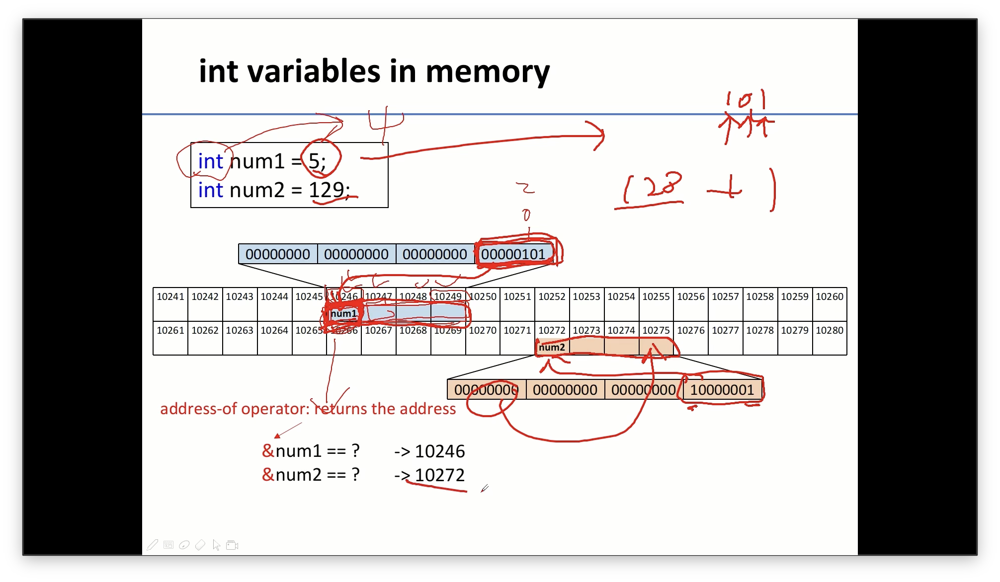
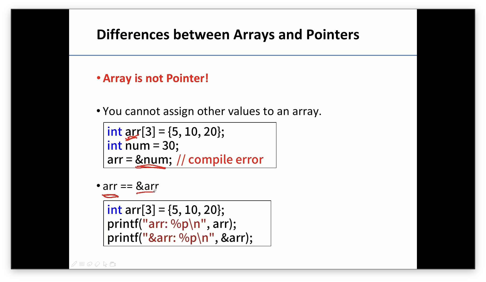
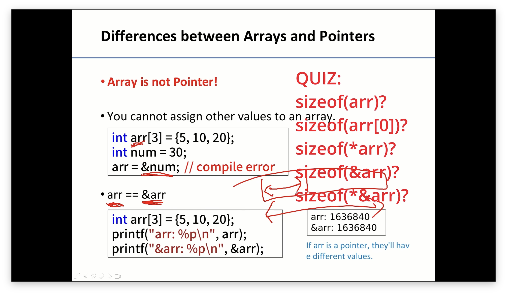
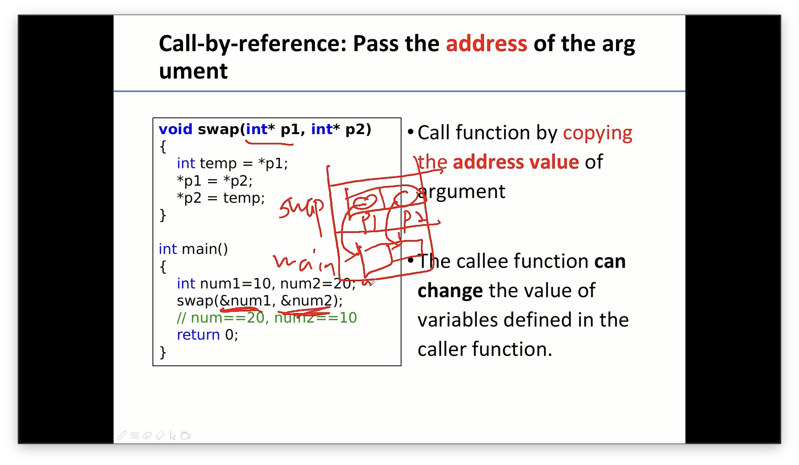
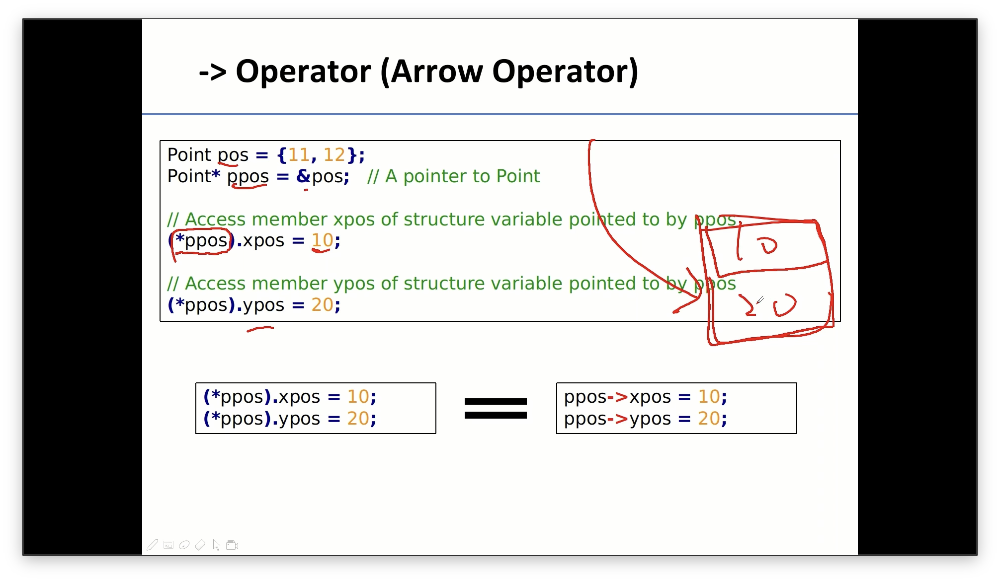
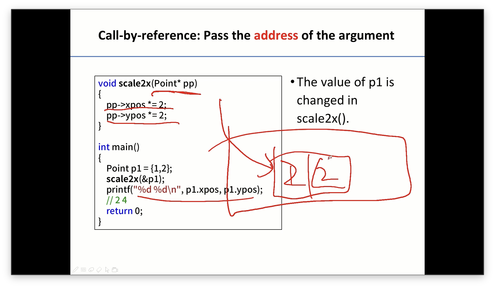

C pointer review

- 주소번호는 1 번호당 1 byte 증가
- int → 4byte → 4번호를 차지.

- 배열의 주소는 constant 값임
- arr = &num → compile error가 발생함

- sizeof(arr) → 12바이트( 배열 전체 크기)
- sizeof(arr\[0\]) → 4바이트(첫번 째 원소(int)의 크기)
- sizeof(\*arr) → 4바이트(arr 배열의 시작 주소 = 첫 번째 원소)
- sizeof(&arr) → 64비트 프로그램이라면 8 바이트 / 32비트 프로그램이라면 4 바이트
  - 현재 환경에서 사용하는 배열 포인터의 타입의 크기(배열 전체를 가리키는 포인터의 크기)
  - 64비트를 쓰는 프로그램이면 64비트니까 8바이트가 되는 것임.
- sizeof(\*&arr) → 12바이트(&arr의 주소를 따라가서 나온 배열의 전체 크기)
  - \*(&arr)로 연산됨.
- arr\[i\] == \*(arr + i) / arr\[i\] ≠ \*(&arr + i)

- swap 함수에서 main에서의 변수 주소에 접근하고 싶다면 호출 시에 &로 주소를 넘겨주고 포인터 변수를 parameter로 사용하면 됨.

#### Struct

- &p1으로 p1이 저장되어 있는 주소를 넘기고
- scale2x에서 Point\* pp로 Point strcut type의 포인터 변수가 해당 주소를 가리킴.
- pp→xpos \*= 2; 를 통해서 pp가 가리키는 주소의 xpos 값을 2배 시킨다.
