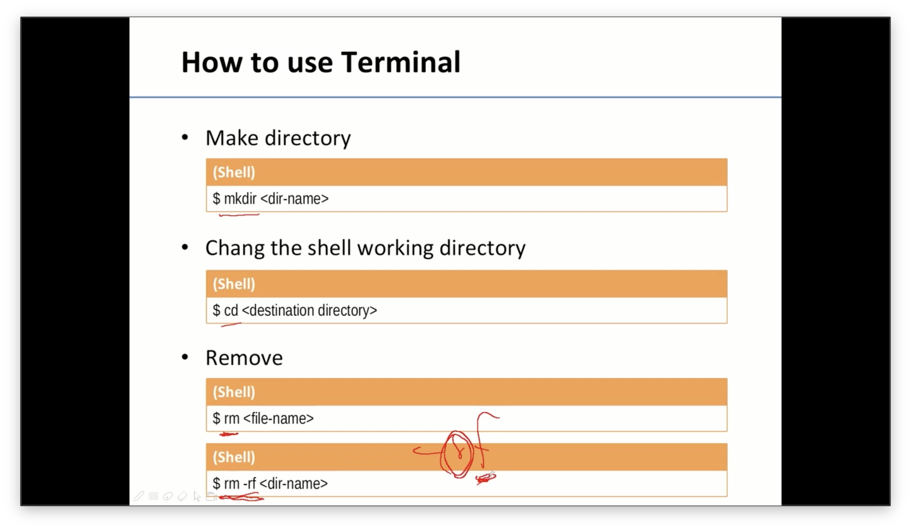
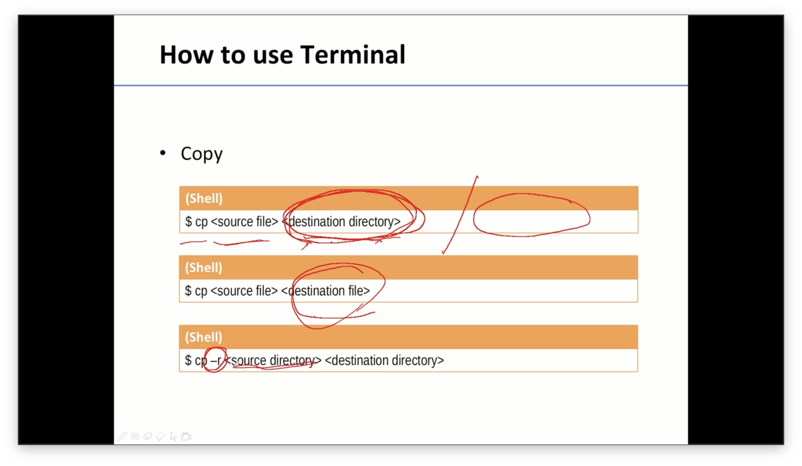
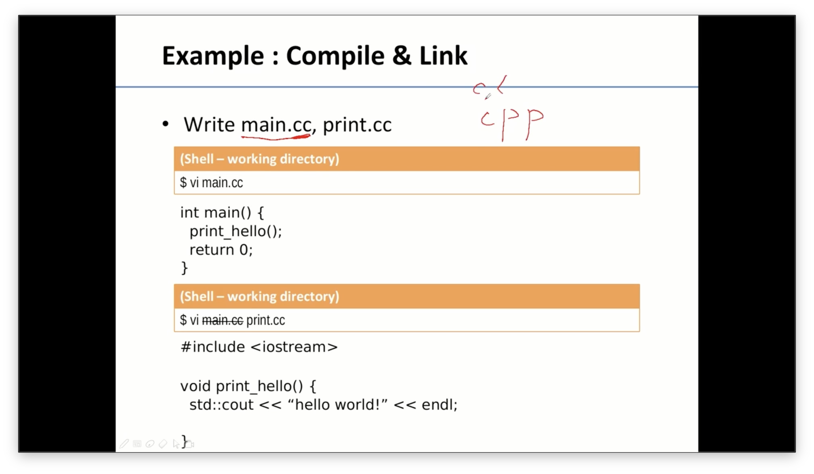
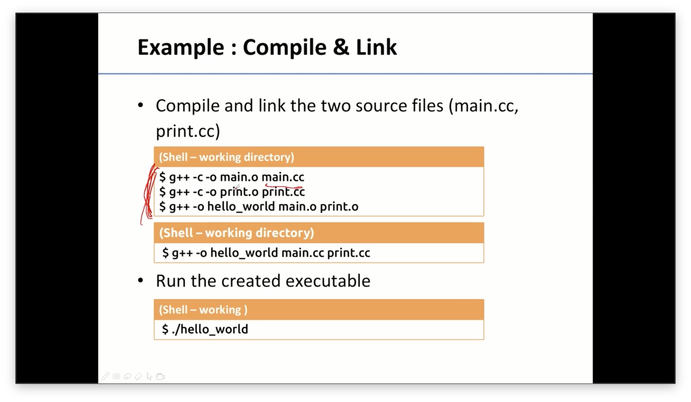
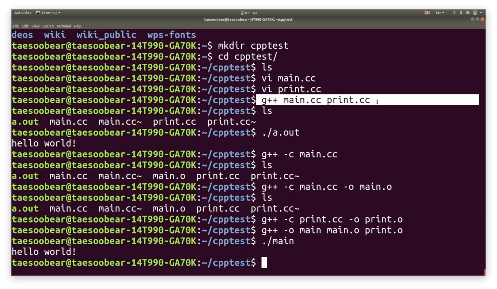
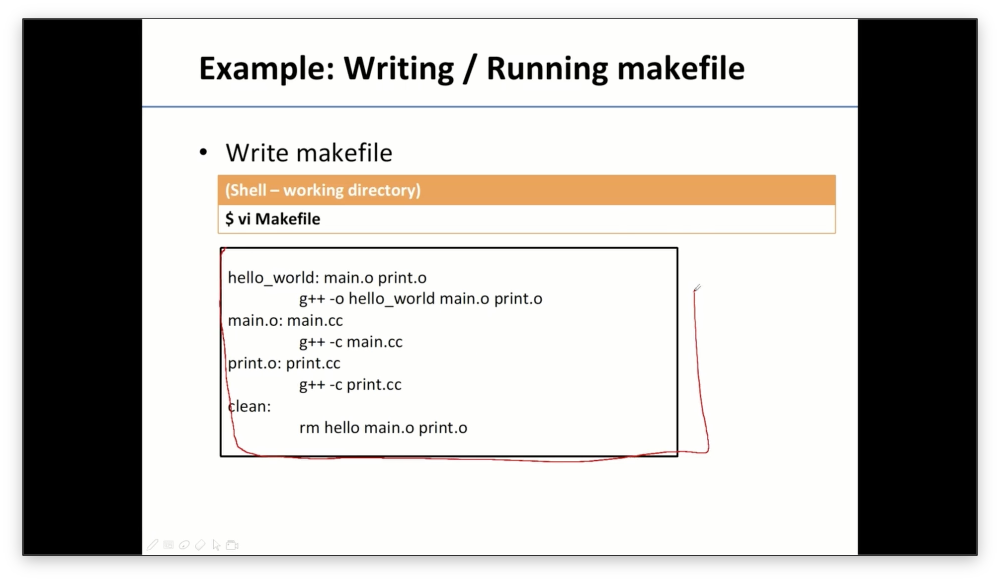
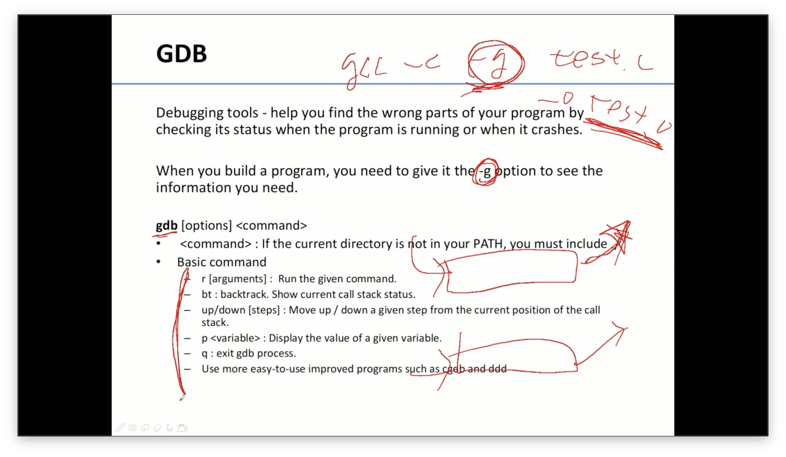
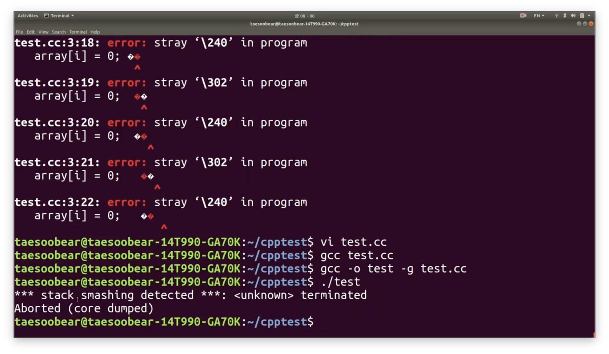

#### g++, make, gdb 사용법











```c
g++ main.cc print.cc //한번에 묶어서 한줄로 실행하는 명령어

g++ -c main.cc -o main.o
g++ -c print.cc -o print.o
// 이런 식으로 하나하나 하면 object code를 뽑지만 
// 아직 link 되어 있지 않은 실행 파일들이 나옴.

g++ -o main main.o print.o
// main.o와 print.o를 link해서 main 실행파일 생성

./main
// 실행파일 main 가져옴.


-c // compile
-o // 출력파일의 파일 이름을 지정
```

#### Make

- 실행 파일을 만들 때 규칙들을 저장해둔다면 알아서 필요한 파일만 변경해주는 tool



- Makefile text를 만듦.

```c
// hello_world 실행파일을 만들려면 뒤의 2개 파일이 필요하다.
hello_world: main.o print.o
(tab)g++ -o hello_world main.o print.o
main.o: main.cc
	g++ -c main.cc
print.o: print.cc
	g++ -c print.o
clean:
	rm hello main.o print.o
```

#### GDB - debugging



- “-g” 옵션을 통해 debugging 가능.
- bt : 현재 call 상태를 보여줌.


