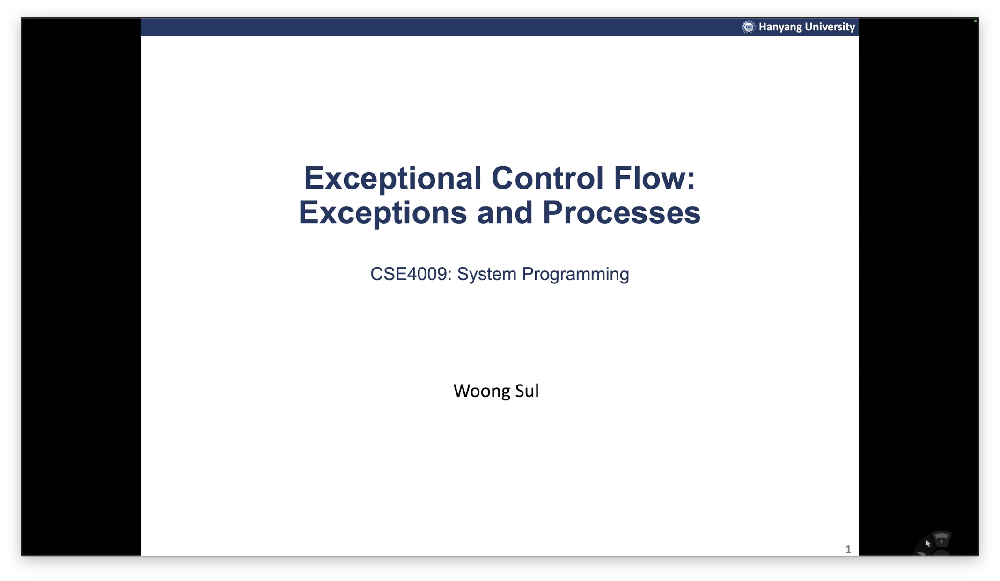

- 여러 개의 Program이 동시에 실행되고 있을 때, CPU 갯수보다 많은 Program이 동시에 작동한다는게 어떻게 가능한 것인가?

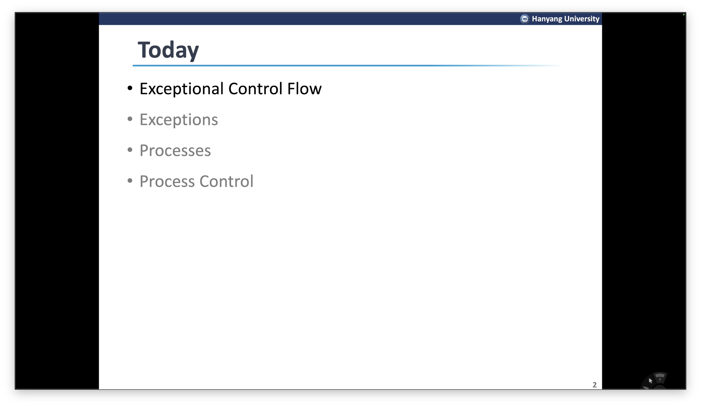

#### Control Flow

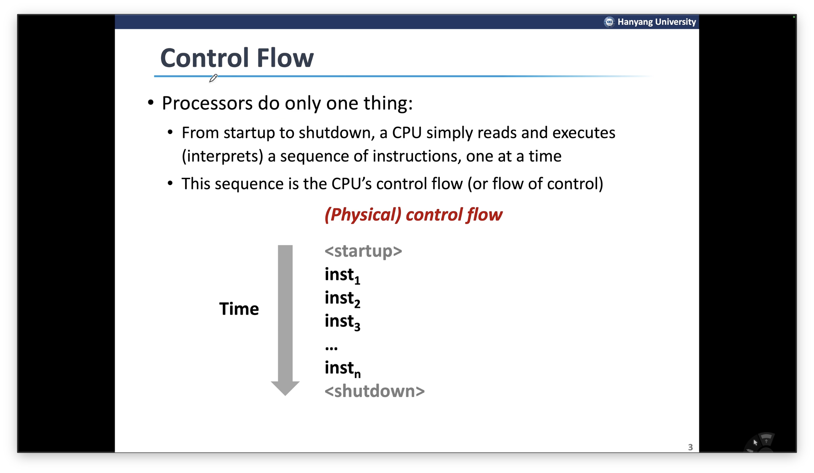

- 여기서 말하는 control flow란 program logic에 적혀있는 실행 흐름을 뜻함.

#### Altering the Control Flow

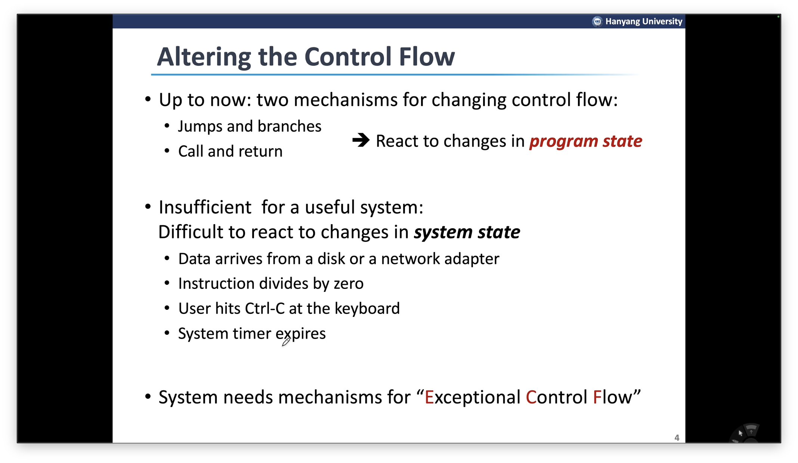

- 컴퓨터에서는 exception이 매우 중요한 요소 중 하나임
- 위 슬라이드는 control flow를 변경하게 되는 상황들에 대한 내용이 적혀 있음.

#### Exceptional Control Flow

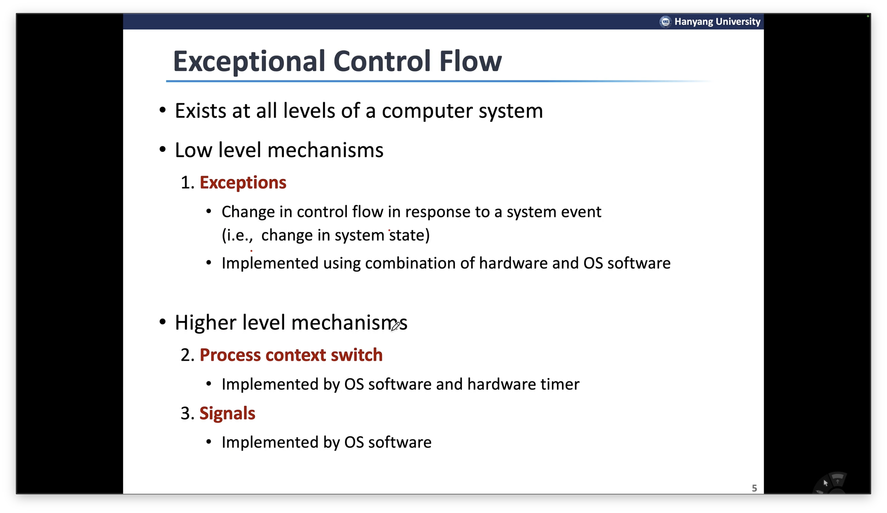

- 쉽게 설명하면 program에 발작 버튼이 존재하고 특정 상황에 그 발작 버튼이 눌린 것임.

1. Exception

   → control flow가 변경되는 가장 대표적인 예시

   → exception mechanism을 통해서 OS가 process를 제어함.

2. Process context switch

   → 현재 수행 중인 program의 실행을 중단 시키고 이 program에 할당되었던 CPU를 회수하여 다른 program의 수행에 CPU를 할당

3. Signal

   → 정상적으로 작동 중이던 program을 signal을 통해 중단 시키는 행위

#### Exceptions

→ 특정 상황에 대한 행동 강령을 정해두고 특정 상황이 되면 OS가 개입하도록 세팅

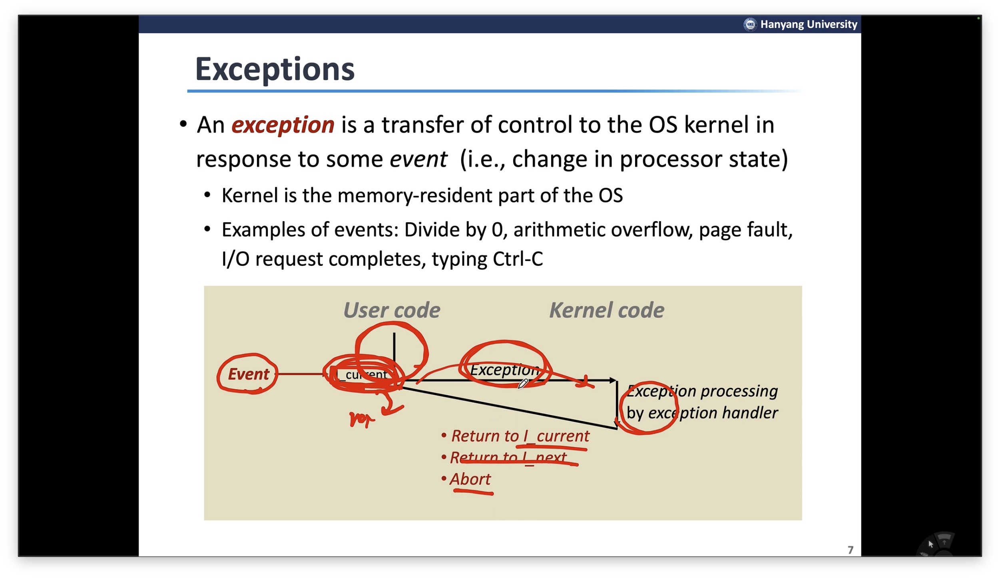

- User code에서 특정 상황에 대한 Event가 발생
- Exception을 통해 Kernel code에 위치한 Exception Handler가 작동
- Exception 처리 후 다시 User code로 복귀. → 단 I\_current / I\_next / abort는 Exception이 발생한 instruction의 종류에 따라 다름

#### Exception Tables

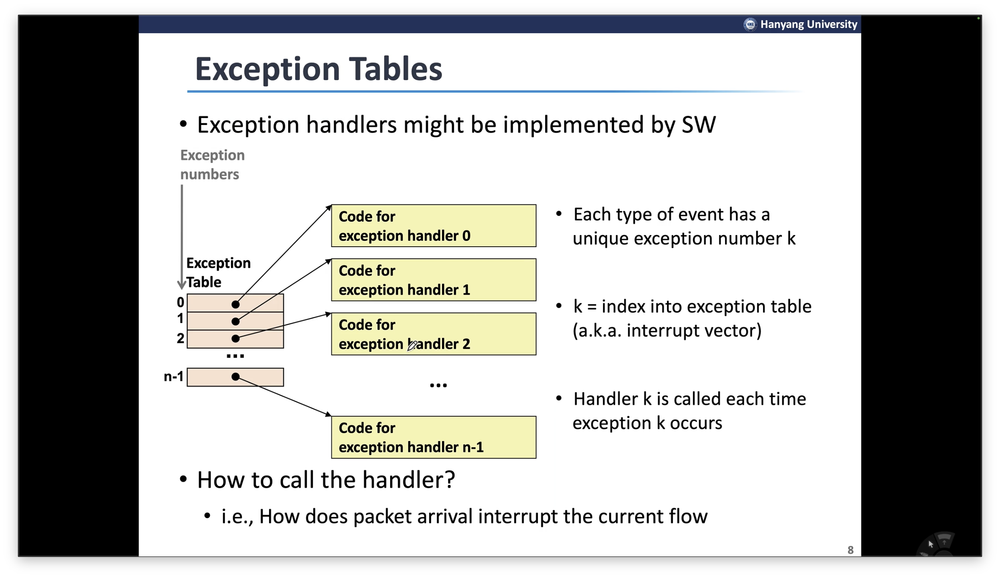

- Booting 시 exception table이 만들어지고, 각각 해당 exception을 처리할 수 있는 exception handler의 시작 주소를 저장하고 있음.
- Table의 index를 exception이 발생하는 event의 상황으로 둔다면
- 발생한 Exception의 원인에 따른 handler를 빠르게 수행할 수 있다.

#### Asynchronous Exceptions

→ 비동기화 exception

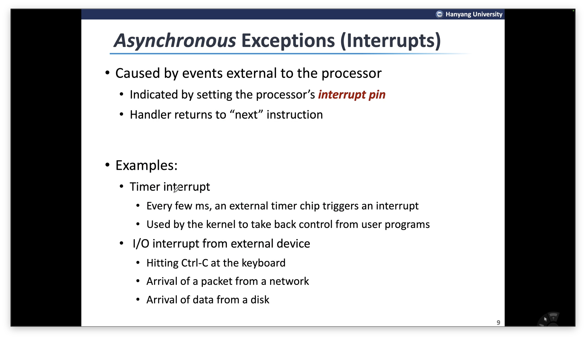

- processor 외부 event에 따른 exception
- I / O 장치에 데이터가 준비된 경우를 생각해보자.
- 이 데이터를 메모리를 옮기기 위해 패킷을 보내고 패킷이 도착한 상황에
- interrupt pin을 세팅하여 exception을 발생시킨다.
- 이후 원래의 CF가 아닌, 메모리를 옮기기 위한 instruction을 수행시킴
- 이 경우에는 exception handler 종료 후 기존 CF 중 마지막 instruction 수행 다음의 instruction으로 복귀
- Timer interrupt도 또 하나의 예시임. → CPU에는 timer가 있고 일정 시간 마다 exception을 발생시켜 CPU를 다른 program에 할당함
- 왜 비동기인가?

  → 동기 / 비동기에 대한 대상은 Global Time Clock에 따름.

  → 동기의 경우 각 event 들이 global time clock에 동기화가 되어 있다. 즉, 각 event들이 발생되는 시점과 순서가 항상 일정하게 나타나는 상황임.

  → 비동기의 경우 각 event들의 순서들이 일정하지 않음.

#### Synchronous Exception

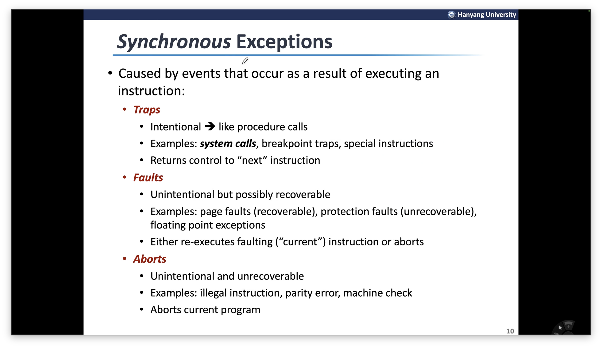

- 동기에 경우 내적 요인에 의해서 exception이 발생함. → 즉, 현재 실행 중인 instruction에 의해서 발생한다는 것.
- 이 경우에는 CF가 변경되는 시점이 일정하게 나타남 → 그래서 synchronous
- Exception을 일으키는 instruction의 종류
  1. Traps
     - 의도적 발생
     - 마지막으로 수행한 instruction이 정상적으로 수행을 마친 후 의도적으로 exception을 발생 시킨 것 → 마지막 수행 instruction 직후의 instruction으로 복귀.
  2. Faults
     - 의도적이지 않음.
     - 현재 수행 중인 instruction에 문제가 발생한 상황
     - 하지만 복구 가능한 경우 → OS가 해결할 수 있음.
     - 복구 후 문제가 생긴 instruction으로 돌아와 재실행
     - 복구 불가능한 경우 → abort
  3. Aborts
     - 의도적이지 않음.
     - 복구 가능하지 않음.
     - 복귀 x, program을 종료 시킴.

#### System Calls

→ Trap의 대표적인 예시

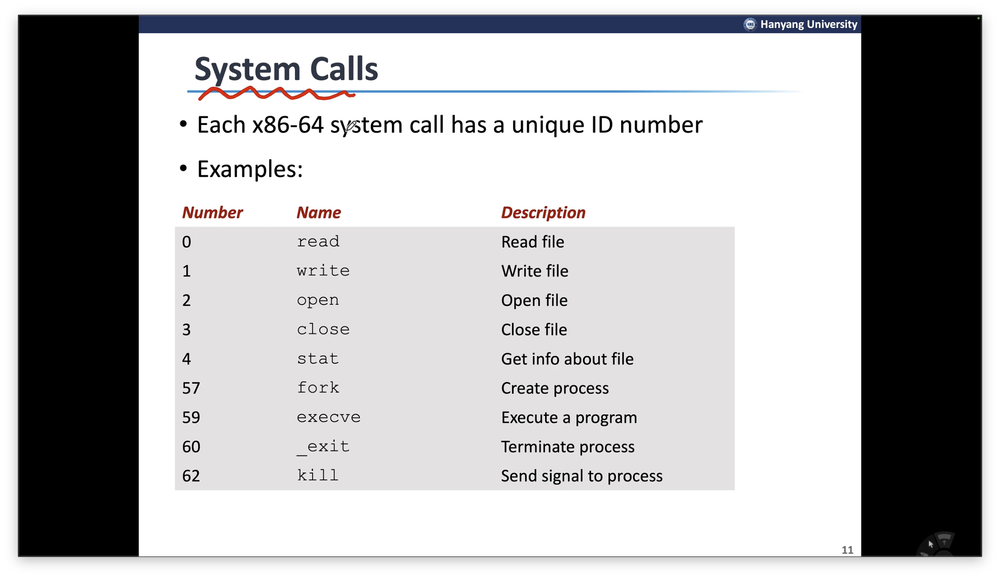

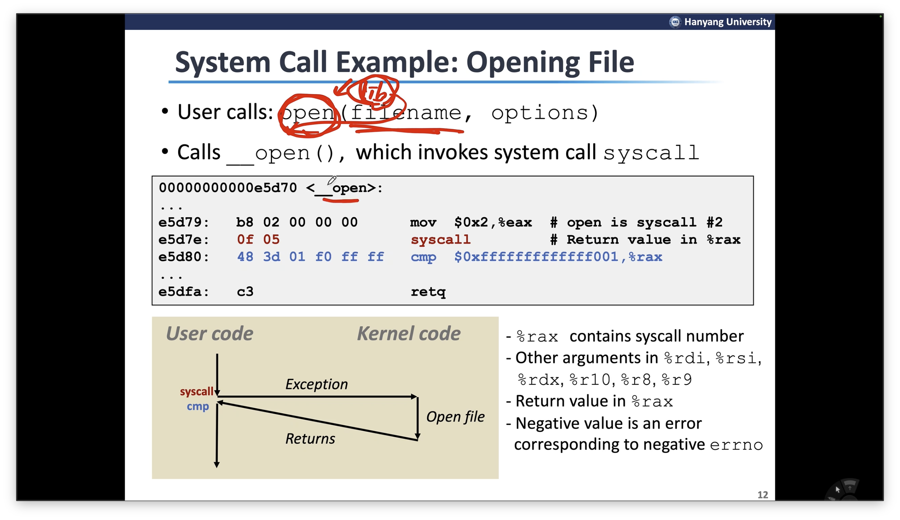

- open(filename, options)는 system call을 사용하여 실행됨.
- mov \$0x2, %eax → 여기서 2는 앞선 슬라이드의 system call number임.
- 함수의 종류를 결정하는 부분(system call 함수)에서는 %rax를 사용함.
- 인자에 대한 내용은 calling convention과 유사
- return 값이 음수라면(비정상) error라고 하고, 자세한 내용에 대해서는 errno라고 하는 global 변수를 사용.

#### Fault Example : Page Fault

→ 현재 실행 중인 instruction이 일시적으로 실행되지 못하는 상황에 있을 때

→ OS가 실행 가능한 형태로 복구 후 다시 실행하는 형태를 말함.

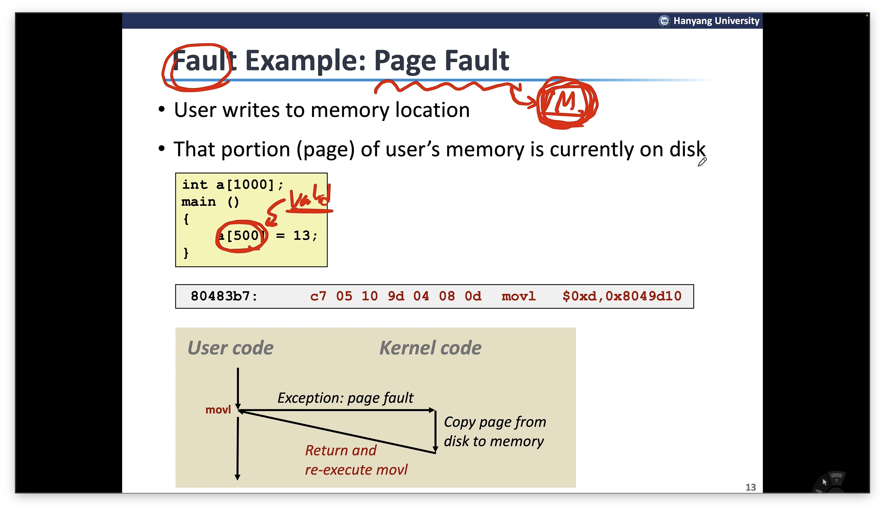

- Virtual memory를 사용하는 경우가 대표적인 예시임
- a\[500\]이라는 배열은 valued한 주소값을 가지고 있지만 메모리가 아닌 disk 상에 존재할 때 page fault가 발생한다.
- 즉, disk 상에 존재하는 데이터를 메모리에 옮기면 복구가 가능

#### Fault Example : Invalid Memory Reference

→ 복구가 불가능한 Fault

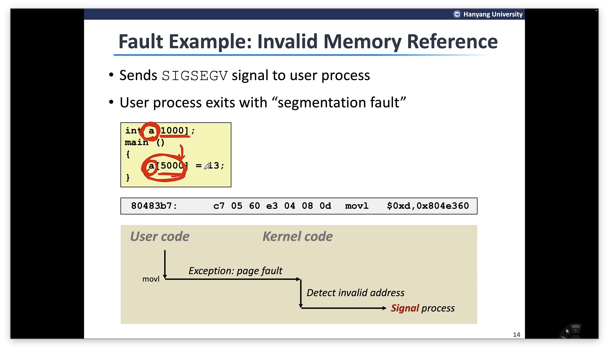

- 할당된 메모리 크기보다 더 많은 크기가 요구됨 → 애초에 잘못된 상황이니까 OS가 해결할 수 없음
- SIGNAL을 통해 해당 process를 중단함.

---

> 이후에는 CPU 갯수보다 많은 Program을 동시에 실행할 수 있는 이유에 대해 알아보자.

---

- OS는 timer를 활용한 context switch를 통해 마치 Program이 여러번 실행되는 것처럼 수행한다.

#### Processes

→ Running Program. 즉, program 중 실행되고 있는 program을 뜻함.

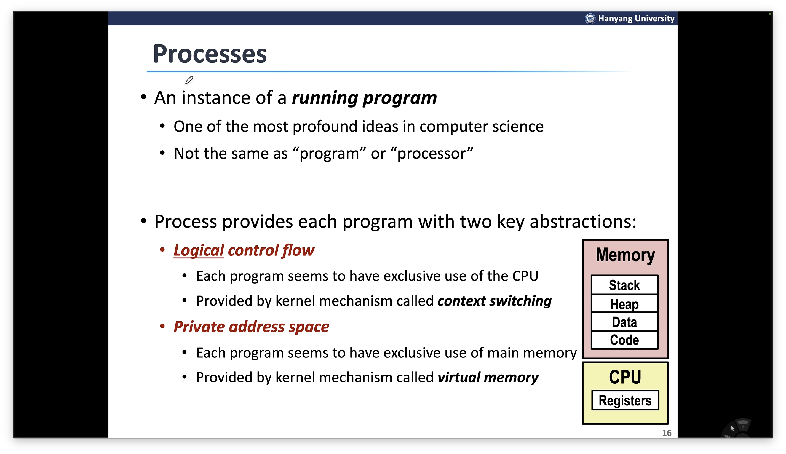

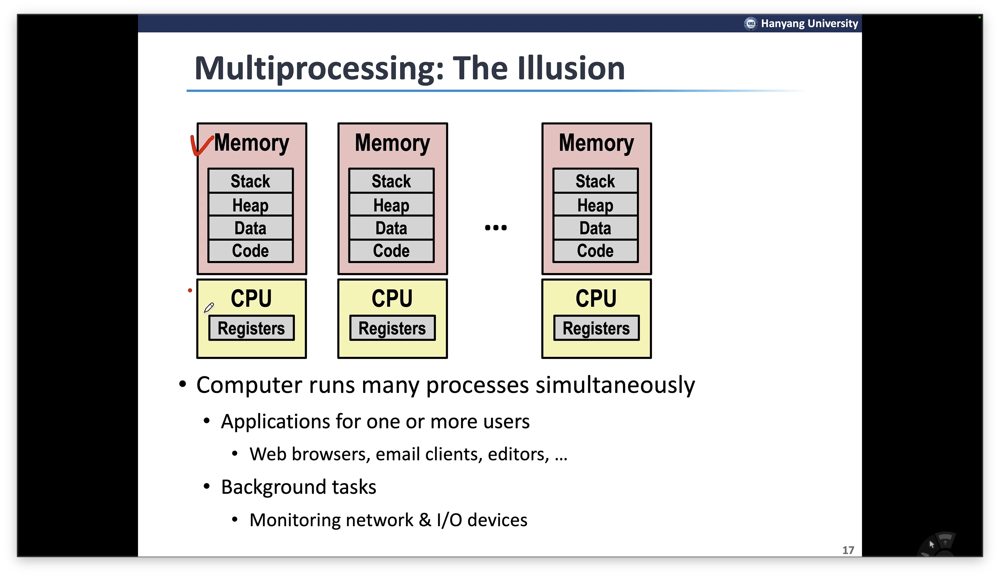

- Multiprocessing이란 이론적으로 여러 개의 process가 각각 하나의 CPU를 할당 받고 있다는 의미

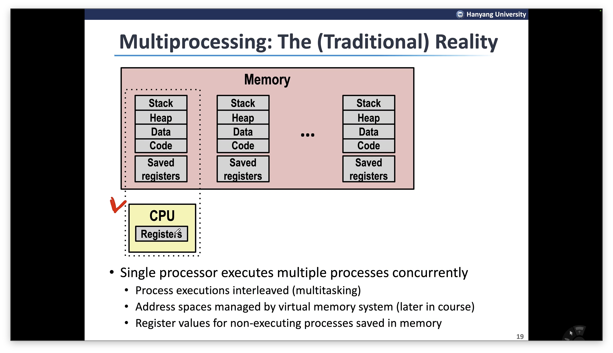

- 실제는 여러 개의 process가 memory 상에 존재하고 존재하는 갯수의 CPU를 하나씩 할당 받는다.
- 이후 일정 시간 혹은 event 마다 context switch를 통해 다른 process로 CPU를 넘겨 줌.

#### Concurrent Processes

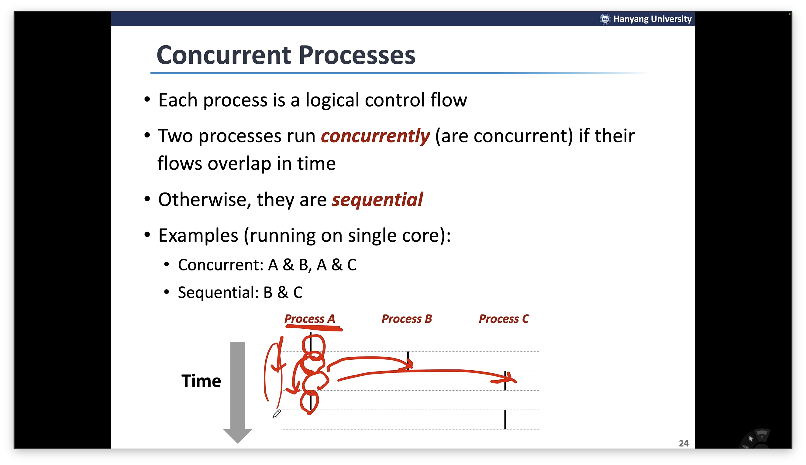

- A&B, A&C의 경우 A의 시작 후 종료 전 CPU를 공유함.
- B&C의 경우 B의 시작 후 종료 전까지 C와 CPU를 공유하고 있지 않기 때문에(즉, B 종료 후 C가 시작함) Concurrent가 아닌 Sequential이다.

#### User View of Concurrent Processes

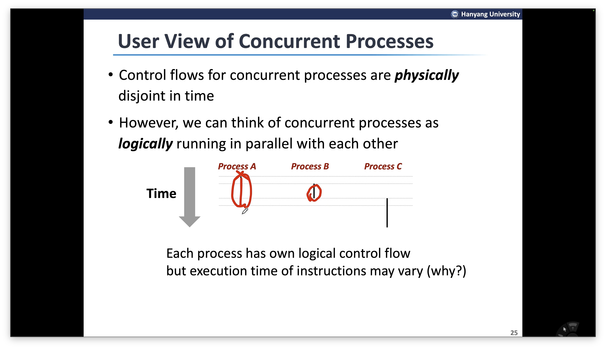

#### Context Switching

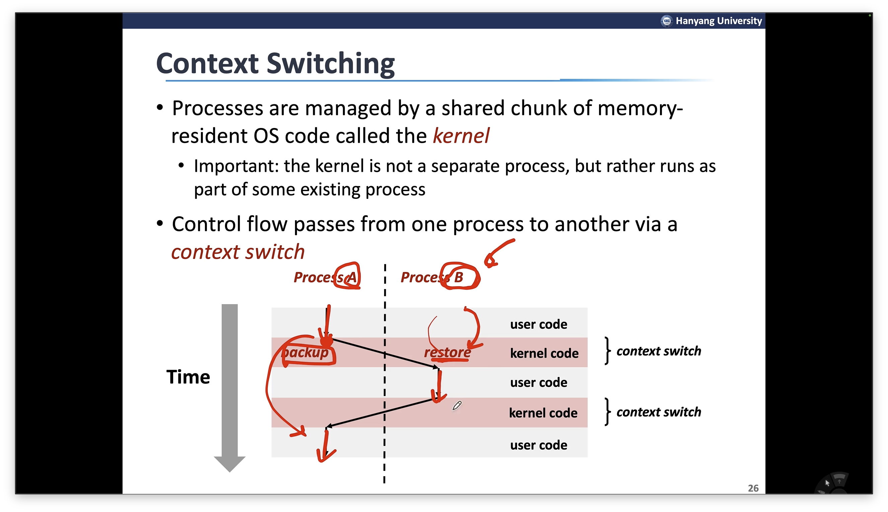

- Process A → Process B로 Context Switching이 발생하는 순간에 Process A에서 실행 중이던 정보를 메모리에 저장하는 backup,
- 이전에 backup 되어 있던 Process B에 대한 실행 정보를 불러오는 restore 과정이 필요함.

1. backup
2. schedule → 다음에 실행되어야 할 process를 결정하는 부분
3. restore

- 이 3가지의 순서로 진행됨.

#### System Call Error Handling

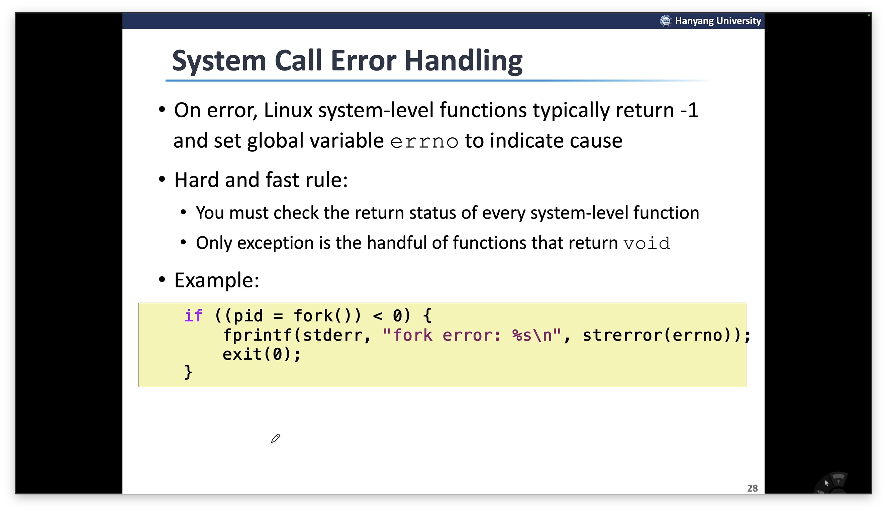

- return 값이 음수를 나타낸다면 error 상황을 뜻함.
- 여기에 대한 정보는 errno라고 하는 global 변수에 저장됨.
- errno는 정수이기 때문에 strerror()를 사용해서 메시지를 출력함.

#### Error-reporting functions

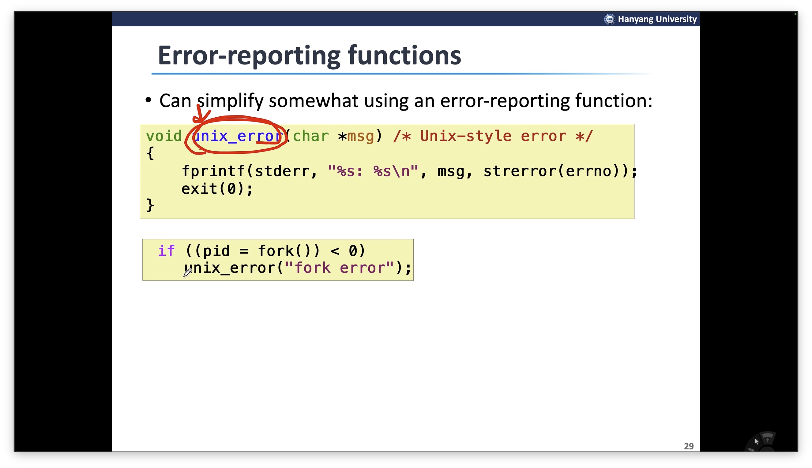

- unix\_error라는 함수를 활용해서 함수 간편화

#### Error-handling Wrappers

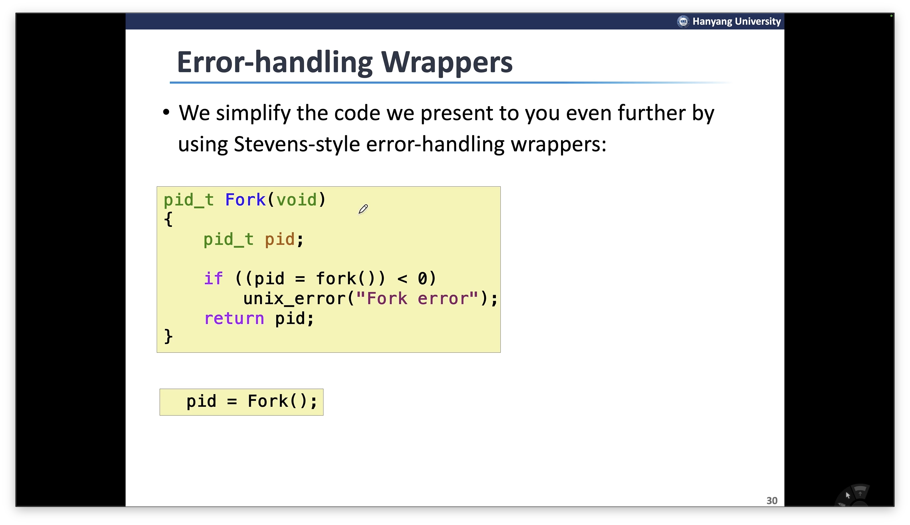

- wrapping 함수 활용해서 함수 간편화
- fork call에 대한 함수는 fork()이고 이에 대한 wrapping 함수는 Fork()이다.

#### Obtaining Process IDs

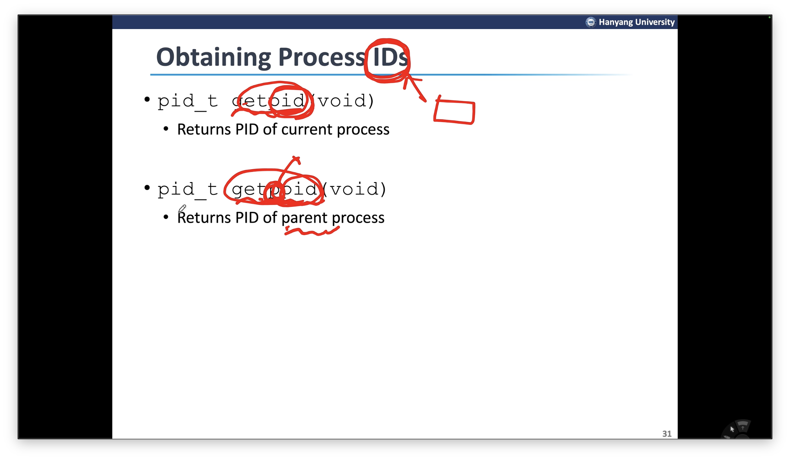

- getpid → 현재 process id를 확인하는 함수
- getppid → 현재 process의 parent process id를 확인하는 함수

#### Creating and Terminating Processes

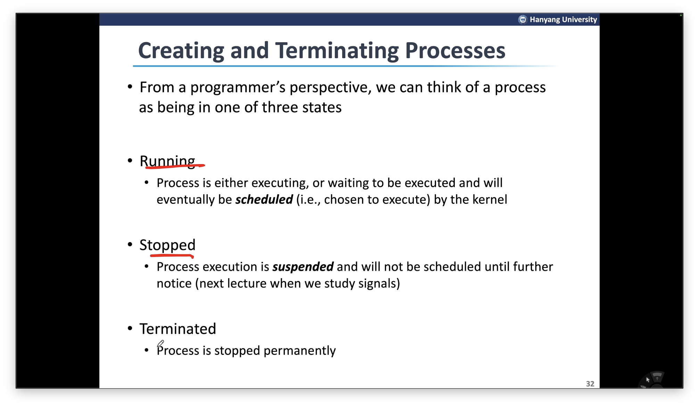

- process의 상태를 나타내는 3가지 → 더 많지만 대부분의 OS가 공통적으로 나타내는 3가지임.
  1. Running - 실행 중

     → OS는 scheduling을 통해서 다음에 실행해야할 process를 선정함.

     → 이때 대상이 되는 process가 실행 중인 process

  2. Stopped - 일시정지

     → stopped 상태는 당분간 실행될 계획이 없는 process임.

  3. Terminated - 종료

     → process가 종료된다면 process는 바로 사라지는 것이 아님.

     → 종료된 상태로 남아있고 명시적으로 제거에 대한 선언을 해줘야 process에 대한 정보가 사라짐.

     → 왜 process가 종료되면 바로 삭제하지 않는거임?

     ⇒ 만약 부모 - 자식 관계에 있는 2개의 process 중 자식 process가 종료되었다고 가정해보자. 이때 종료와 동시에 삭제되었다면 부모 process는 자식 process의 결과를 알 수가 없음.

     ⇒ 즉, 부모 process의 입장에서 자식 process의 실행이 종료되면 해당 process의 실행 결과를 확인할 필요가 있기 때문임.

#### Terminating Processes

→ process를 종료하는 과정에 대한 슬라이드

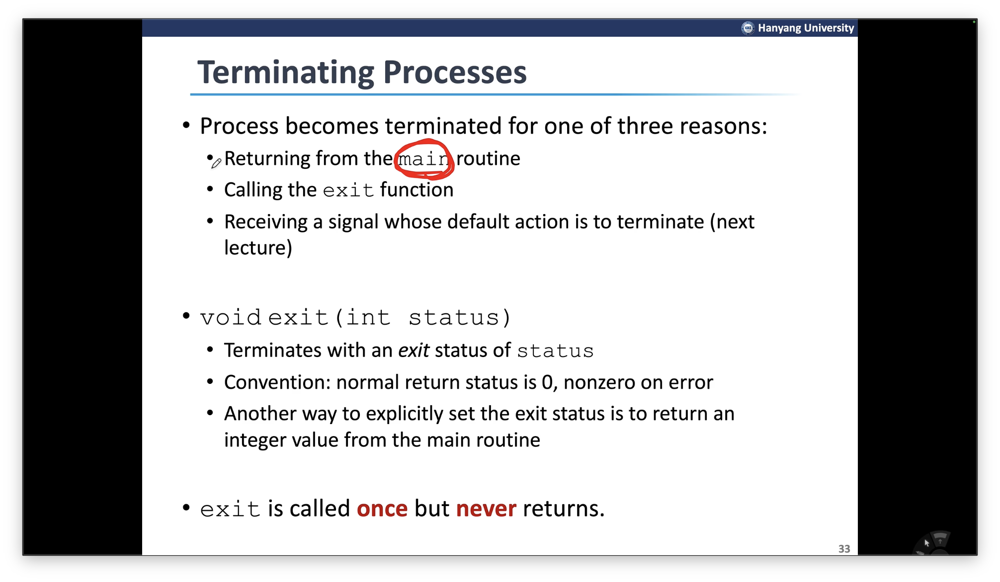

1. main 함수에서 return하는 방법

2. exit 함수를 호출하는 방법

   → 이 방법을 사용하면 main함수 복귀 후 return으로 종료하는 것이 아닌 exit 함수 호출 시점에 바로 process를 종료

3. signal을 통해서 종료하는 방법

- exit 함수를 호출해서 종료
  - void exit(int status)
  - status → process 수행 결과에 대한 정보(정상 return status는 0 / error가 발생했다면 nonzero값)
  - exit 함수는 한번만 호출하며 절대 return 하지 않음. → 당연하지 exit 호출 시 process가 종료되니까.

#### Creating Process

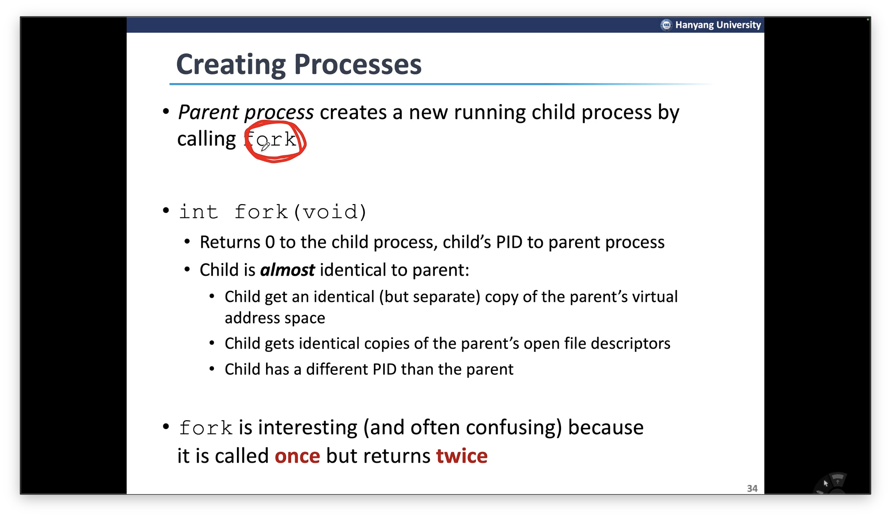

- fork()를 call하여 process를 생성.
- fork 또한 system call
- 반환값
  - 0 : child process
  - nonzero(child PID) : parent process / 부모 process인 경우에는 자식 process의 PID를 return함.
  - 부모 자식 중 어느 process에서 return 하는 call인지 구분하기 위해 return 값을 나눈다.
- Example

  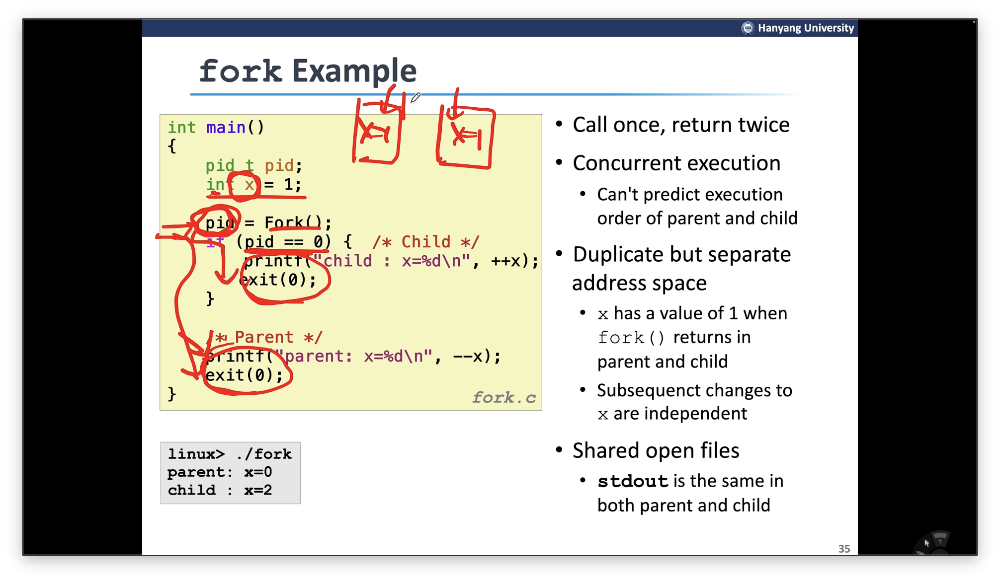

  - fork() 함수에서 가장 헷갈리는 것
    1. 함수 호출은 부모 process에서 한번 이뤄지는데 return은 부모 / 자식 두 군데에서 이뤄짐.
    2. 부모 - 자식 process는 비슷한 형태를 가진 process이지만 각각 다른 메모리 상에 저장되어 있음.
  - 부모 - 자식 process의 실행 순서를 예측할 수 없음.

#### Modeling fork with Process Graphs

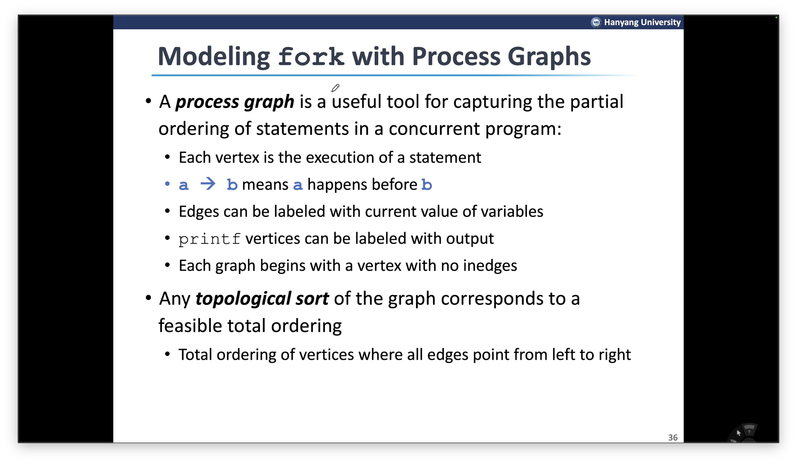

- fork()를 통해서 생성된 부모-자식 process 들은 동일한 instruction sequence를 가지고 있기 때문에 instuction만 본다면 각각의 process 내에서의 실행 순서가 동일함.

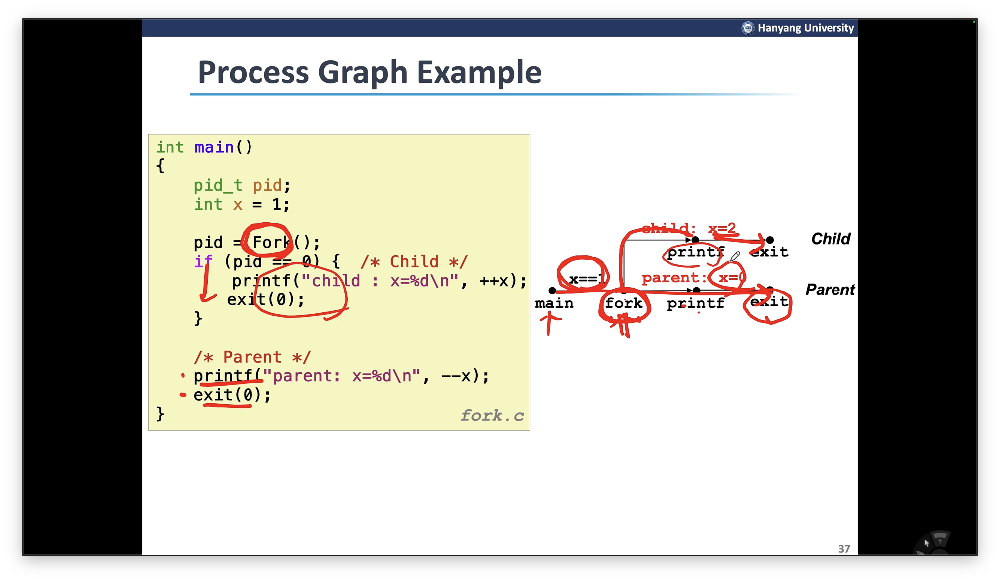

#### Interpreting Process Graphs

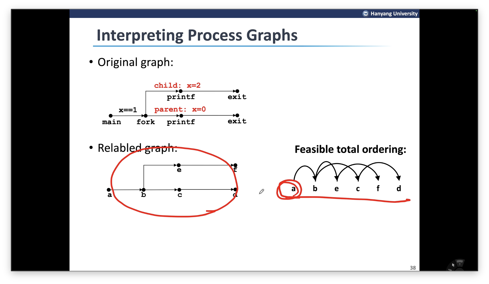

- 각 process의 instruction flow에 맞게 partial order가 세팅되어 있다면 어떠한 경우의 수도 타당한 경우가 됨.
- 만약 total ordering이 a b f c e d 였다면 자식 process의 a b e f의 partial order에 어긋나므로 infeasible한 ordering이 됨.

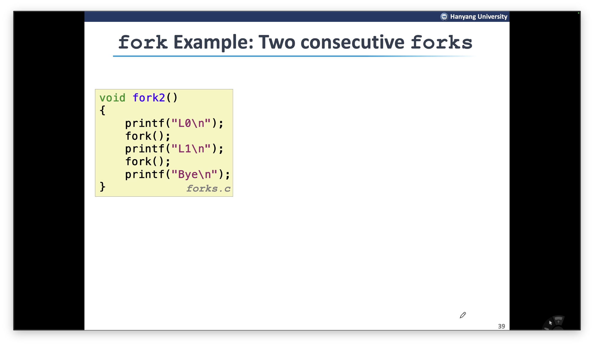

#### Reaping Child Processes

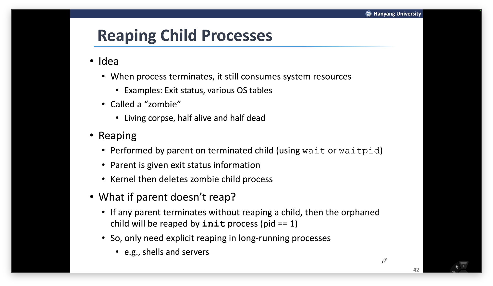

- zombie process - process의 상태 정보를 저장하기 위한 리소스는 사용되고 있지만 process 자체는 종료된 상황.
- Reaping(’추수’라는 의미)
  - reaping하고 나면 OS가 관리하고 있는 process 목록에서 완벽하게 process의 정보가 회수됨.
  - wait() 혹은 waitpid()를 활용하여 수행됨.(부모가 종료된 자식 process에 대해 수행)
  - 만약, 부모가 자식 process를 reaping하지 않고 종료하게 된다면 자식 process에 대한 정보는 계속 남아있게 됨. → 이런 경우에는 init process를 통해 입양됨.(init이 새로운 부모가 됨.)
  - 어쩃든 메모리의 효율 및 성능을 위해 자식 process가 종료되었다면 반드시 reaping을 해주는 것이 좋음.

#### Zombie Example

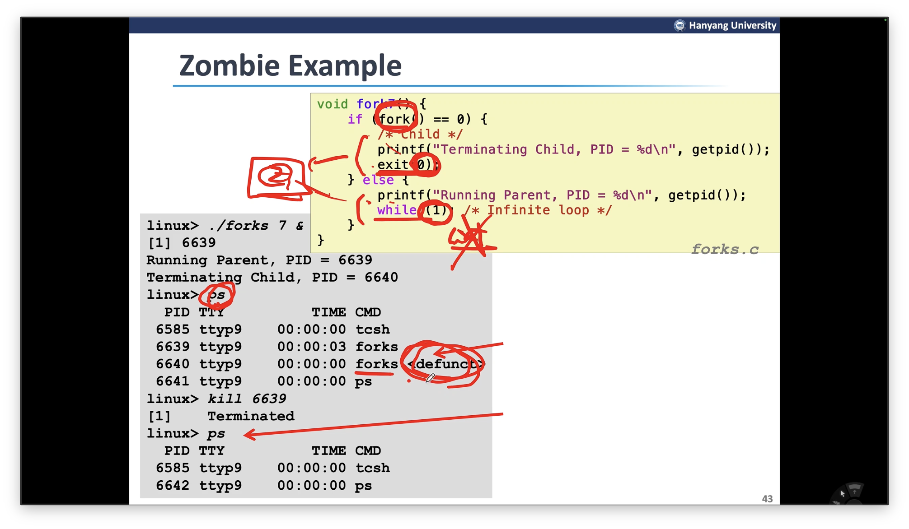

- fork() 이후 자식 process는 wait()을 통해 종료되었지만 부모 process에서 wait()을 통해 reaping 하지 않음. → 자식 process는 zombie 상태로 남음.
- 왼쪽 회색 박스 내부의 \<defunct> → 동작하고 있지 않은 process를 의미.

#### Non-terminating Chlid Example

→ 부모보다 자식 process의 수명이 더 긴 경우

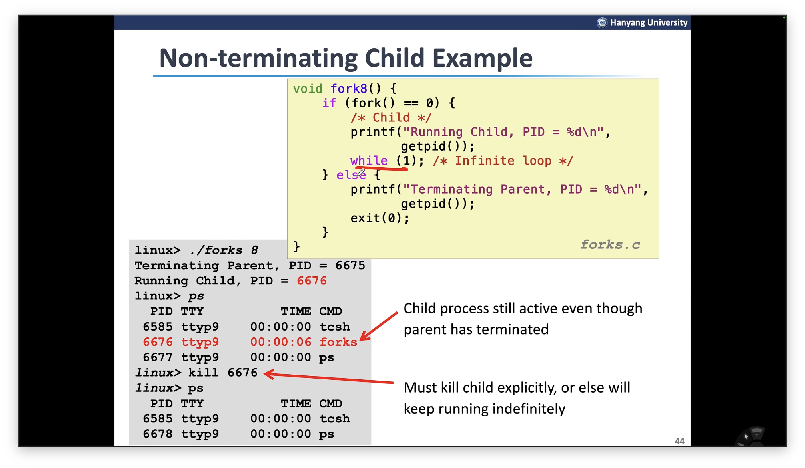

- 자식은 while(1)을 통해 계속 동작, 부모는 자식 생성 후 바로 exit(0);
- 걍 쓰레기임 이따구로 코드 짜지 마세요

#### wait : Synchronizing with Children

→ reaping을 위해 사용

→ 부가적 기능으로 reaping을 위해 자식 process의 종료까지 부모 process를 대기시킴

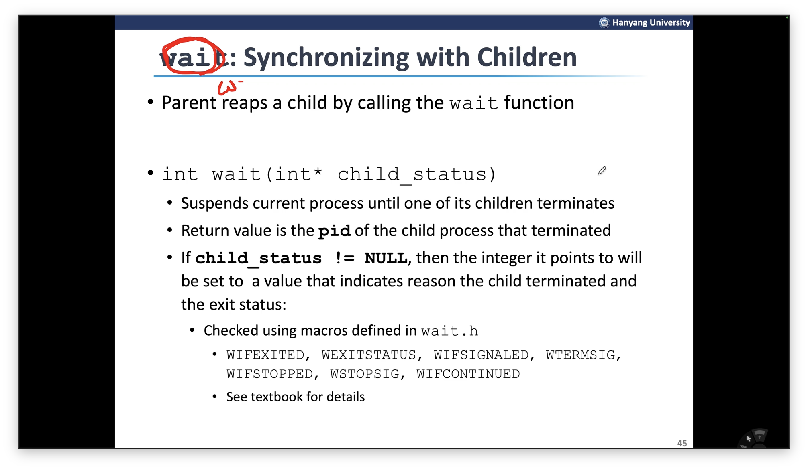

- 기본적으로 부모 Process에서 자식 process의 종료를 기다리는 경우에 사용됨.

- 이 함수 호출 시 부모 process의 control flow는 잠시 중단하고, 자식 process의 종료를 기다리게 됨.

- 자식 process의 모든 instruction 및 내용이 실행되고 그 후 부모 process가 실행되는 것을 보장함. → 부모 - 자식 process의 실행 순서를 동기화 → synchronizing

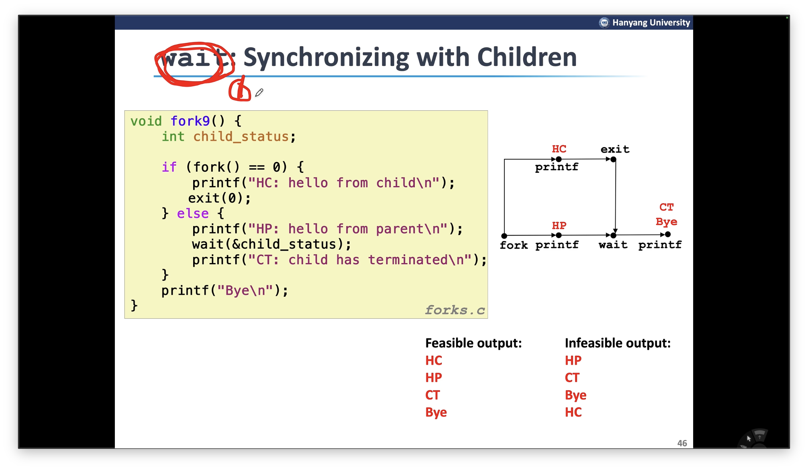

- HC , HP의 실행순서는 보장할 수 없지만 CT는 반드시 HC 이후에 실행되어야 함.

#### Another wait Example

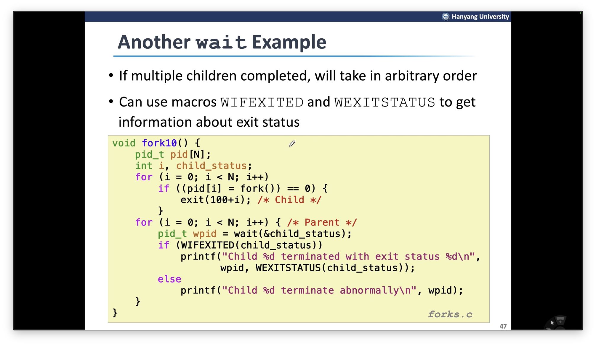

#### waitpid : Waiting for a Specific Process

→ wait()은 어떠한 process라도 wait 할 수 있다면

→ waitpid()는 argu에 적혀있는 process id와 일치하는 process를 wait함.

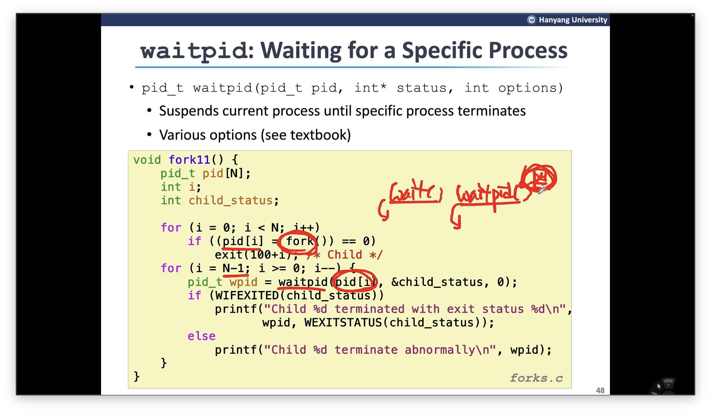

#### execve : Loading and Running Programs

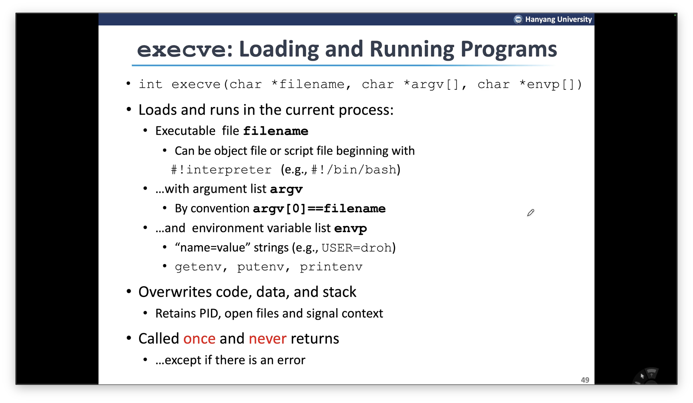

- fork()는 부모 process를 복제해서 자식 process를 생성함. → 즉, 자식 process는 부모 process와 같은 program일 수 밖에 없다.

- 만약, 생성된 자식 process에서 다른 program을 실행하고 싶다면? → exec()을 활용

- filename → 실행 파일의 위치

- argv를 제공하지만 argc에 대한 정보가 빠져있음(배열을 사용할 때는 배열의 초기값에 대한 주소만 전달하기 때문에 argc가 필요함)

  → 여기서의 argv가 Null-terminated를 사용하기 때문에 배열의 끝의 null 값을 만나면 terminate 되기 때문에 argc가 필요 없음.

- exit()와 마찬가지로 호출은 한번이지만 return 하지 않음.

  → exec()은 코드 전체를 rewrite하기 때문에 호출한 함수로 return 하지 않는다.

  → 만약 exec()을 실패했다면 error 메시지의 출력을 위해 호출한 함수로 return 하는 경우도 있음.

#### Structure of Stack When a Program Starts

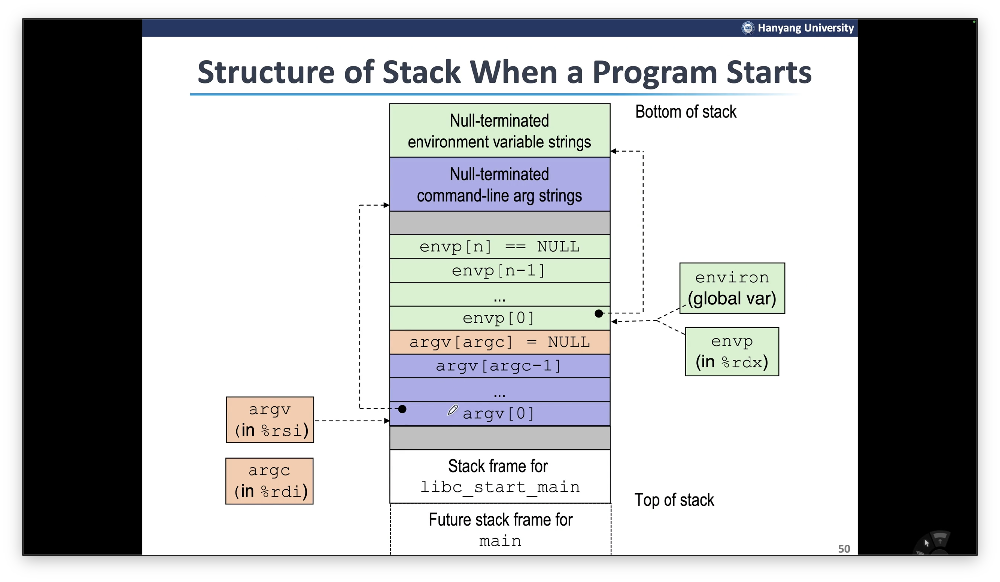

#### execve Example

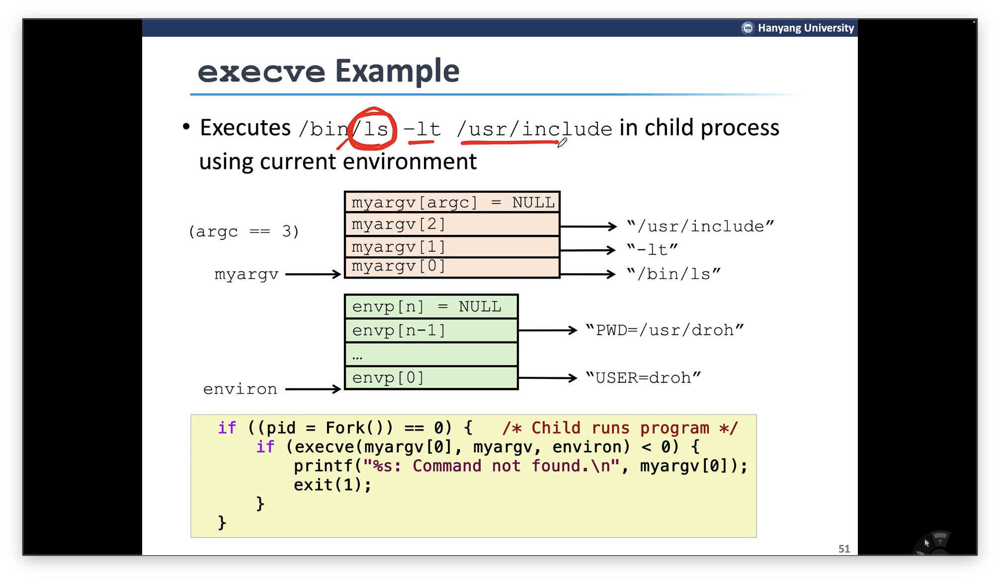

