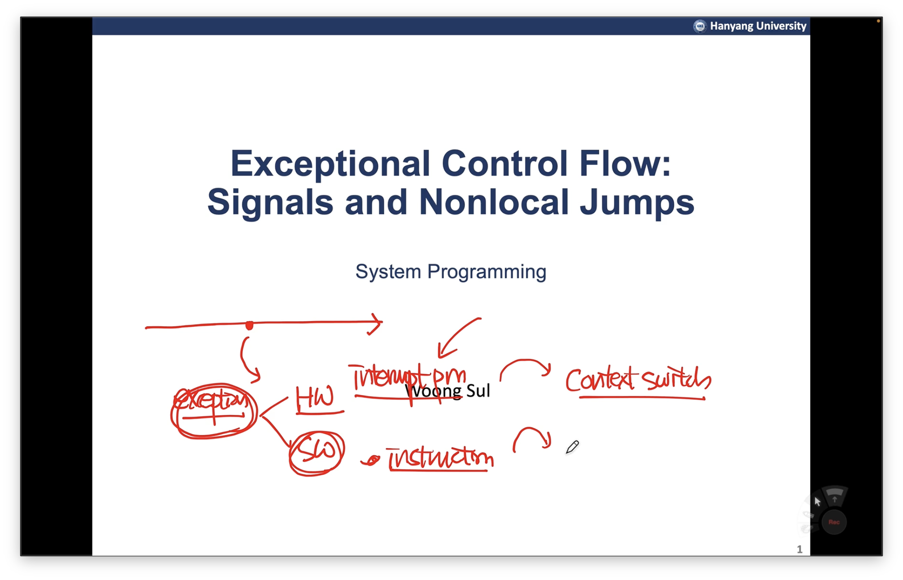

- 이전 강의에서 진행했던 exceptional control flow는 HW 적으로 interrupt pin을 사용한 context switch가 대표적인 예시였음.
- 이번 강의에서 진행할 signal 같은 경우는 SW의 측면에서 instruction을 막는 것.

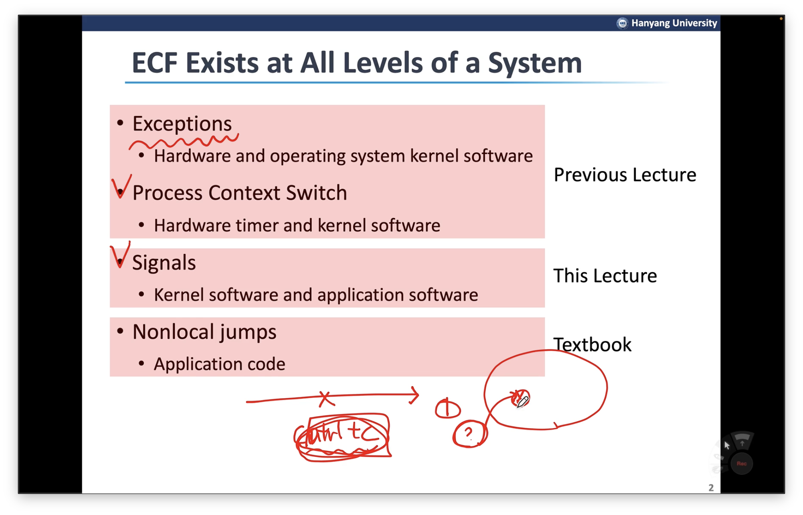

- 이번 강의에서는 signal에 관련해 살펴볼 것.
- 우리가 process를 중단할 때 ctrl+c를 사용한 경험이 있을 것이다. 그러면 이 명령어를 통해 process를 중단하기 위해 명령어가 넘어가는 것에는 어떠한 과정들이 있을까?\
  → 이번 강의에서 shell 명령어에 대해 알아보면서 이해해보도록 하자.

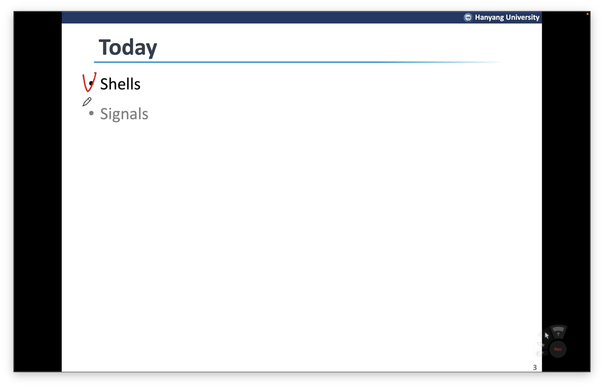

- 이번 강의에서는 크게 shell program과 signal에 대해 살펴볼 것.

#### Linux Process Hierarchy

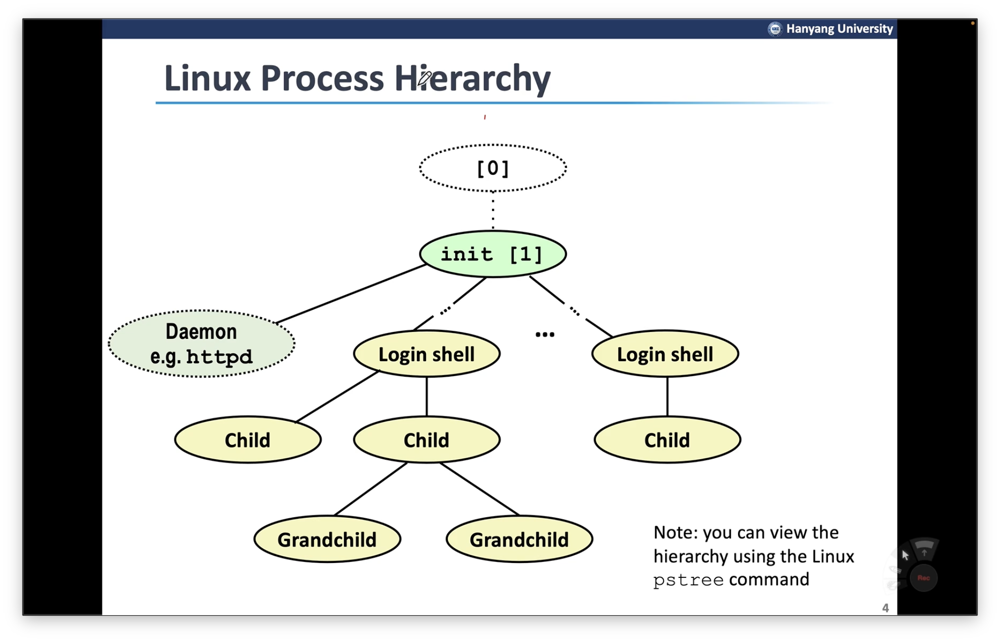

- process의 생성은 반드시 부모 process에서 fork()를 통해 생성되어 이어짐.
- init process에 의해 처음 만들어지는 process 중 Login shell이 있음.
  - 여기서의 Login은 우리가 생각하는 계정 login이 맞음
  - 즉, 이 슬라이드에서의 process는 사용자와의 interaction(Keyboard / Mouse 등)과 관련된 program인거임.

#### Shell Programs

→ 주목적은 사용자와의 interaction임.

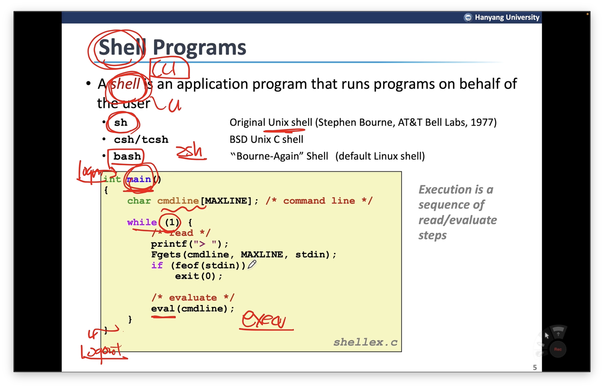

- main()의 시작은 login , 끝은 logout
- 사용자가 keyboard에 입력한 내용을 buffer에 모음
- 입력이 끝나면 eval()를 통해서 해석.

#### Simple Shell eval() Function

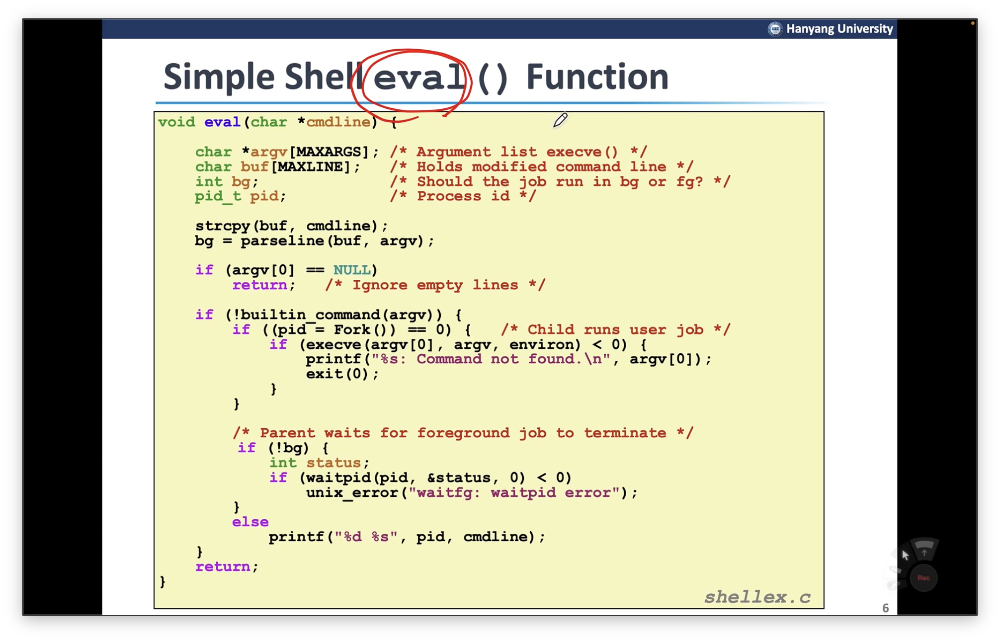

- 공부할 때 구조 이해해보자.

1. !builtin\_command → buildin\_command가 아니라면 실행파일임.
   - fork()를 사용하지 않고 exec()만 사용한다면 어떤 문제가 있을까.
   - program 종료 후 다시 shell program으로 들어가야 다른 program 실행이나 로그아웃 등의 기능을 수행할 수 있음.
   - Shell이 exec()을 하게 되면 shell이 아니라 user program이 됨. → shell로 돌아가지 못해서 shell program이 파괴됨.
   - 그렇기에 반드시 fork()를 통해 process를 생성하고 exec을 통해서 실행하고자 하는 program을 실행해야함.
   - 이후 wait을 통해 fork()한 process의 종료를 기다림
2. wait을 선택적으로 진행하고 있음.
   - 이전까지 배운 program은 foreground으로 실행했었음. → 해당 program이 실행되는 동안 shell은 입력받는 행동들을 멈추고 실행 중인 program의 종료를 기다렸음.
   - 만약, program을 foreground로 실행하면 shell은 back으로 가서 우리가 실행시킨 program이 종료되는 것을 기다림.
   - 만약, shell에서 우리가 실행시키고자 하는 program을 background로 실행한다면 shell은 계속 foreground에서 interaction을 받을 수 있다.→ 실행하고자 하는 program은 back에서 실행시켜두고 우리는 shell을 계속 이용할 수 있다. → 이 경우에는 wait을 하지 않아야함.

#### Problem with Simple Shell Example

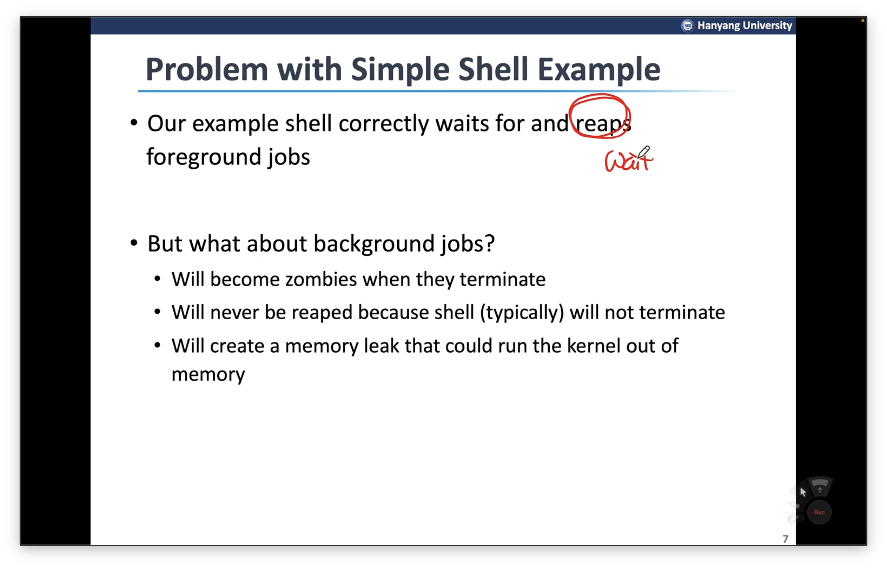

- 앞선 코드에 대해서 의문이 생김 → background process에 대해서 reaping을 할 수 있는가??
  - 명시적으로 wait을 하고 있지 않다. → synchronization , reaping을 하지 않는다.
- Shell Program은 Login - Logout의 텀이 매우 긴다 → Reaping이 제한된다면 그 사이에 수많은 Zombie process를 만들 수 있다는 의미.
- 당연히 안좋겠지? → 어떻게 해결해야 할까.

#### ECF to the Rescue

→ 위의 문제를 해결하기 위해 ECF가 필요함.

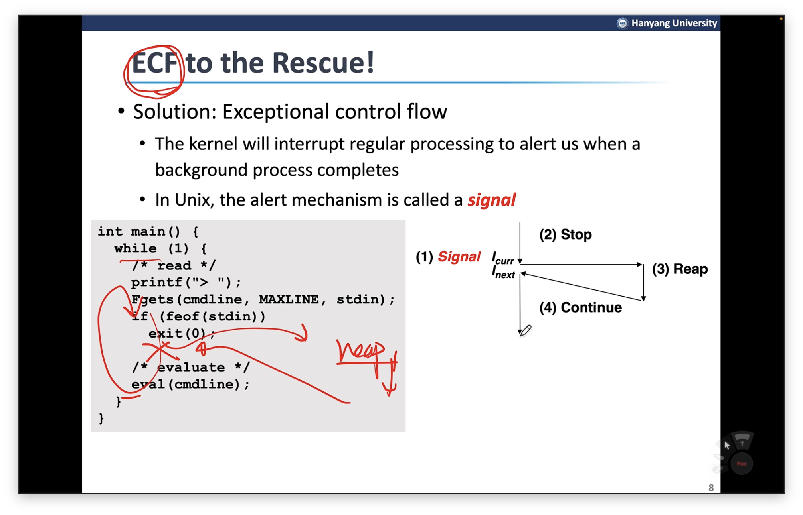

- Shell은 background에서 program을 계속 wait을 사용하지 않고 반복시킬 수 있고 signal을 통해서 program의 종료를 알게 됨.
- signal mechanism을 사용하게 된다면 자식 process가 종료되면 잠깐 반복을 멈추고 reaping을 수행한다.
- 그러면 자식 Process가 종료되었을 때 reaping을 위해 control flow를 중단 시키기 위해서는 조건이 필요함.
  1. 외부 HW을 활용한 interrupt pin 사용
  2. 어떠한 문제가 있거나 의도적으로 control flow를 변경하는 instruction 사용

   → Signal이 이러한 control flow를 중단시키는 mechanism이다..? → 위의 2가지에 적합한 상황은 아니기 때문에 Signal이 필요하다는 말인 것 같음.

---

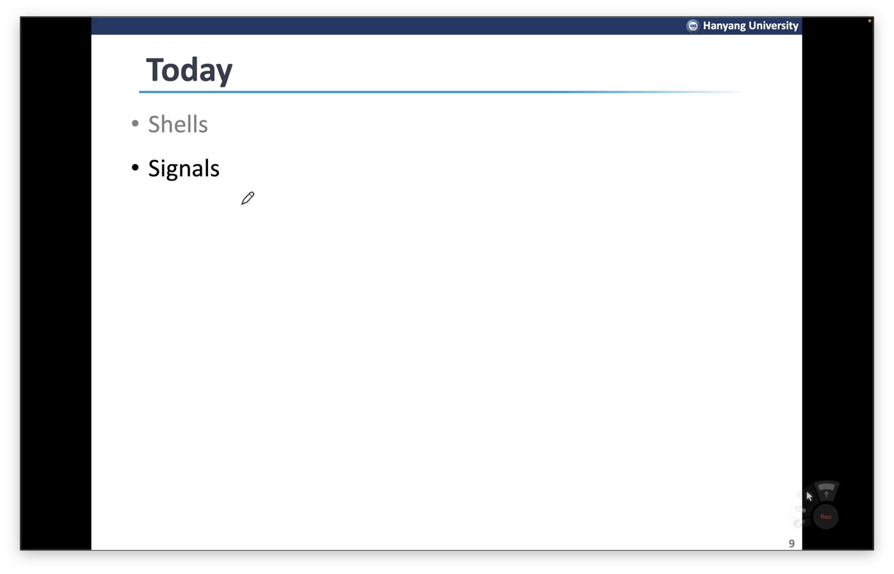

---

#### Signals

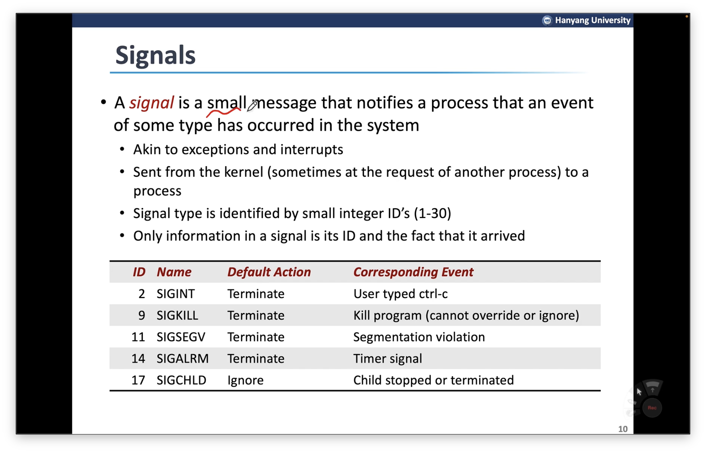

- small message임. 단, message라는 단어를 사용했지만 숫자값임.

- 1-30 사이의 번호를 사용하고 있고 각 번호에 대한 의미를 약속함.

  → 숫자를 받은 쪽이 숫자를 확인하고 message를 인식하는 방식.

- SIGINT → Signal Interrupt

- SIGCHLD → Signal Child

- Signal을 보내고 받는 행위는 모두 kernel(OS)에서 수행됨.

#### Signal Concepts : Sending a Signal

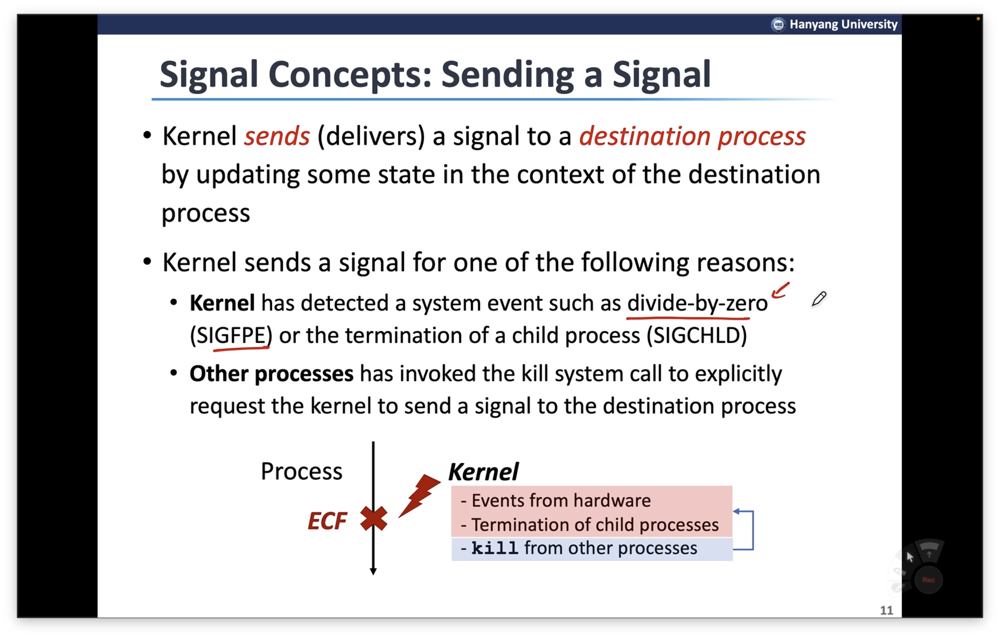

- HW를 통해서(event) signal이 전달되거나 자식 process의 종료에 따라 Kernel이 특정 process에 signal을 전달.
- 혹은 kill 명령 등을 통해서 다른 process로 부터 OS를 통해 signal을 전달할 수가 있다.

#### Signal Concepts: Receiving a Signal

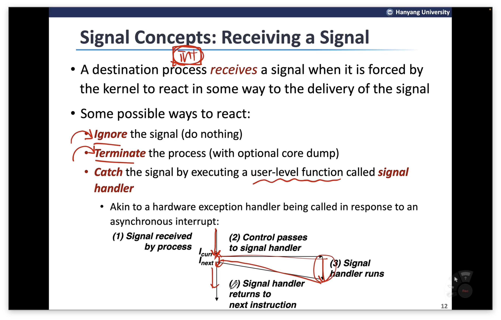

- Signal은 매우 다양하기 때문에 하나하나 학습하는 것은 큰 의미가 없음. → 큰 가지의 측면에서 학습하자.
- Ignore : Signal을 무시
- Terminate : Signal을 받았을 때 해당 Process를 종료시킴.
- Catch : 특정 Signal에 대한 전용 handler를 설정

#### Signal Concepts : Pending & Blocking

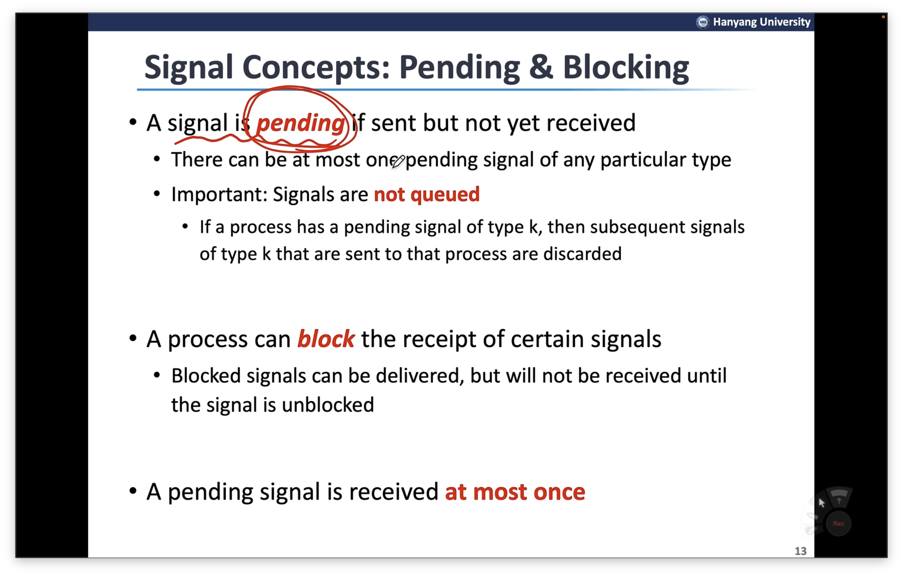

- Signal은 OS에 의해 송수신 됨.
- Signal의 송신은 즉각적으로 가능하지만 수신은 가능하지 않음.
- 실행되고 있지 않은 Process(schedule에 맞지 않거나 아직 CPU 할당이 되지 않은)는 부재중인 상태로 볼 수 있다.
- 나중에 Process에 CPU가 할당되면 그제서야 Signal을 수신할 수 있게 됨.
- 이렇게 송신은 되었지만 수신이 되지 않은 상태를 **Pending** 상태라고 한다.
- Signal이 도착했지만 signal보다 우선적으로 처리해야 하는 일이 존재할 수 있다. 이때를 signal이 **Block** 되었다고 말함.
- Signal은 Queing 되지 않음 → Pending Signal은 하나의 타입당 딱 하나씩만 받을 수 있음.

#### At Most One Pending Signal

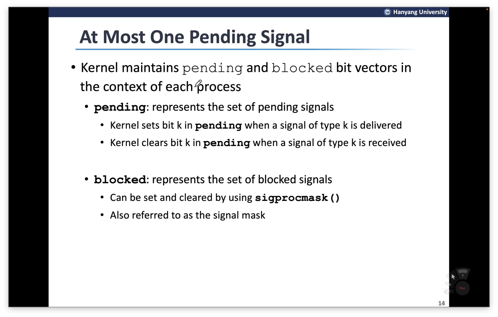

- Bit vector를 사용해서 pending과 blocked할 signal을 저장해둔다.
- pending과 blocked를 따로 구분해서 저장하는 이유는?
  - blocked는 지금 당장 signal을 처리하지 않는 다는 것이지 언젠가는 처리해야 하는 signal임.
  - 즉, pending과 block은 엄연히 다른 역할을 하기 때문

#### Sending Signals: Process Groups

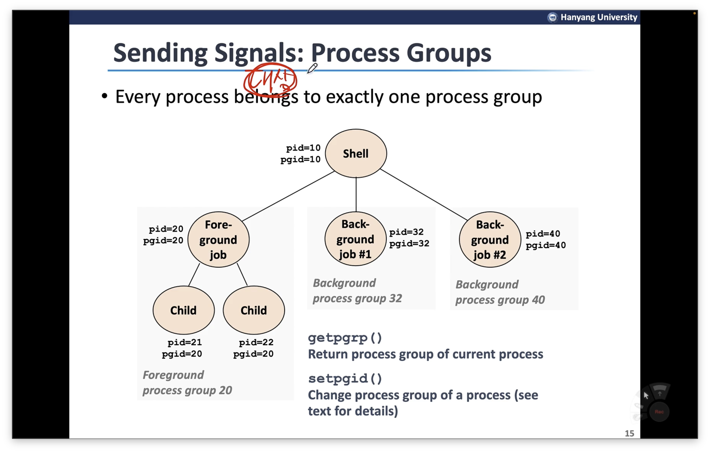

- Signal을 보낼 때 message와 함께 수신 대상이 존재함.
- 그 대상은 process id인 pid로 대상을 식별함.
- 그런데 PID로는 하나의 Process로만 전달이 된다. → 여러 Process에 동시에 전달하고 싶다면??
- PGID(Process Group ID)를 관리해서 수신 대상을 group으로 설정한다.
- Shell에서 fork()로 자식 process를 생성한다면 자식 process에 대한 pgid는 생성되는 자식 process의 pid가 된다.
- 이때 자식 process의 자식 process의 pgid는 shell이 생성한 자식 process의 pgid와 같음\
  → Shell에서 fork()하는 것이 아닌 기본적인 fork()의 방식은 현재 process group id를 그대로 유지함.
- getpgrp() → get p group : 현재 process의 pgid를 알 수 있는 함수.
- setpgid() : process group id를 새로 지정해 줄 수 있는 함수.
- 만약 Shell Process에서 fork()할 때 pgid를 분리하지 않는다면 어떤 일이 일어날까?

  → 실행 중이 process에서 ctrl+c를 하게 된다면 fore-ground에서 실행 중인 process group 전체에 signal이 전송됨\
    → ctrl+c를 통해 Shell이 종료되는 상황이 생길 수 있음.

#### Sending Signals from the Keyboard

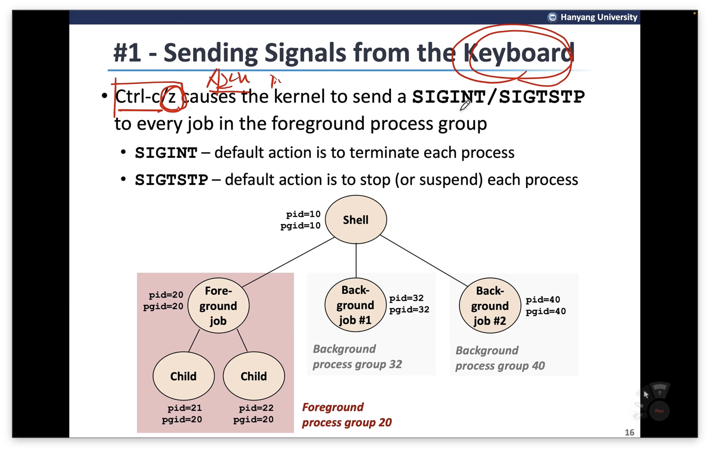

- KeyBoard를 통해서 Signal을 보내는 방법.
  1. Ctrl + C : SIGINT(Interrupt) → 실행 중인 process가 terminate됨.
  2. Ctrl + Z : SIGTSTP(Terminal Stop) → 실행 중인 process가 suspend 후 Background로 이동

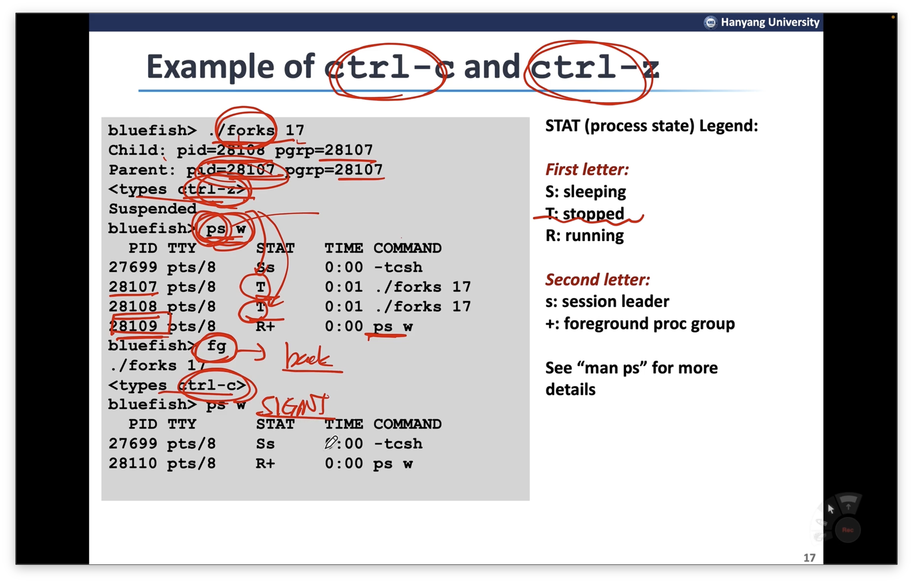

- T → Terminate가 아닌 Stopped
- ctrl-z를 통해 같은 28107의 pgrp를 가진 process들의 STAT이 T로 바뀜.
- “fg” → foreground 명령어 사용 : 직전의 background에 있는 process를 뽑아서 running 상태로 변경 → 부모가 running으로 바뀌어 foreground로 오면 자식은 back에 있지만 running 상태가 됨.\
  ⇒ 여기서 직전이란 바로 이전에 foreground에서 background로 변경된 process를 뜻함\
  ⇒ 이 슬라이드에서는 pid=28107인 process

#### Sending Signals with /bin/kill

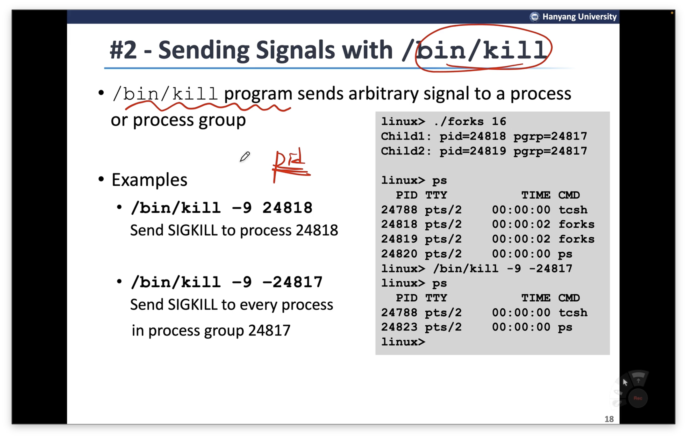

- /bin / kill Sign\_Num PID 의 형태로 이루어짐
- 만약 PID가 아니라 PGID인 경우 앞에 ‘-’를 붙임. → 슬라이드의 경우 -24817

#### Sending Signals with kill Function

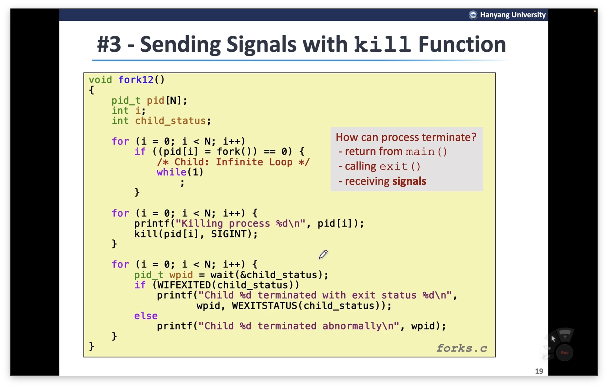

- while(1)을 통해 자식 process는 반복 실행 중 → kil(pid\[i\], SIGINT);를 통해 signal을 보내서 자식 process를  종료
- 현재 코드에서는 pid\[i\]를 사용해서 process를 하나씩 종료시키고 있지만 앞서 배운 내용처럼 -PGID를 사용할 수도 있음.

#### Receiving Signals

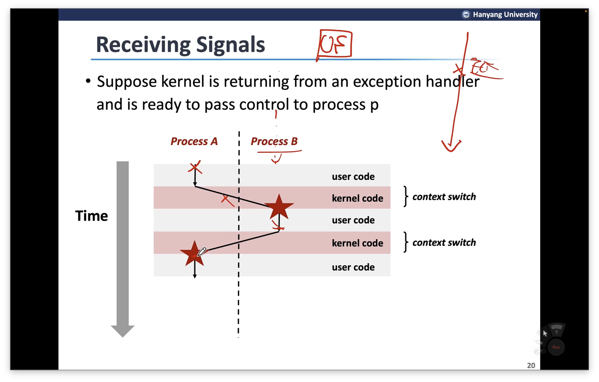

- Signal은 OS가 수신 및 처리를 진행함.
- 이 슬라이드는 Signal 수신 후의 timeline에 관한 그림
- Signal의 처리는 Context Switch로 다시 CPU를 할당 받아 왔을 때 Signal을 확인하게 됨.
  - 슬라이드에서 x 표시가 된 시점에 Signal이 도착했다면 OS는 Signal을 보관했다가 B로의 Context Switch → A로 다시 Context Switch한 순간에 Signal을 확인함.
  - 당연하게도 Signal에 대해 Pending Or Blocking을 구분함.

#### Receiving Signals

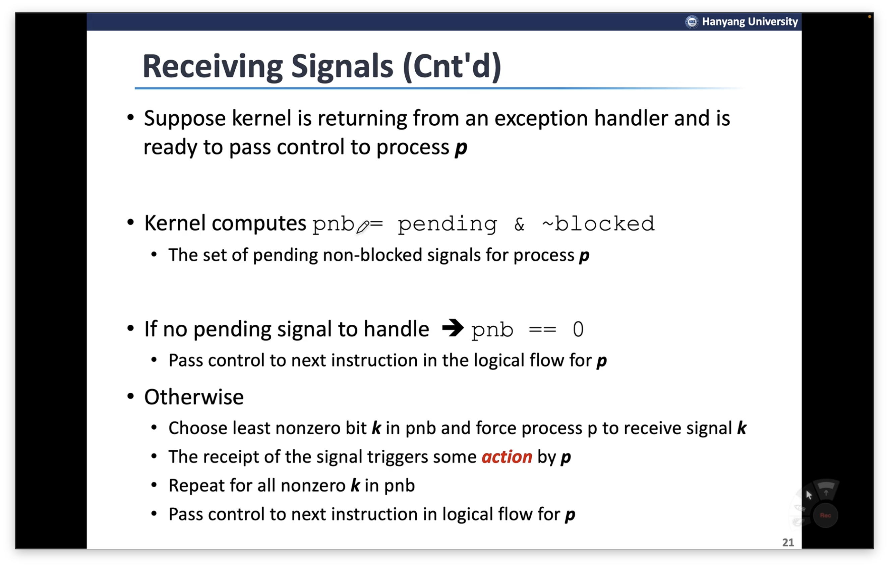

- Context Switch로 CPU를 재할당 받은 후 기존의 Control Flow로 돌아가기 직전에 Signal을 수신함.
- 이때 Pending & \~Blocked 의 연산을 통해 지금 현재 처리해야 할 Bit Vector을 추출함.
- Bit Vector에 해당되는 Signal을 처리 후 다시 0으로 Clear 시킴.
- pnb == 0 → 현재 처리해야 할 Bit Vector가 모두 완료 됨 → 기존의 Logical Flow로 복귀 후 실행
- 이 시점에 Blocking 되어 처리되지 않은 Signal 들은 Pending Vector에 남아 있기 때문에 다음 차례 혹은 맞는 차례에 처리할 수 있게 됨..?

#### Default Actions

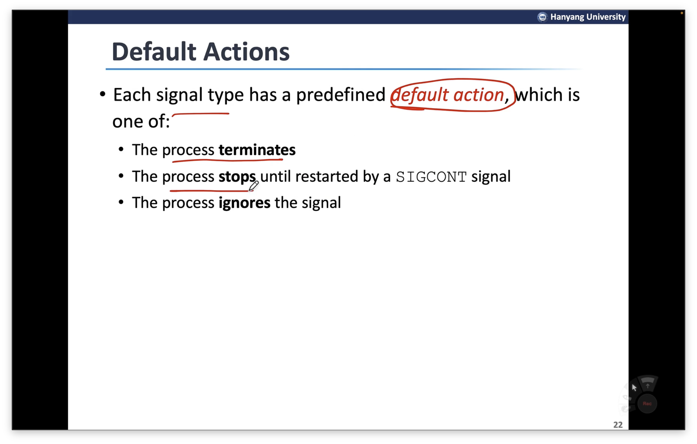

- 각각의 signal type은 정해진 행동강령이 존재한다.

#### Installing Signal Handlers

→ OS에는 기본적인 handler들이 별도의 OS가 관리하는 Table에 저장되어 있다.

→ 사용자가 원하는 Handler를 생성한다면 함수 포인터를 활용해 handler가 저장된 공간에 채워 넣는다고 생각하면 됨.

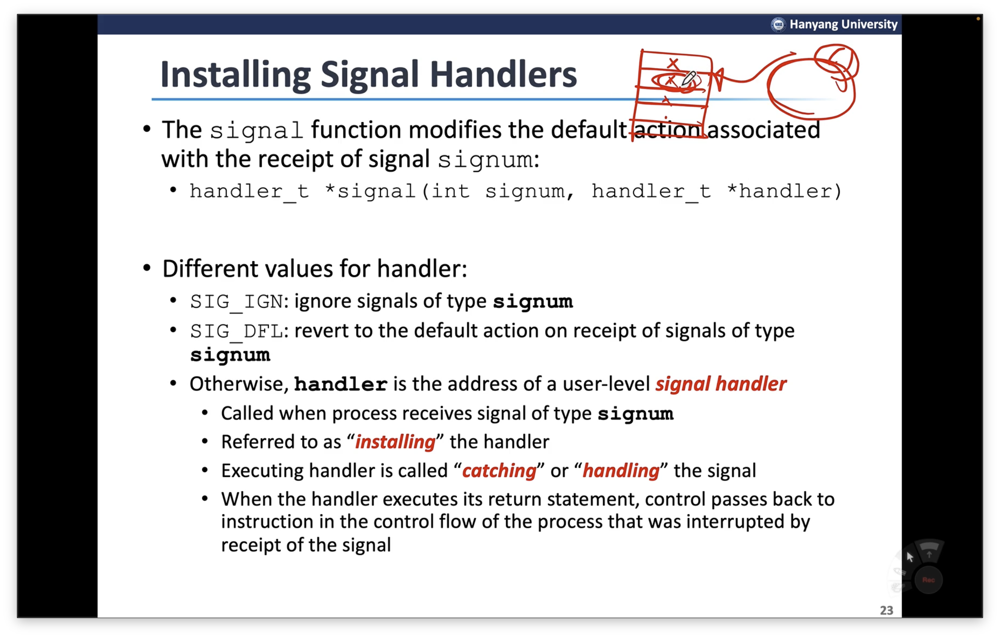

- SIG\_IGN : Signal 무시해라
- SIG\_DFL : Default 값에 대한 설정

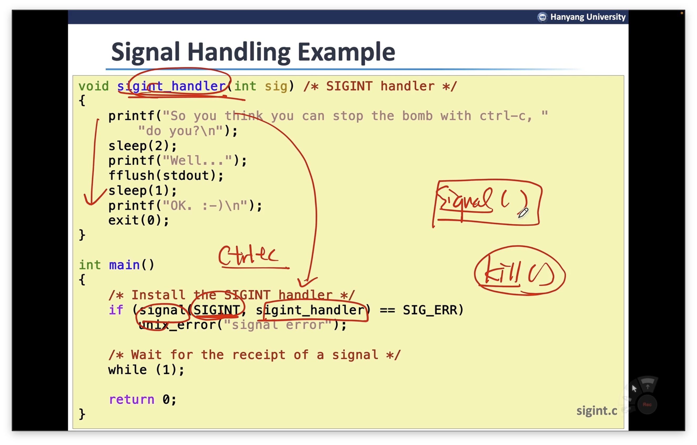

- SIgnal Handler를 등록하는 code의 예시
- signal()를 통해 handler를 등록함.
- 헷갈리기 쉬운 점
  - signal() → Signal Handler를 등록할 때 사용하는 함수
  - kill() → Signal을 송신할 때 사용하는 함수.

#### Signal Handlers as Concurrent Flows

→ Signal 전용 처리 함수를 사용하게 되었을 때 유의해야 할 점.

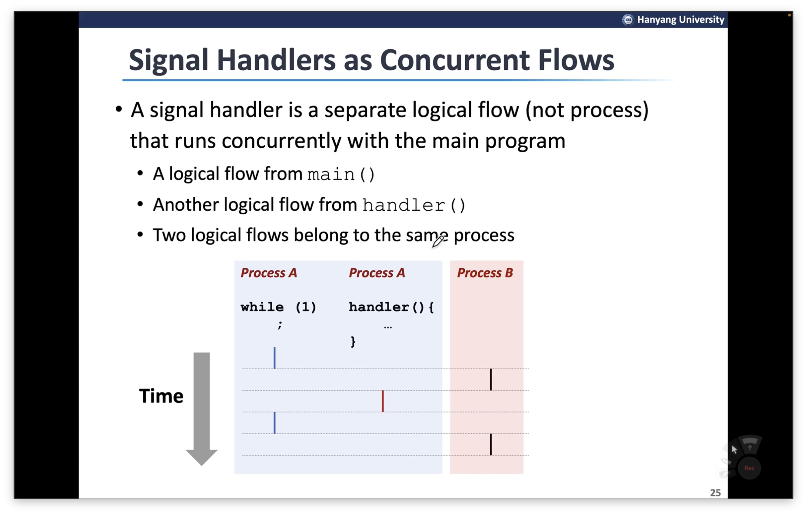

- Handler를 사용한다면 같은 Process지만 2개의 독립적인 flow가 서로 중첩되서 나타난다.

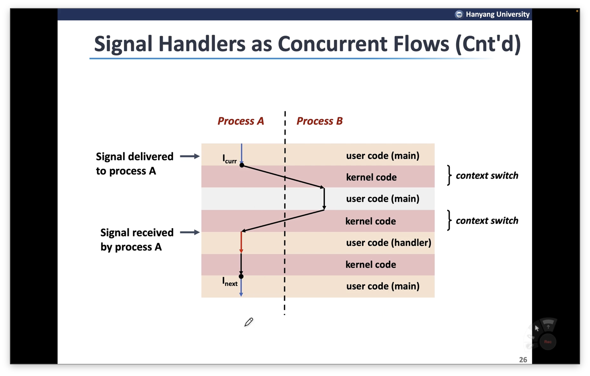

- Handler 처리 전 후에 kernel code로의 진입이 있음.

#### Nested Signal Handlers

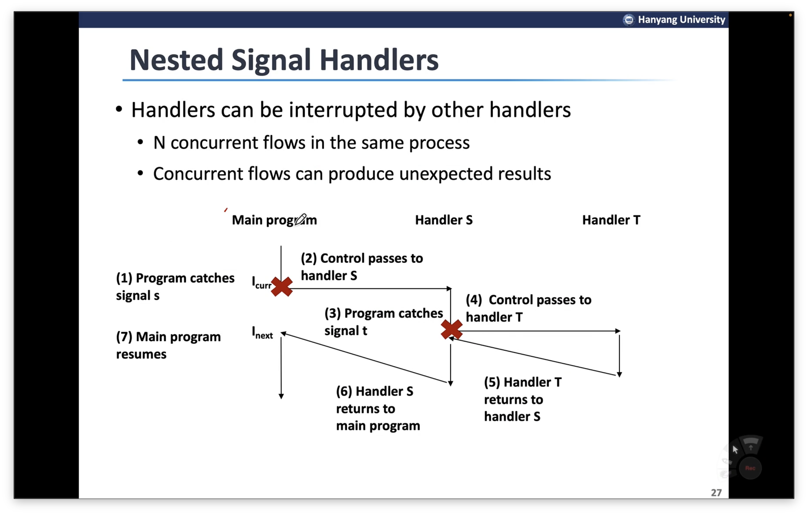

- 사실 Process의 main flow와 Handler의 flow가 concurrent 하게 보이는 것은 일종의 착시현상임.

  → 왜냐면 main의 flow 중간 어느 지점에 handler가 발생하는 지 알 수가 없기 때문이다.

  → OS 입장에서는 main flow 실행 중인지 handler에 대한 flow인지 구분할 수 있는 방법이 없음.

- 슬라이드의 예시에서 Handler S 실행 중 우선 순위를 가지는 Signal이 도착해서 Handler T로 즉각적으로 실행된다면 하나의 process에서 3개의 flow가 실행되는 상황으로 우리에게 보여질 수 있다.

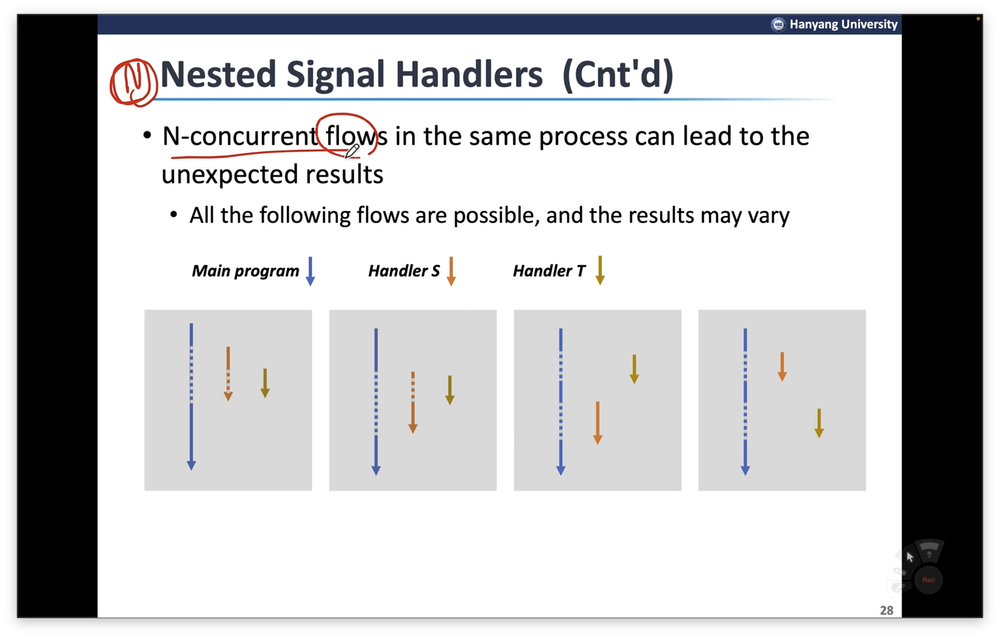

- N개의 Signal Handler를 사용했다면 같은 Process 내에 최대 N+1개의 flow가 생길 수 있음.

#### Blocking and Unblocking Signals

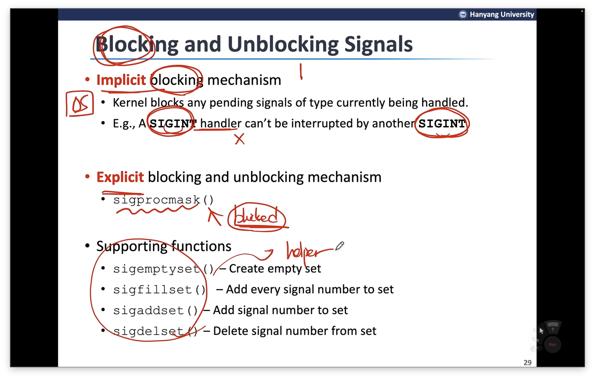

- 만약 Handler 실행 중 다른 Signal의 방해를 받고 싶지 않다면 Blocking의 방법을 사용할 수 있음.
- 암묵적인 blocking mechanism : 같은 Signal에 대해서는 암묵적으로 중복 실행을 막아주고 있음.\
  → OS가 암묵적으로 진행해줌.
- 명시적인 mechanism : sigprocmas() 라고 하는 system 함수를 사용.
- 아래의 Supporting functions는 bit vector를 생성해주는 helper 함수라고 생각하면 됨.

#### Temporarily Blocking Signals

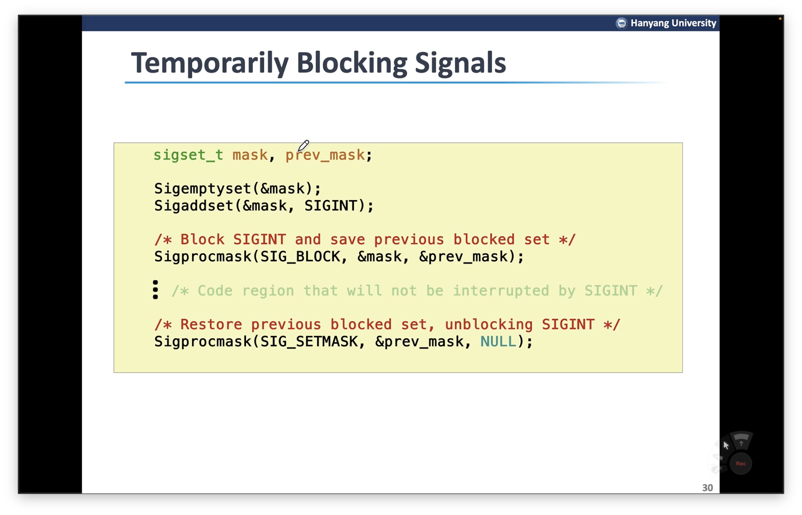

- 일시적으로 blocking 할 때 사용하는 함수(process 종료 전까지 해제하지 않으면 일시적이 아닐 수 있지만 기본적으로 일시적인 Blocking을 염두에 두고 만든 것.)
- Sigemptyset(&mask); 를 통해 Sig Vector를 0으로 초기화
- Sigaddset(&mask, SIGINT); 를 통해서 SIGINT에 해당하는 bit만 bit vector에 set해서 mask에 저장해둠. → &mask에 SIGINT를 저장함.
- Sigprocmask()에서 SIG\_BLOCK을 통해서 &mask bit vector를 사용할 수 있음\
  → 기존의 mask 값은 &prev\_mask에 저장되게 됨.\
  → &mask는 새롭게 추가하려는 block signal을 담고 있음.\
  → &prev\_mask \| &mask를 통해 block할 Signal을 bit vector에 추가함.
- Temporarily Block한 Signal이 더 이상 Blocking 될 필요가 없다면 아래의 Sigprocmask()를 사용함.

  → 기존의 mask 값을 복원해야 함. ⇒ prev\_mask를 활용해서 복원

- SIGINT Signal이 들어온 다면 Sigprocmask 전 후에 들어온 경우에서만 즉각 처리 가능하고, 함수 사이에 Signal이 들어온다면 Block되어 대기됨.

#### Safe Signal Handling

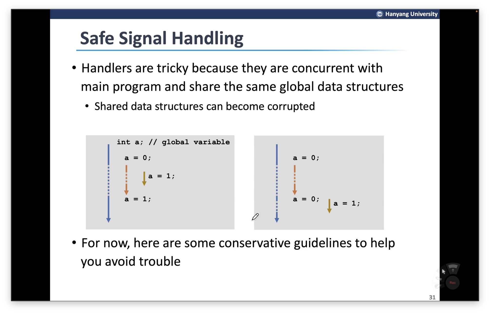

- 하나의 Process에서 여러 handler가 concurrent하게 실행된다고 했을 때 ordering이 되지 않으면 문제가 생길 수 있다.
- 주황색 : Handler S / 금색 : Handler T
- Handler S가 전역변수 a를 0으로 설정하고 T가 a를 1로 설정한다면 S의 종료 후 의도한 값과 달라지는 문제가 생길 수 있음.(왼쪽 그림)
- 해결법
  1. 변수의 공유를 금지한다.
  2. 서로 겹쳐서 수행하지 않도록 flow를 synchronization 한다.

#### Guidelines for Writing Safe Handlers

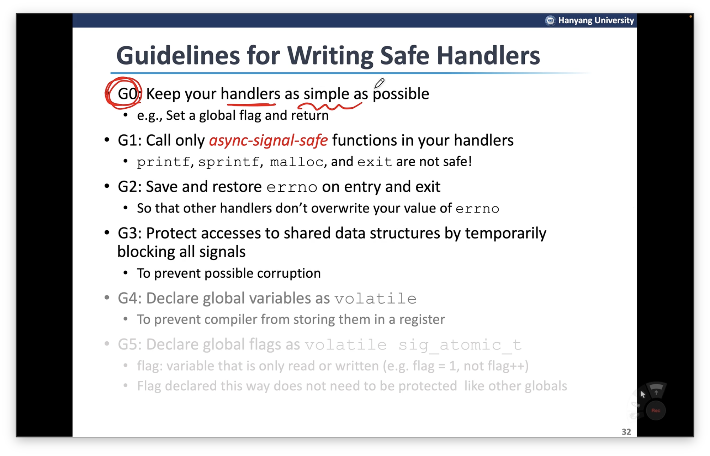

- G0 : Handler를 최대한 간단하게 만들어라. → Handler가 짧다면 겹칠 확률이 줄어듦.
- G1\~G2 : 공유하는 변수 및 데이터, 자료구조 등을 최소화하여 Handler가 concurrent하게 실행 되더라도 문제가 발생하지 않도록 해라.
- G3 : Handler 실행 중 다른 Handler가 실행되지 않도록 원천 봉쇄하는 방법.

  → Blocking이 안전하게 Handler Flow를 만들긴 하지만 Blocking 했을 때의 문제점도 있기 때문에 가장 마지막에 나온 것.\
    → Blocking 한다면 현재 실행 중인 Signal보다 높은 우선 순위의 Signal이 도착한다 하더라도 나중에 처리되는 문제가 발생할 수 있음.

#### Async-Signal-Safety

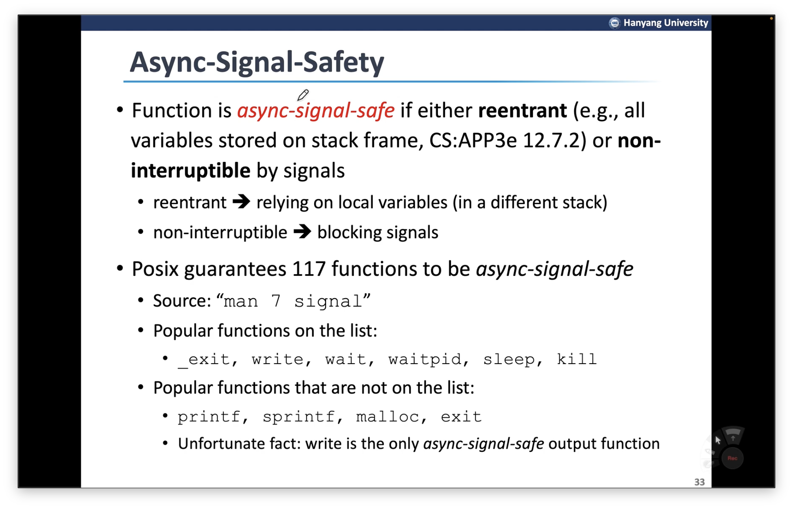

- Signal이 중첩되어 처리 되더라도 사용함에 있어 안전한 함수들의 종류

  → 정말 Low-Level의 함수들임.

- 전역 변수를 사용하지 않아서 stack에 있는 변수들을 사용하기 때문에 서로 다른 Handler는 서로 다른 변수를 사용하도록 만들어져있거나 blocking 등을 사용해서 다른 Handler들과 중첩되서 호출되지 않는 것을 보장하는 함수들로 구성되어 있음.
- \_exit, write, wait, waitpid, sleep, kill 등이 안전한 함수들
- printf, sprintf, malloc, exit 은 안전하지 않음
- \_exit / exit 주의

#### Safely Generating Formatted Output

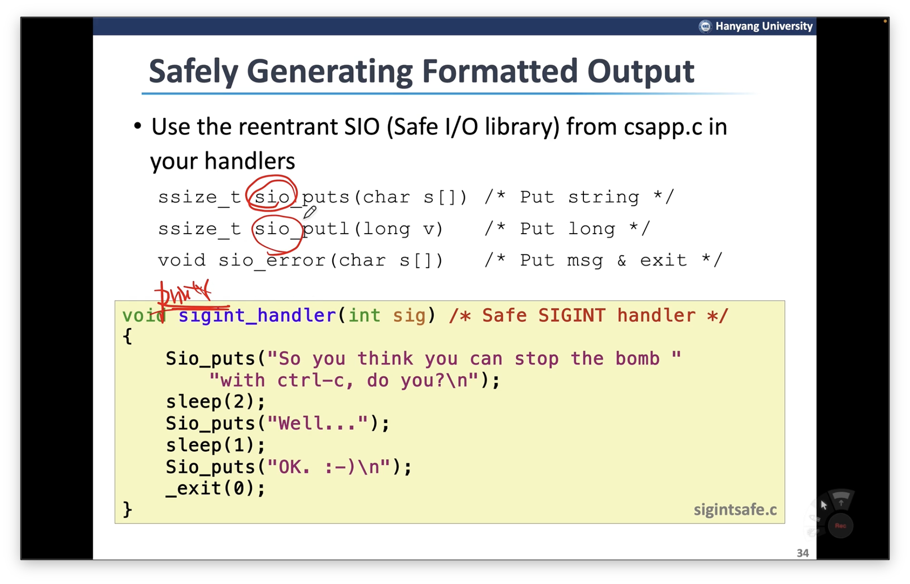

- 안전하지 않은 printf 함수 대신 안전한 sio\_put을 사용하는 방법에 대한 슬라이드
- printf 대신 Sio\_puts를 사용해서 sigint\_handler() 내부에는 사용한 모든 함수들이 signal 중첩 처리에서 안전한 함수들로 이루어져 있음.

#### Correct Signal Handling?

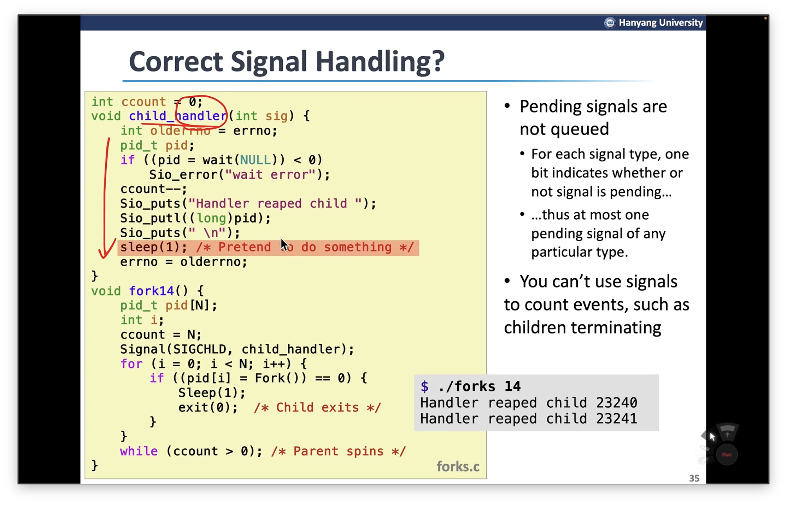

- 앞선 Handler에 비해 비교적 안전한 함수들로 구성되어 있는 Handler임.
- ccount라는 전역변수가 있지만 안전함 → 와이?\
  → ccount가 값을 가지게 되는 경우는 fork() 이전임\
  → SIGCHLD Signal이 발생할 수 있는 시점은 fork() 이후임\
  → fork() 이후에 child\_handler를 제외한 다른 코드에서 ccount를 업데이트 하는 코드가 없기 때문에 race가 발생하지 않음.
- 하지만 이 슬라이드의 코드는 다른 이유로 제대로 동작하지 않음.\
  → 14개의 fork를 진행했지만 결과는 2개만 reaping 됨.

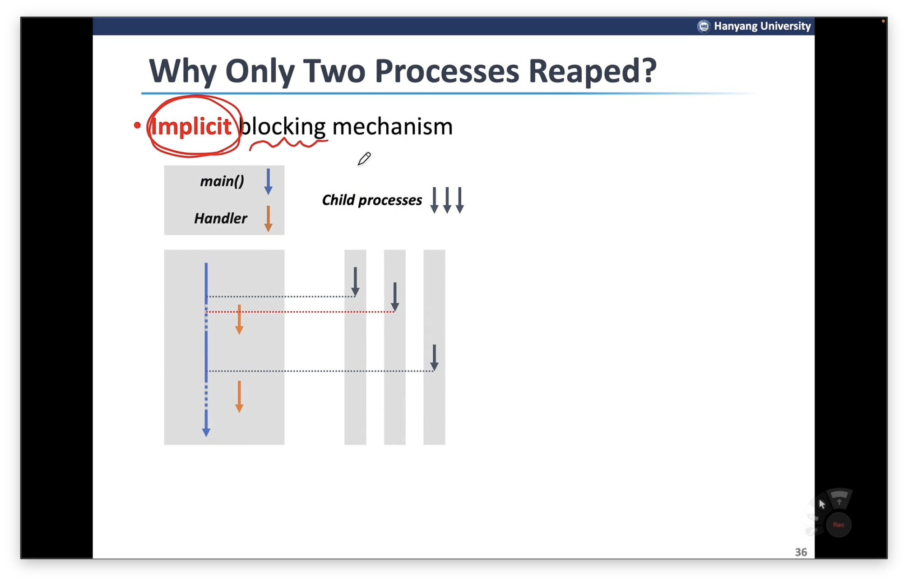

- 같은 종류의 Signal을 처리하고 있다면 해당 Signal에 대해서 중첩하지 않기 때문임.

#### Correct Signal Handling

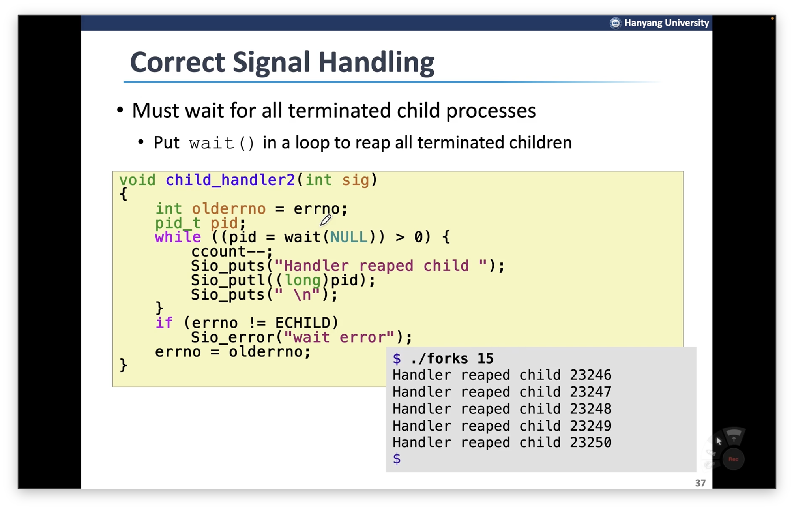

- 종료된 자식 process에 대해 모두 reaping 하기 위해 그 시점에 종료된 모든 Process에 대해 reaping을 해야함.
- 개선된 child\_handler2에서는 while()문을 통해 여러 번의 wait() 을 통해 종료된 모든 자식 process에 대해 reaping을 하고 있음.

#### Portable Signal Handling

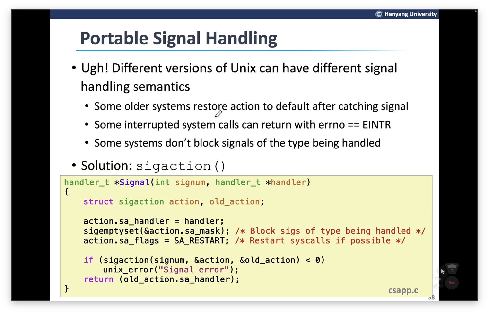

- 참고로만 알아둬라.

#### Synchronizing Flows to Avoid Races

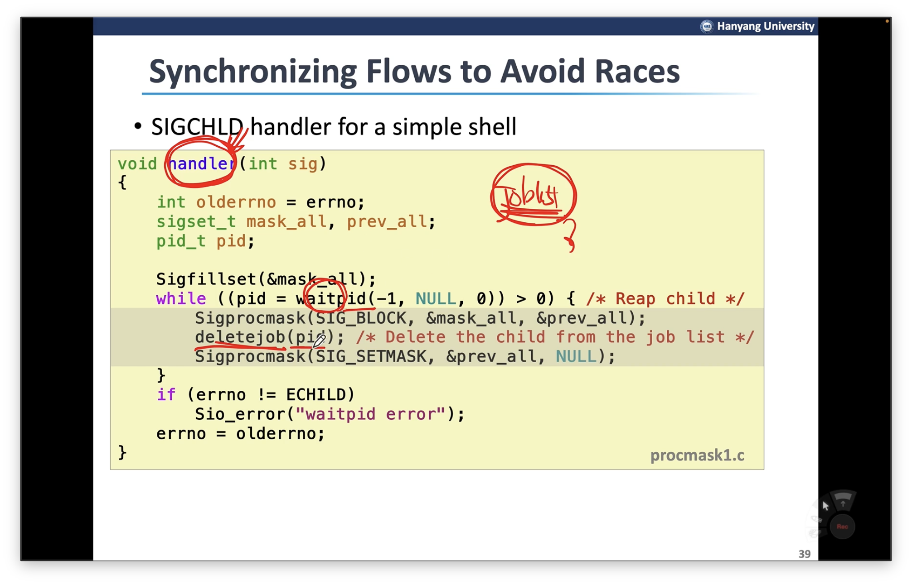

- Main Routine에서의 Flow와 Handler의 Flow가 Concurrent 하게 실행되면서 발생할 수 있는 race에 대한 내용.
- SIGCHLD니까 자식 process가 종료 되었을 때 실행되는 handler임.
- Shell Program을 가정하고 있고 fork()를 통해 만들어진 Program들의 생성 순서를 관리하기 위해 joblist를 관리하고 있다고 가정
- Process가 종료되면 별도로 joblist에서 해당 PID를 제거하는 작업이 필요함 → while() 안의 deletejob(pid);

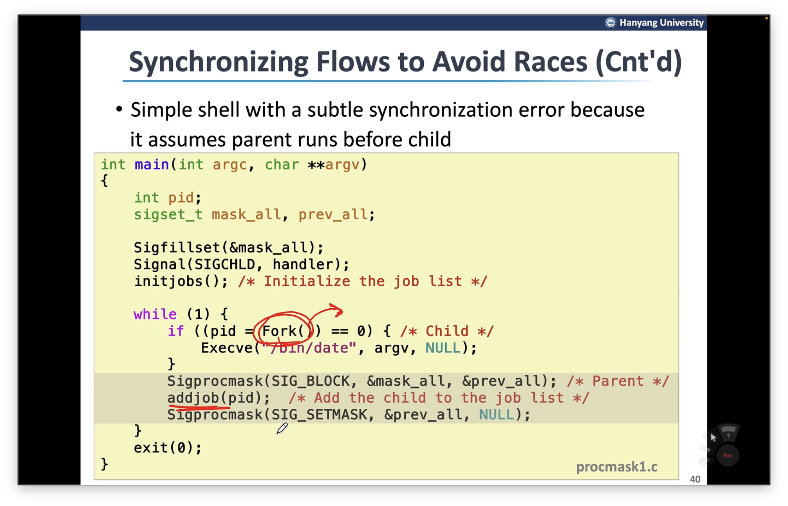

- Fork() 이후에는 새로운 pid를 joblist에 추가하는 작업이 필요함 → addjob(pid);
- 이러한 경우에는 main flow와 handler flow에서 joblist를 공유하고 있음. → 때문에 flow가 concurrent하게 실행될 때 race가 발생할 수 있음.
- joblist를 update 하는 과정에서 race가 발생하는 것이 문제이므로 handler와 main 모두에서 addjob() 및 deletejob() 실행 전후에 blocking 실행 및 해제를 진행함

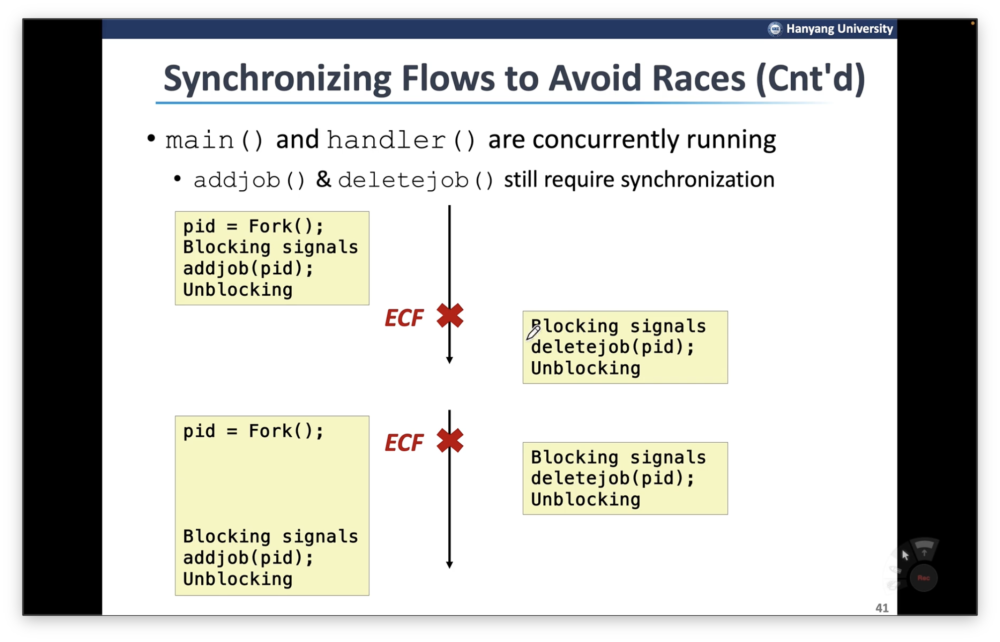

- main flow에서 addjob 한 전후에는 blocking이 존재하기 때문에 Unblocking 이후 ECF 발생
- Handler 호출 → deletejob 호출
- 이 경우는 문제가 없다.
- Fork() 이후 바로 addjob 하지 않고 잠깐 뜸을 들이는 사이에 자식 process가 먼저 종료 되어 ECF가 발생
- addjob 이전에 deletejob이 실행됨.
- 이 경우는 문제가 발생함 → 즉, deletejob이 addjob 이전에 실행되도록 코드를 작성하면 안됨.

#### Corrected Shell Program without Race

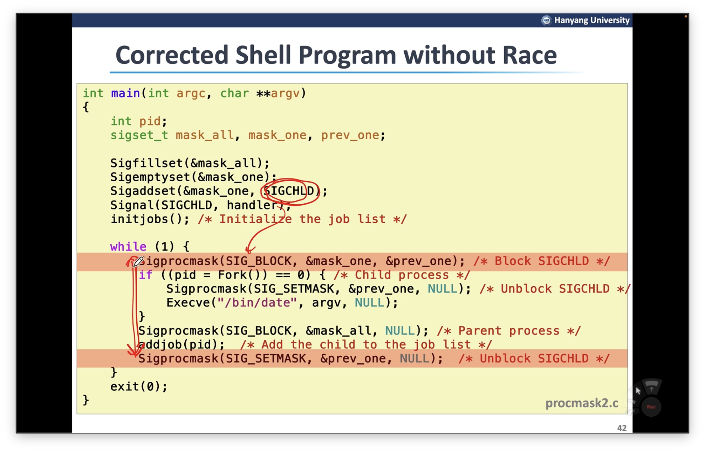

- 애초에 Fork() 후 block 생성이 아니라 애초에 Fork() 전에 blocking 하고 addjob 이후 blocking 해제하여 문제를 해결

#### Explicitly Waiting for Signals

→ 부모 process가 자식 process를 기다리는 또 다른 방법

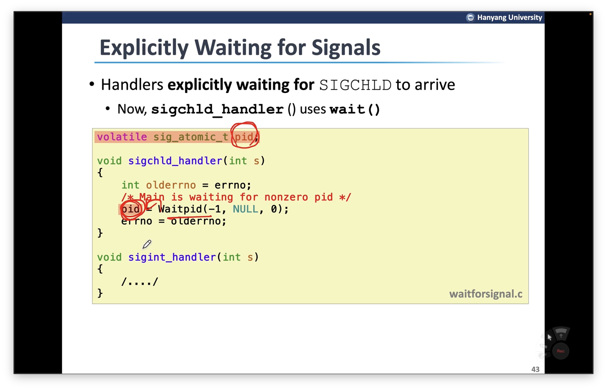

- 편의상 부모 Process가 자식 Proces를 하나만 만든다고 가정
- Handler에는 전역 변수 pid에 종료된 0이 아닌 pid 값을 기록함.

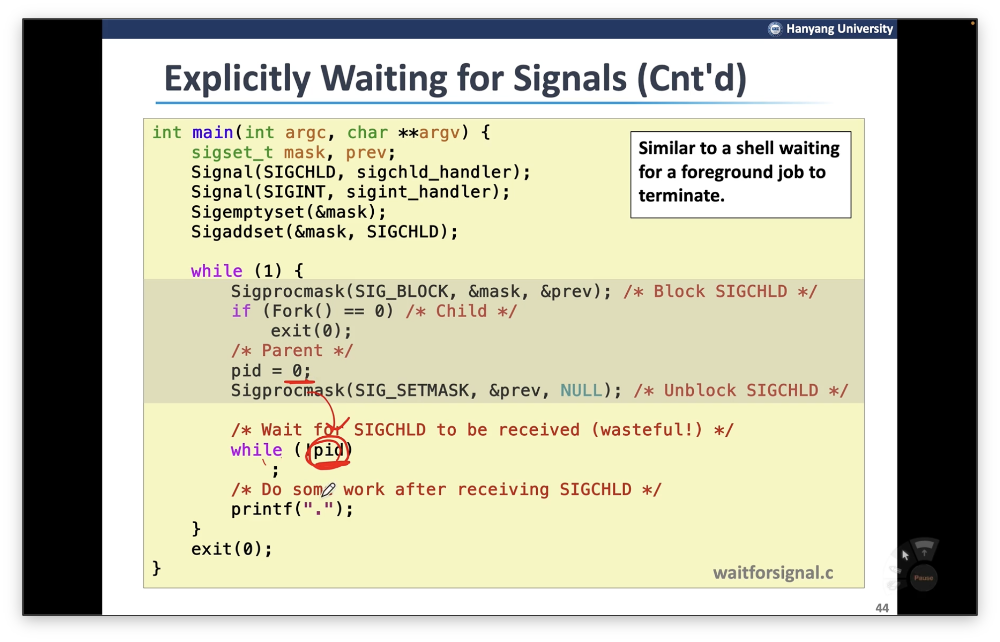

- 부모는 pid의 초깃값 0에서 0이 아닌 값으로 변경되는 것을 기다림.
- pid가 0이 아닌 값으로 return 되면 while()문을 빠져나와 다른 동작을 실행
- 이 경우는 동작에는 문제가 없지만 자식 process의 종료를 기다리면 busy waiting을 하며 기다림. → 이 기간동안 CPU 및 전력의 낭비가 발생함.

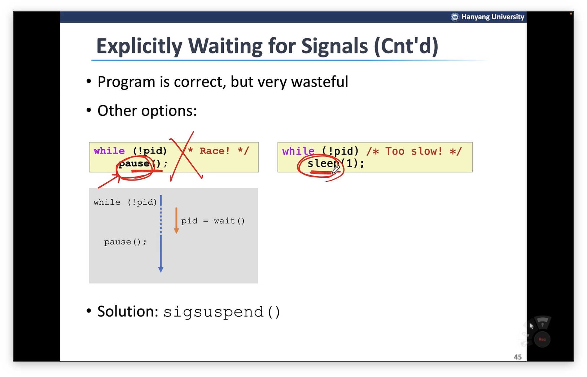

- 그래서 while() 동안 잠시 멈추는 함수를 사용할 수 있다.
- pause()는 안전하지 않은 함수기에 사용하지 않음.\
  → pause()를 사용하게 된다면 pause() 이전에 자식 process가 종료되어 pid가 반환됐지만 pause() 되어 영원히 while()에 갇히게 될 수 있음.
- sleep()은 안전하지만 또다른 문제가 생길 수 있음.

  → sleep은 1초에 한번씩 깨어나서 pid를 확인할 수 있음.\
    → 하지만 sleep 직후에 pid가 반환된다면 시간의 낭비가 발생함.

- sigsuspend() 함수를 사용하여 해결함.

#### Waiting for Signals with sigsuspend()

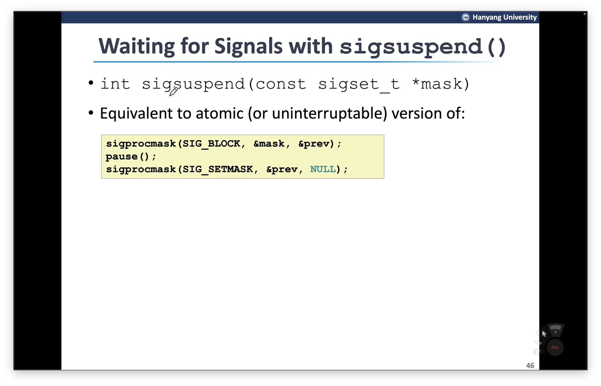

- sleep()은 무조건 정해진 시간만큼 CPU를 받지 않고 잠들어 있음.
- 하지만 sigsuspend()는 signal이 오기 전까지만 잠들기 때문에 signal이 도착하면 바로 깨어날 수 있음.
- sigsuspend()는 argu로 bit vector(\*mask)를 받고 있음 → sleep 하는 동안 무시할 signal에 대한 bit vector를 담기 위함.

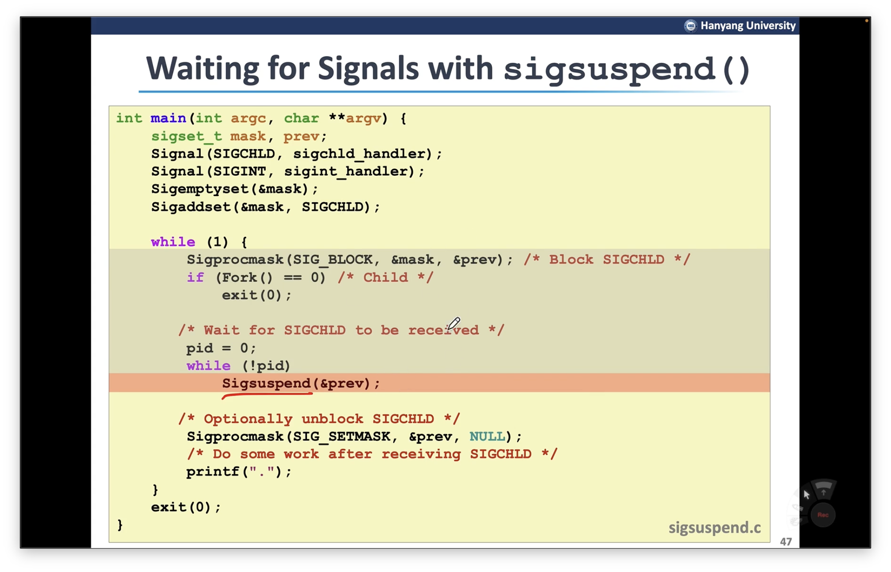

