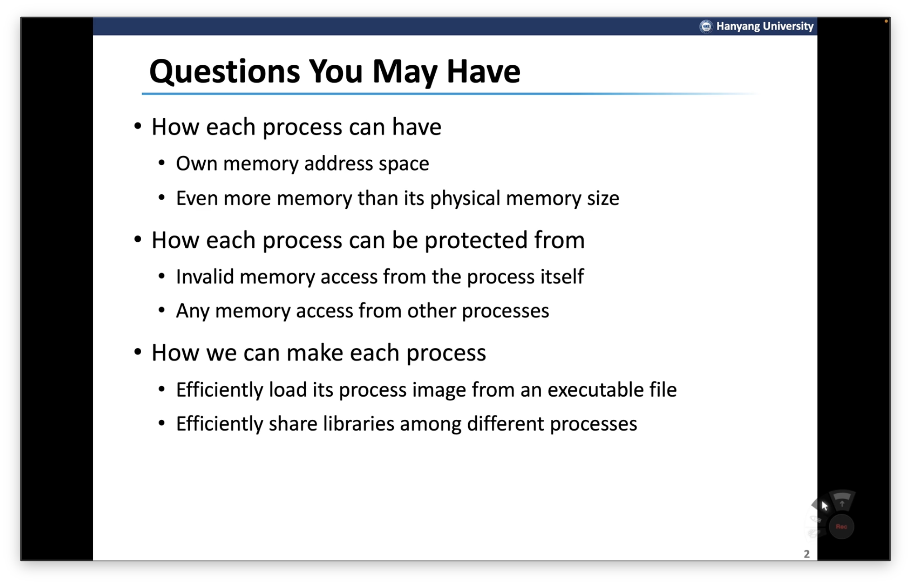

- VM에 대한 핵심 내용이자, 이번 강의에서 우리가 답을 찾아야 할 내용들

- Process는 어떻게 자신만의 독립적인 메모리를 가지는가?

  → 자신만의 메모리 주소를 가짐\
    → 자신이 가진 physical memory size보다 큰 메모리를 할당 받는 경우도 있음.

- Process는 아래 내용들에 대해 어떻게 memory를 보호하는가?

  → 부적절한 메모리 접근\
    → 다른 process에서의 메모리 접근

- OS는 Process의 메모리 영역을 어떻게 관리하며, 공유할 수 있도록 만들었는가?

→ 답은 VM임.

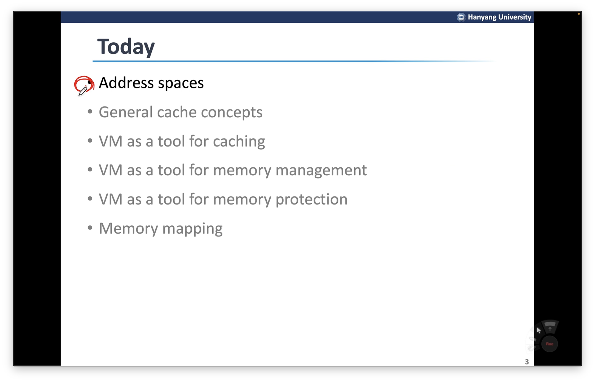

#### Systems Using Physical Addressing

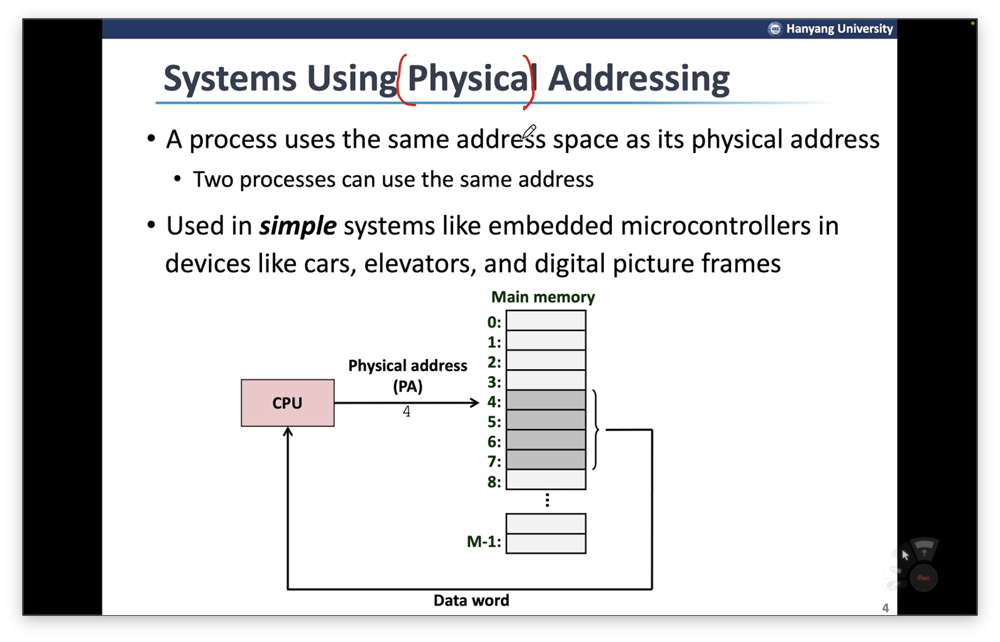

- Physical Addressing은 아래의 구조로 그려볼 수 있다.
- CPU는 PA를 통해 Main memory에 접근하여 data를 가져오는 구조
- 하지만, 이러한 구조는 큰 문제가 있음.
- 동일한 Program을 2개 실행시킨다면, 이 Program은 2개의 Process로 실행됨.
- 하지만, 실행하는 Process는 동일한 Memory 주소를 사용함 → 이 경우 독립적인 2개의 Process는 하나의 메모리를 공유하기에 온전하게 독립적으로 실행될 수 없음.

#### Systems Using Virtual Addressing

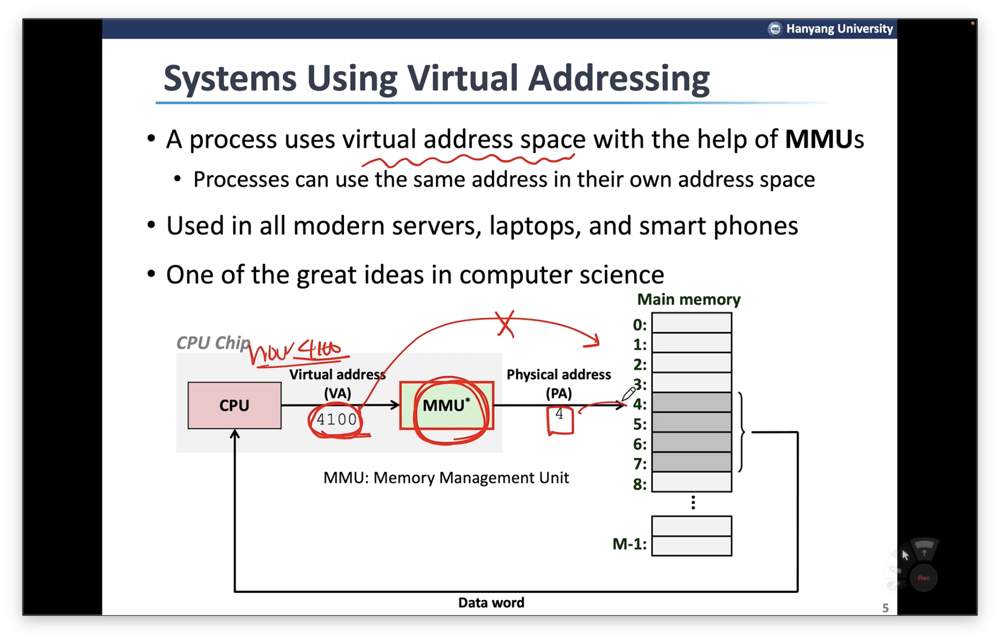

- 위 슬라이드의 문제를 해결하기 위해 각 Process는 자신만의 Virtual Address Space를 할당 받음.
- VM은 MMU라는 HW의 도움을 받아 PA로 변환 된 후 실제 Memory에 접근하는 구조를 가짐.
- MMU라는 Unit의 추가로 비용은 증가되었지만 여러 개의 Program을 동시에 실행 시킬 수 있는 장점을 가지게 됨.

#### Address Spaces

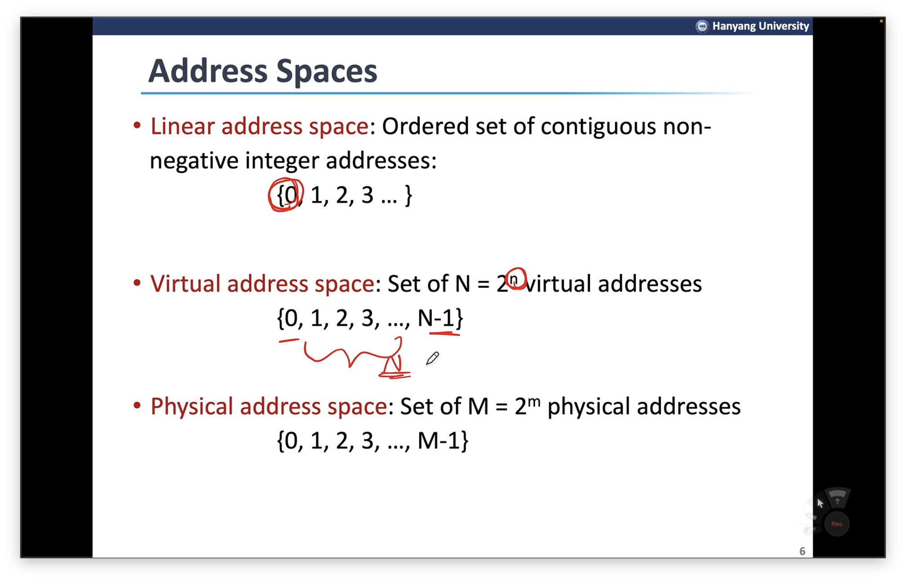

- Virtual Address Space & Physical Address Space → N / M 비트에 따라 2\^N개 혹은 2\^M개의 주소값을 가짐.

#### What Virtual Memory Enables

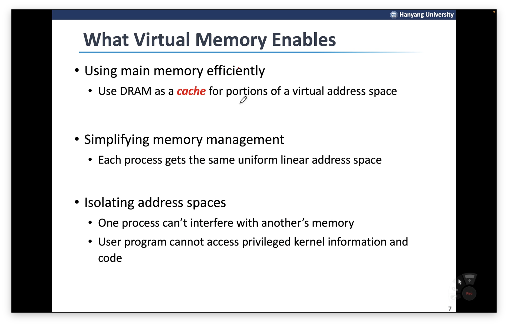

- Main Memory를 더 효율적으로 활용할 수 있음.
  - 한 Process에서 필요한 주소 공간을 VM의 주소 공간으로 표현할 수 있다.
  - 이 전체를 저장 장치에 저장하고 현 시점에 필요한 부분만 실제 Memory에 올려두는 방식.
  - DRAM을 저장 장치의 cache처럼 사용했다고 표현하기도 함.
- Memory 관리가 단순해짐.
  - 실제로는 그렇지 않더라도 가상 메모리는 Process의 메모리가 연속적으로 보이도록 해줌.
  - 다른 Process가 어느 Memory를 사용하는지 알 필요가 없어짐.
- Process 별로 메모리 공간을 격리 시킬 수 있음.
  - 한 Process에서 잘못된 주소로 접근하더라도 다른 Process는 이 접근에서 안전함을 보장 받음.
  - 잘못된 접근으로 인한 Kernel Memory 손상 및 정보도 보호 받을 수 있음.

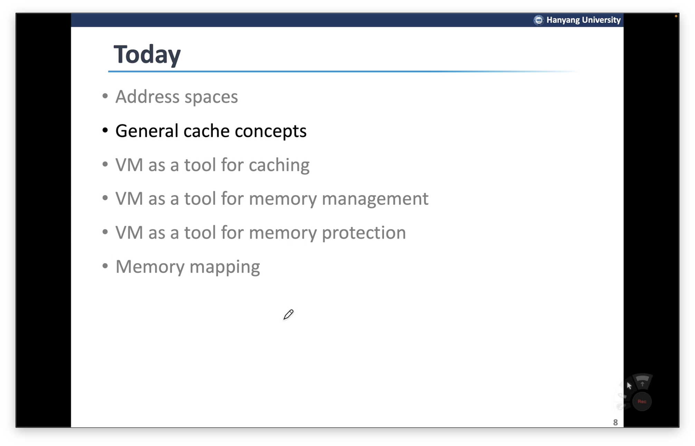

#### Illusion of Fast and Large Main Memory

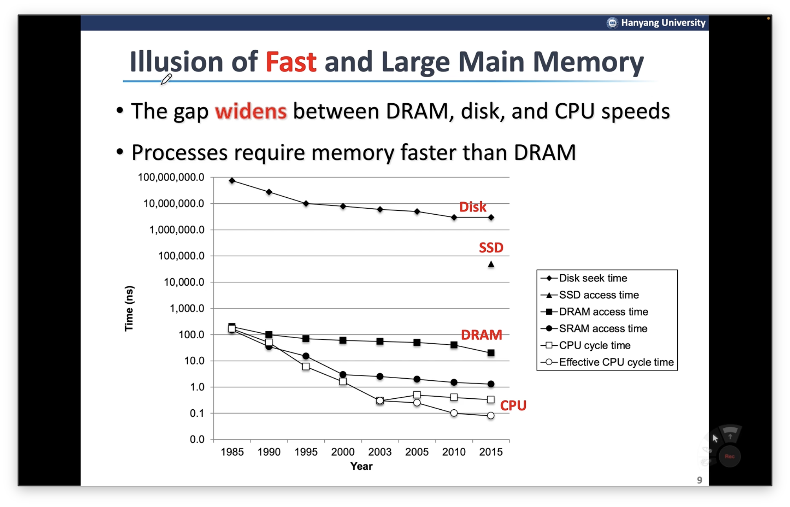

- 메모리는 빠른 처리보다는 많은 양을 저장하는 것에 집중해옴

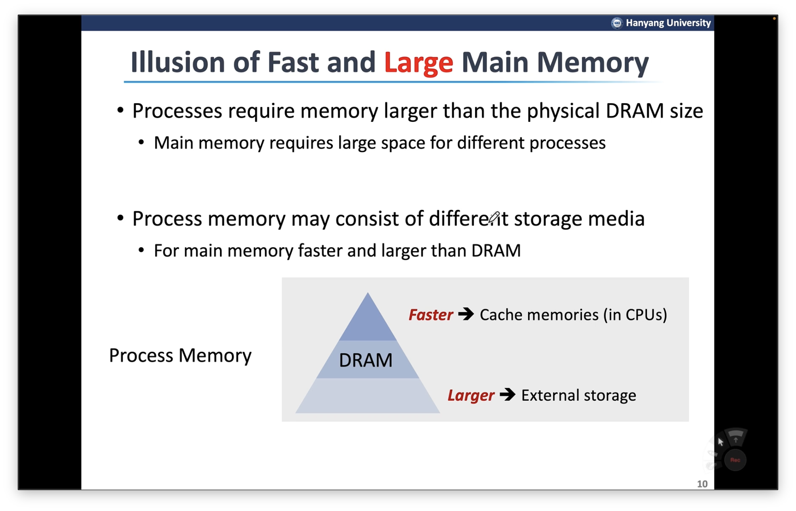

- Process는 Data를 많이 다루게 될 수록 큰 Memory를 필요로 함.
- 결론적으로 Process Memory는 DRAM보다 더 크고 더 빠른 memory를 필요로 함.

#### Memory Hierarchies

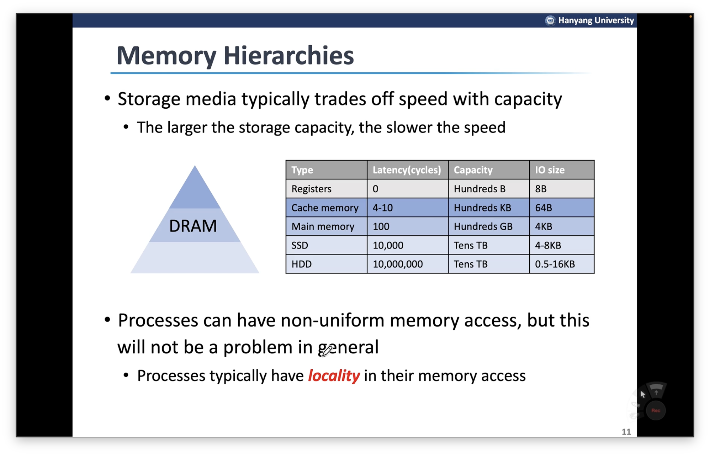

- Process가 보기에는 단일 계층의 memory로 보이지만 실제로는 여러 계층의 memory 종류가 복합되어 있는 형태를 실제 하나의 memory처럼 사용함.
- Cache Memory → DRAM(Main Memory) 보다 용량이 적지만 훨씬 빠름.
- SSD / HDD → DRAM보다 느리지만 훨씬 큰 용량을 가짐.
- Locality 덕분에 이러한 다중 구조는 잘 동작됨.

#### Locality

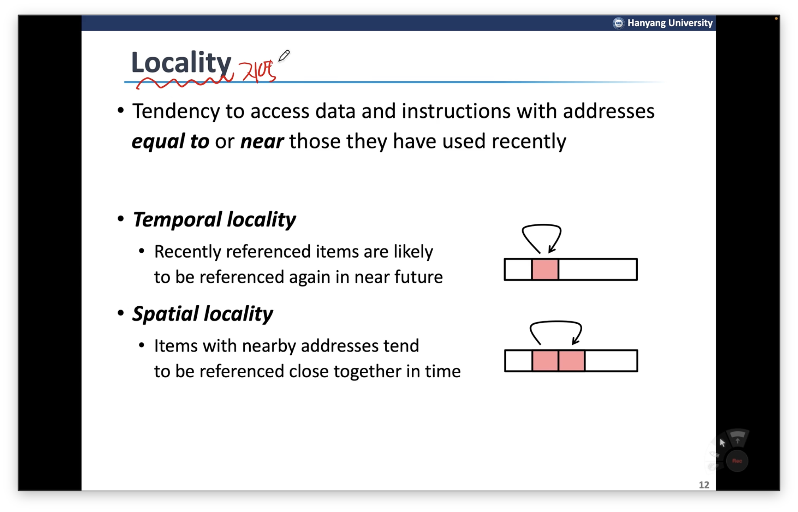

- Temporal Locality
  - 같은 데이터는 가까운 시간 내에 다시 활용될 확률이 높다.
- Spatial Locality
  - 접근된 데이터의 주변에 있는 데이터는 머지 않아 접근될 확률이 높다.

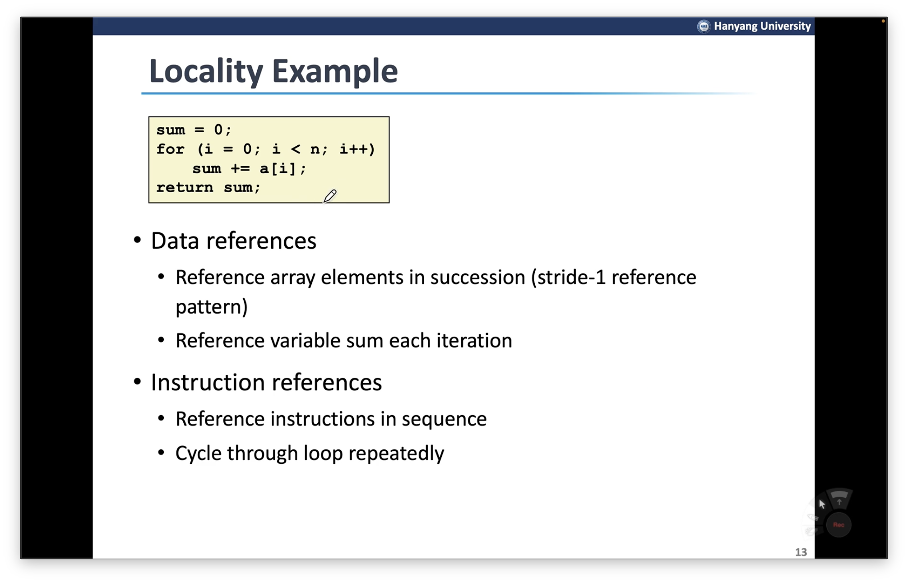

- Program을 data와 instrcution으로 나눠서 살펴보자.
- Data
  - Spatial Locality → 배열의 경우 비슷한 위치의 data가 접근됨.
  - Temporal Locality → 반복문에서 사용되는 변수의 경우, 동일한 변수에 대해서 반복적으로 사용됨.
- Instruction
  - Spatial Locality가 매우 높음. → Instruction은 보통 순차적으로 접근되기 때문
  - Temporal Locality → 반복문을 사용하면 동일한 주소의 instruction이 반복 사용됨.

#### General Cache Concepts

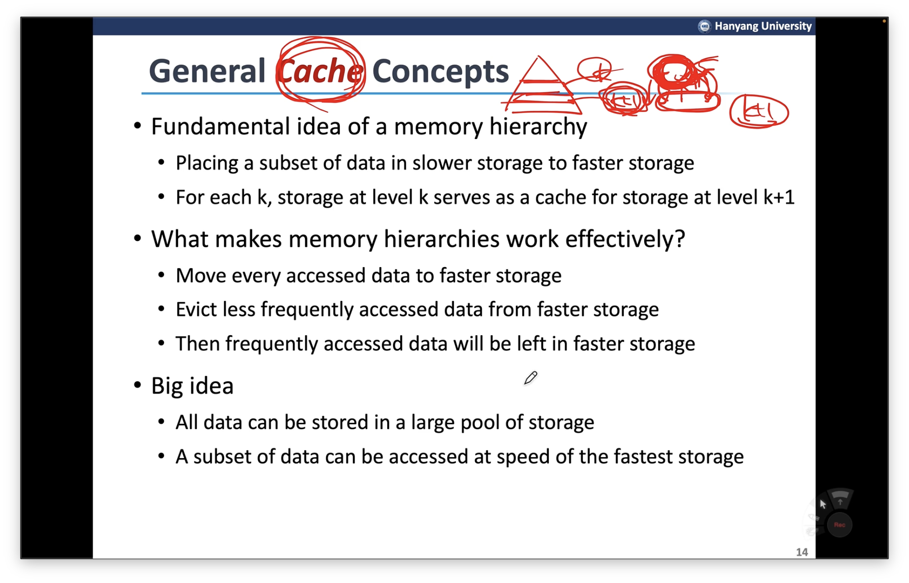

- Locality에 의해 자주 사용되는 data는 작지만 더 빠른 계층에 위치할 것.
- 그럼 이러한 data 들을 어떻게 subset에 저장할 것인가?

  → 매번 어떠한 Data에 접근할 때마다 data를 상위 level로 옮겨두면 된다.

  → k + 1에 있는 data에 접근한다면 k Level로 data를 옮긴다.

- 만약, 상위 Level에 존재하는 공간이 부족하다면 존재하는 Data 중 덜 사용된 data와 교체함.

  → locality가 낮은 data를 교체한다는 소리.

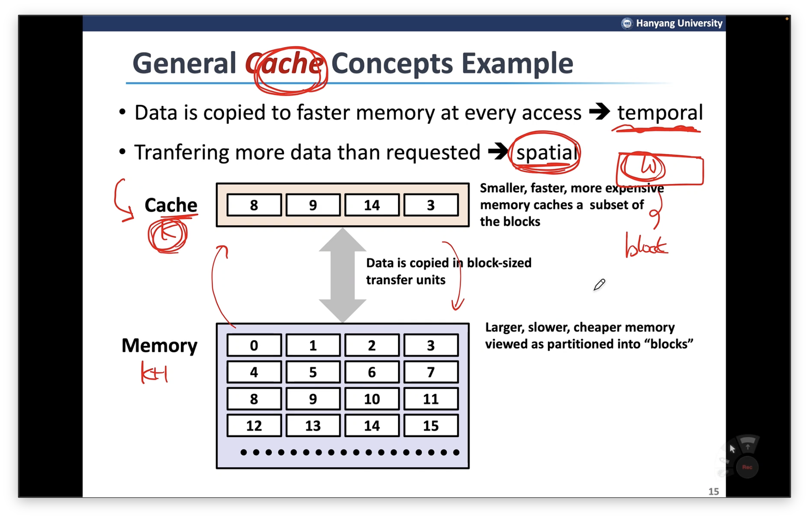

- 예를 들어 8에 접근했다면 temporal locality에 의거해 8이 cahce에 저장되고, spatial locality에 의거해 9 또한 cache에 저장되는 것을 볼 수 있다.
- Cache는 reference(요청)에 따라서 cache memory를 채운다. 또한, Spatial Locality를 만족시키기 위해 요청 사이즈보다 큰 block 단위로 data를 이동시킨다.

#### Cache Hits

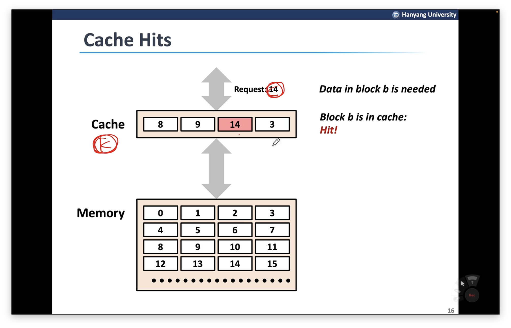

#### Cache Misses

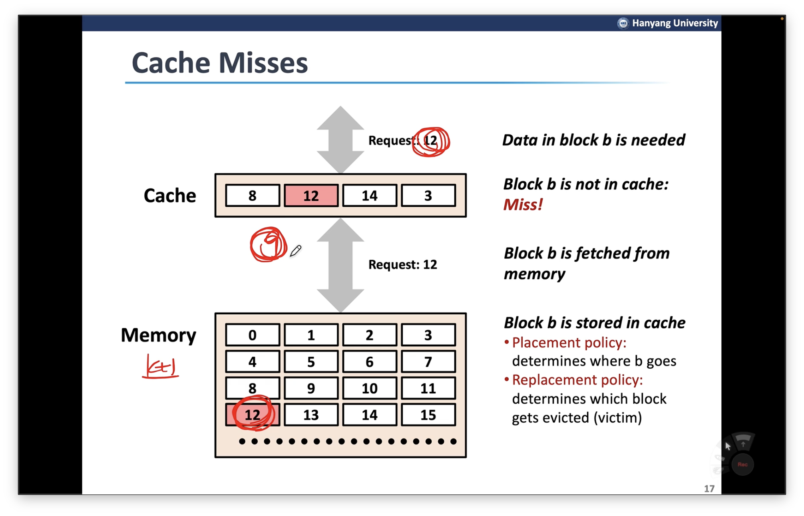

- Cache에 요청한 data가 없는 경우에는 하위 계층으로 내려가 맞는 data를 찾는다.
- 이후 해당 데이터의 temporal locality를 고려해 Cache에 해당 데이터를 저장함.
- Cache Hit이 연달아 발생한다. → 빠른 메모리를 사용하기 때문에 성능이 향상됨.
- Cache Miss가 자주 발생한다. → 느린 메모리로의 접근이 잦기 때문에 성능이 저하됨.

#### Types of Cache Misses

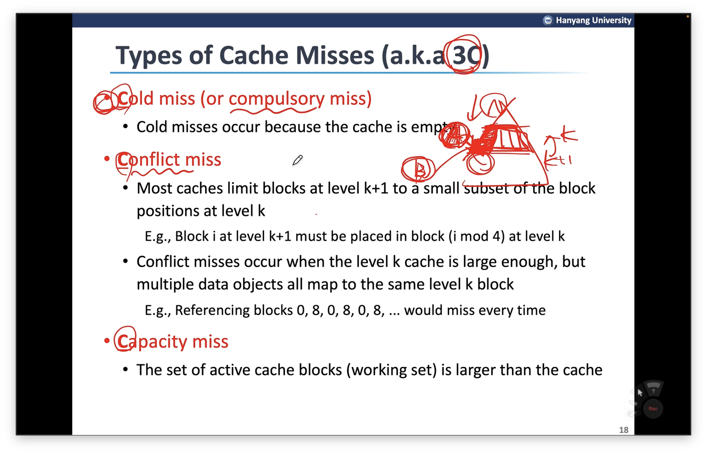

- Cache Miss를 발생시키는 원인들
  1. Cold Miss(Compulsory Miss)

     → 피할 수 없는 Miss임.

     → Cache가 비어있을 때 발생하는 Miss

     → 애초에 Data에 접근이 없는 Program이 막 시작된 시점에는 Cache가 당연히 비어있기 때문에 첫 data의 접근에서 필수적으로 발생함.

  2. Conflict Miss

     → 대부분의 Cache는 Data의 존재 유무를 빨리 파악하기 위해 공간을 Block으로 분할하여 관리한다.

     → 이로 인해 특정 Data들이 같은 Block에 할당되어 있다고 할 때, 매우 작은 공간을 가지고 데이터기리 경쟁하는 상황이 벌어질 수 있음.

     → 이 Data들을 A,B라고 하고 접근이 A B A B 반복적으로 이뤄진다면 반복된 Miss가 발생됨.

  3. Capacity Miss

     → 절대적인 Cache 공간이 모자르기 때문에 발생하는 문제.

     → 일정 시간 내에 작동하는 Cache Block(working set)이 Cache Size보다 작다면 필연적으로 Miss가 발생함.

#### Cache Misses Greatly Affect Performance

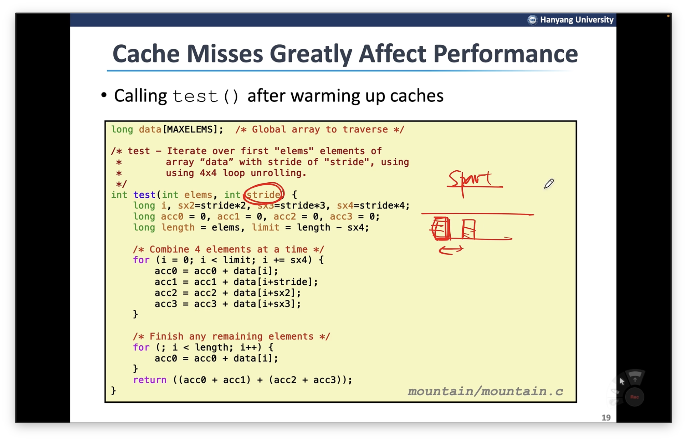

- stride : 배열 데이터 간의 폭을 나타냄 → stride가 커진다 = spatial locality가 떨어진다.

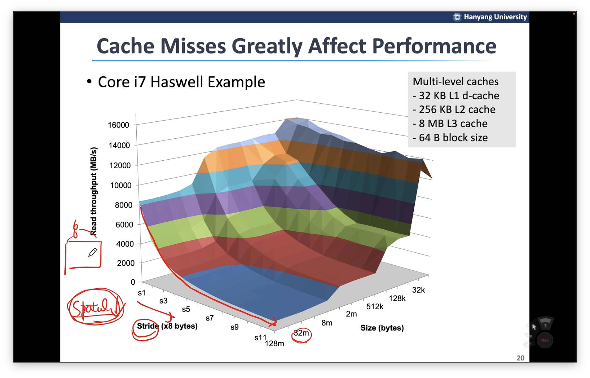

- 같은 Size에 대해 Stride가 커지면 Spatial Locality가 줄어듦에 따라 성능이 줄어드는 것을 볼 수 있다.

#### System Design Related to Cache Misses

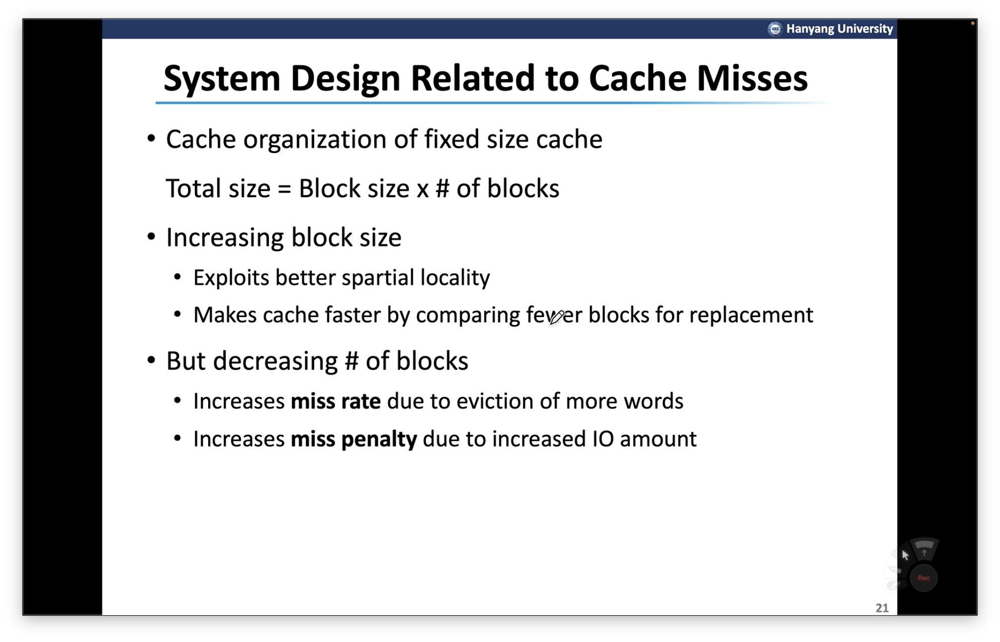

- Cache의 Block 크기가 Cache Miss에 미치는 영향.
- Block Size를 크게 만든다면 Spatial Locality를 더 좋게 할 수 있음.
- 하지만, Block 갯수를 줄인다면 eviction에 대한 후보군의 갯수가 줄어들 수 있음.\
  → 오히려 Miss rate이 증가할 수도 있다.(왜?)\
  → Block Size가 크다면 한번에 많은 양의 data를 올려야 하기 때문에 Miss Penalty가 늘어날 수 있음.

#### System Design Related to Cache Writes

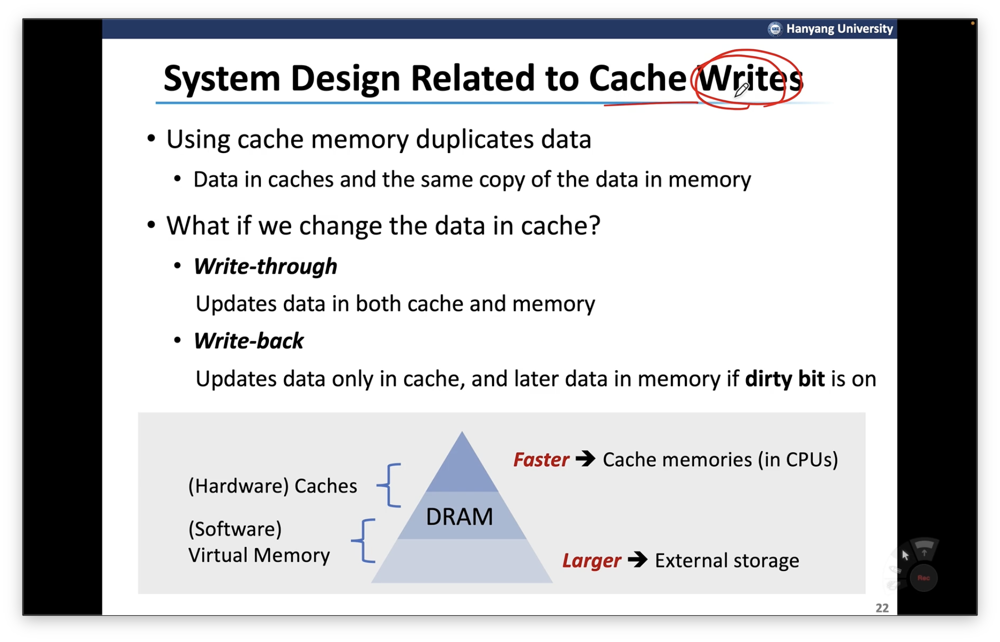

- 여러 계층에 걸쳐서 data가 중복될 수 있다(Main Memory와 Cache에 같은 데이터가 존재할 수 있다.)
- Data가 중복되었을 때 데이터에 대한 Update 일관성을 어느 수준까지 적용해야 하는가?
  1. Write-through : Cache와 Memory에 있는 모든 data를 같이 update
     1. 일관성 유지 가능
     2. 오래 걸림. → Cache를 사용하는 의미가 사라짐.
  2. Write-back : 가장 빠른 메모리에 위치한 data만 업데이트를 한다.
     1. dirty bit을 사용해서 빠른 메모리에서 data가 삭제될 때 하위 memory에 update
     2. 일관성이 보장되지 않음.

#### VM as a Tool for Caching

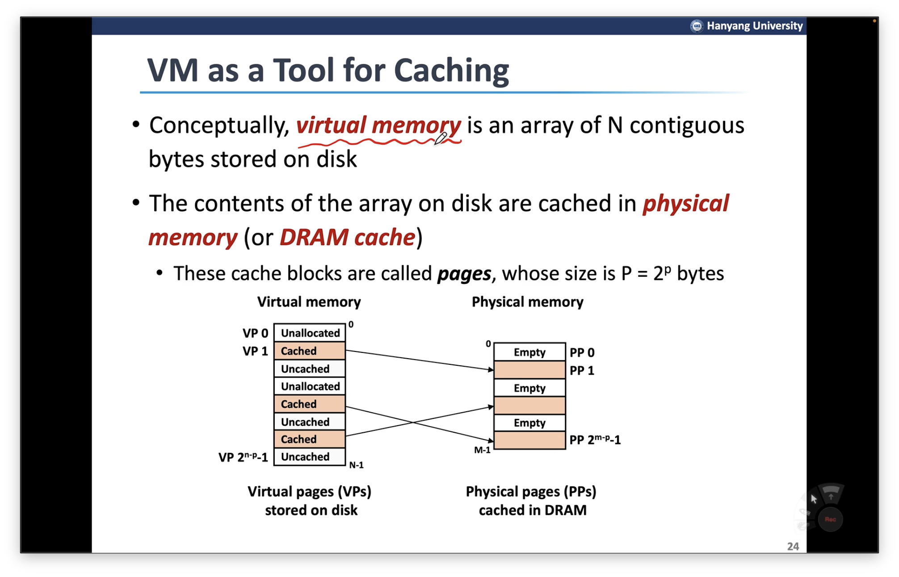

- Processor가 사용하는 VM 전체를 DISK에 저장하게 됨.
- 이 중 일부 Locality가 높은 block들을 Memory에 Caching함.
- Cache의 Block을 VM에서는 Page라고 부름

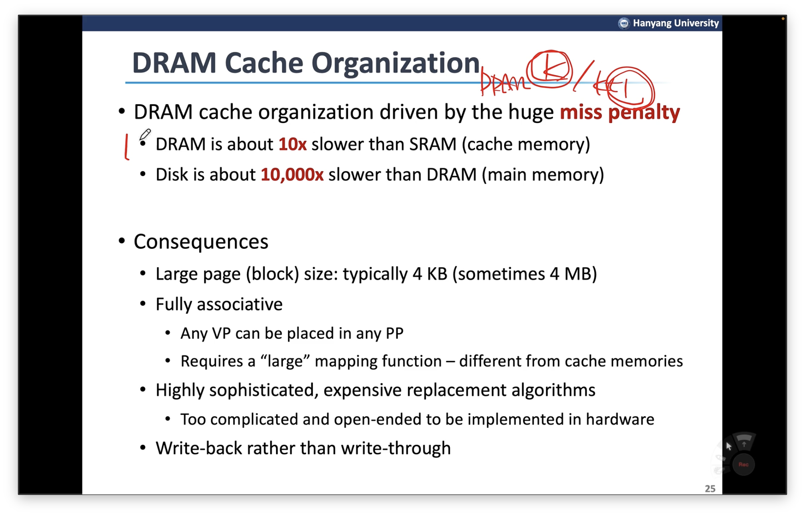

- Cache ↔ Memory 관계 처럼 DRAM ↔ DISK 관계에 대한 내용
- Cache ↔ Memory 관계에 비해 DRAM ↔ DISK는 Miss Penalty가 매우 큼

  → 왜냐면 DISK는 진짜 개쳐느리니까 ㅋㅋ

- 그렇기에 VM은 가능한 Cache Miss를 줄이는 구성을 갖게 됨.
- 즉, Page의 크기가 매우 크다.
- Fully Associative한 구성을 갖게 됨.

  → 작은 Cache Block 내에 어느 곳이든 Page를 이동시킬 수 있게 하여 Miss를 최소화함.

  → 대신 Block화의 장점인 빠른 탐색 속도에 대한 장점은 잃어버리게 됨.

  → Page가 가득 찼을 때 Page를 교체하기 위해 Victim Page를 정하고 해당 Page를 DISK로 내림. → Victim을 잘못 선택하게 된다면 큰 Penalty를 갖게 됨.

- DISK로의 접근 자체는 매우 오래 걸리기 때문에 Write-back이 선호됨.

#### Core Data Structure in Virtual Memory

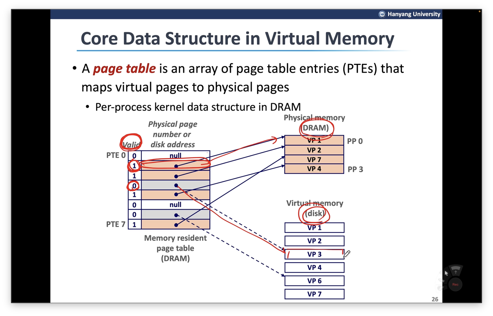

- Page Table을 통해 Virtual Page와 실제 Memory의 Mapping 정보를 표현할 수 있다.
- 하지만, Virtual Memory는 일부는 DRAM에 있고 일부는 DISK에 저장되어 있음.
  - Valid Bit을 통해 구별함
  - Valid BIt이 0이고 Null이 아닌 값을 가지게 된다면 Virtual Memory인 DISK의 주소를 가리키게 됨.

#### Page Hit

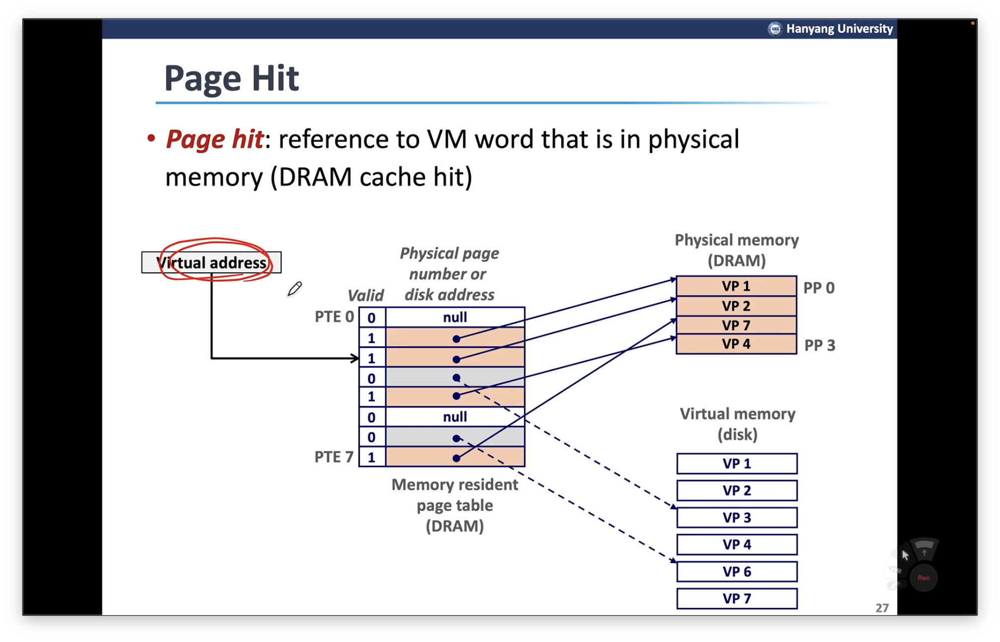

- Virtual Address가 가리키는 Page Table을 보고 어느 Memory에 접근해야 하는지 빠르게 판단할 수 있다.
- Virtual Address를 사용하게 되면 모든 access 마다 Page Table을 거치게 되어 있음. → 그만큼 자주 접근되기 때문에 Main Memory에 항상 Caching이 되어있음.

#### Page Fault

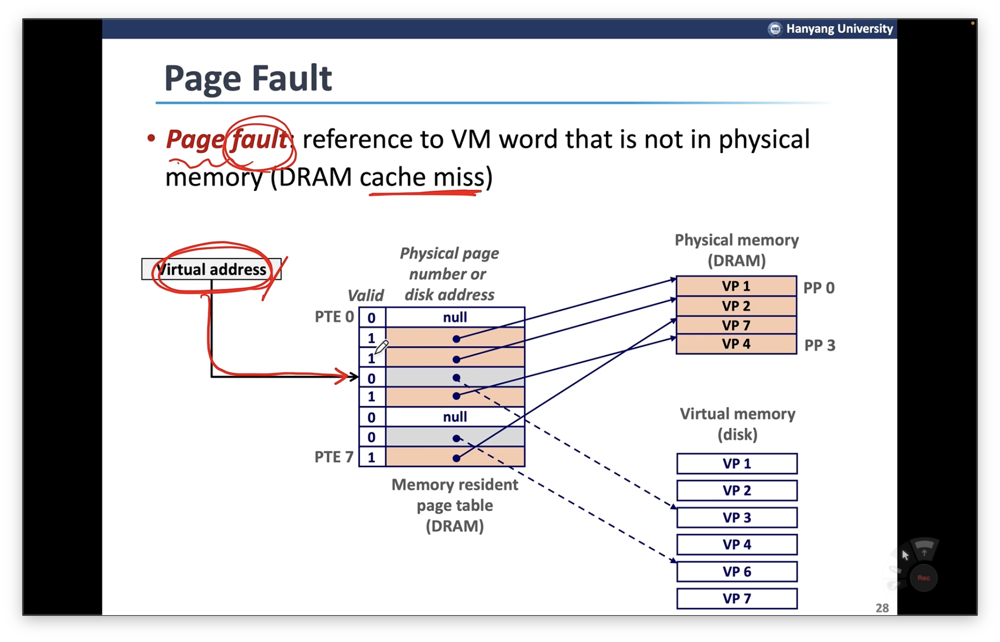

- Page Table에서 Main Memory에 있는 Data를 찾을 수 없는 경우 Page Fault라고 한다.

  → DRAM의 Cache Miss와 같음

- Virtual Address가 가리키는 주소의 Page Table은 Valid bit이 0이고 값이 null이 아니므로 VM인 DISK에 저장되어 있음 → Main Memory에서 바로 접근할 수 없음 → Page Fault

#### Handling Page Fault

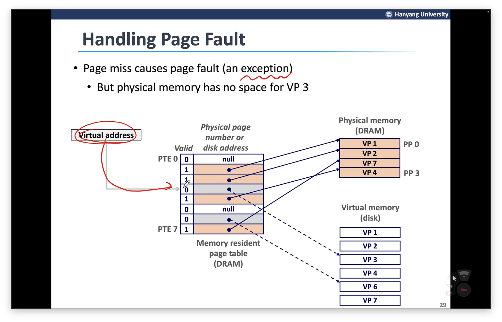

- 더 이상 instruction을 실행 할 수 없기 때문에 Exception이 발동됨.
- 이후 Exception Handler 실행

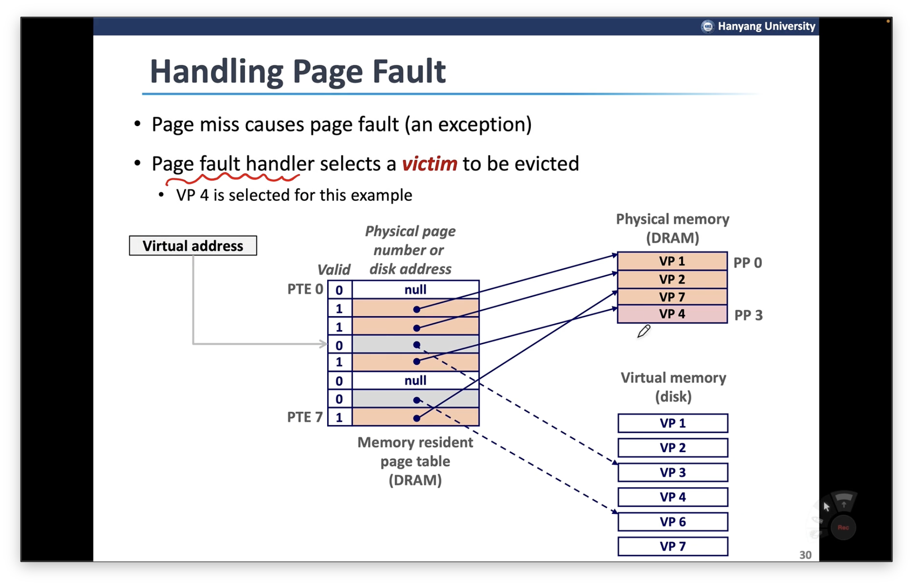

- Handler는 접근하려는 Page를 Main Memory에 준비하기 위해 가득 찬 DRAM 중 Victim Page를 정한다.
- VP 4를 Victim으로 설정했다고 가정.

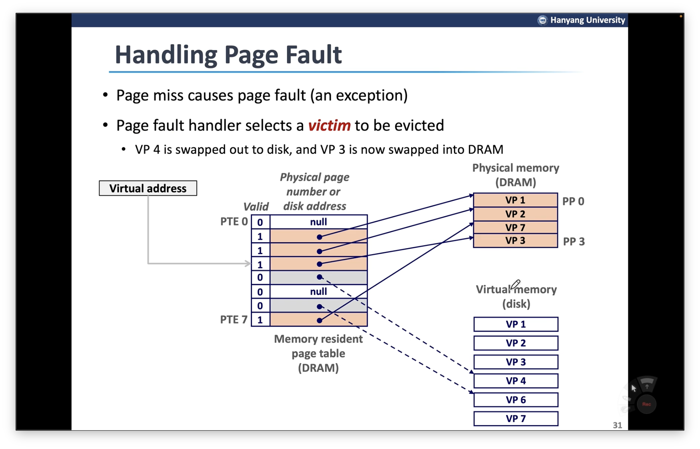

- Victim Page였던 VP 4를 내리고 접근하려던 VP 3를 Main Memory에 Caching
- 이제 handler 종료 하고 instruction 복귀 후 재실행 하면 Page Hit으로 정상 실행 가능.

#### Allocation Pages

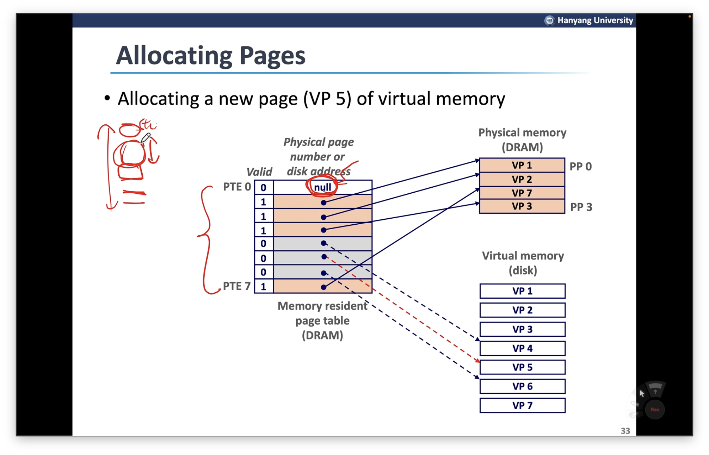

- Page Table에서 Valid bit이 0이고 값이 null이면 비어있는 entry를 뜻함.
- Processor의 가상 영역의 대부분이 비어있음. → VM은 ㅈㄴ 크기 때문
- 그럼 비어 있는 entry에 Page 할당은 어캐됨? → 그냥 VM의 VP 5를 할당했고 매핑 정보를 Page Table에 추가함.

#### Virtual Memory Has Huge Miss Penalty

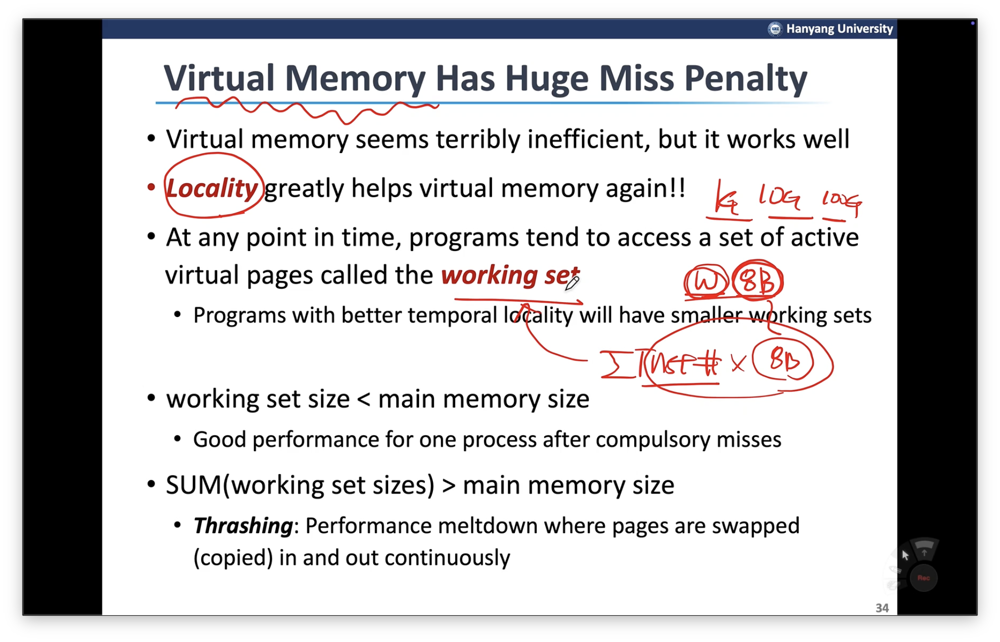

- VM은 실제 환경의 Memory의 크기에 비해 엄청 크지만 잘 작동됨.

  → Locality가 아주 큰 역할을 하고 있음.

- Process가 사용하는 가상 Memory의 크기는 각각 다를 수 있지만 Process의 실행 단위는 모두 instruction임. → Instruction은 word 단위기에 64비트 컴퓨터 기준 8바이트
- VM은 Locality를 잘 활용해야 하며 Locality를 표현할 수 있는 지표로서 Working Set을 확인함.
- Working set : Σ(단위 시간 동안 접근할 수 있는 Inst의 갯수 \* Inst 하나당 크기)
  - Working Set size \< Main Memory size

    → Process에 필요한 모든 Page를 M ain Memory에 옮겨두고 사용할 수 있다.

  - Working Set size > Main Memory size

    → 필요한 Page가 Main Memory에 없을 수 있기 때문에 DISK에서 읽어와야함.

    → 매번 Memory Access마다 Page를 교환하는 작업이 필요하게 됨. ⇒ **Thrasing**

#### VM as a Tool for Memory Management

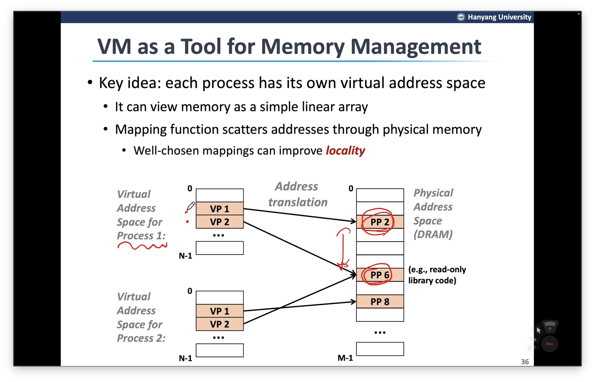

- VM의 핵심은 Page Table임. Process마다 독립적인 Page Table을 관리함으로서 실제로는 연속적이지 않은 메모리의 공간들을 연속적인 것처럼 표현할 수 있게 한다.
- 독립적인 Page Table을 사용하기 때문에 실제 DRAM 상의 같은 메모리(PP 6)를 2개의 Process가 사용하더라도 각 Page Table에서 서로 다른 VM에 각각 매핑됨.\
  → DISK의 같은 Page를 여러 Process가 공유해서 사용할 수 있다는 장점.

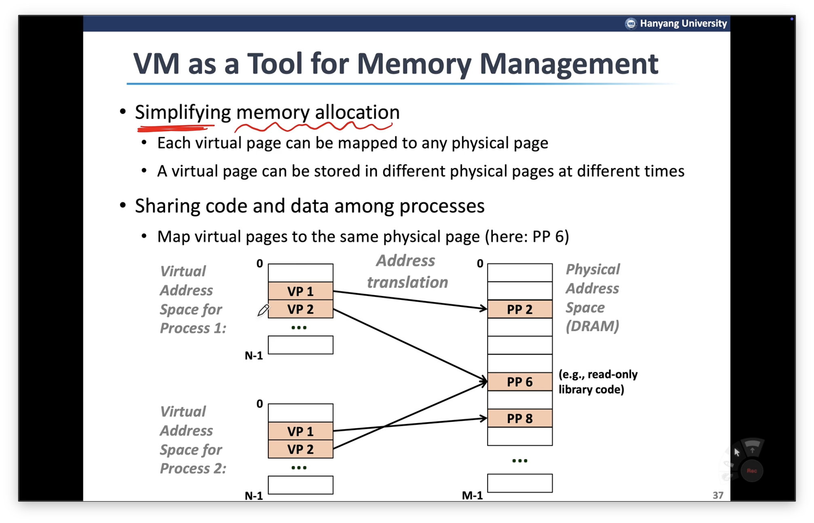

- Memory Allocation이 간단해 짐.

#### Simplifying Linking and Loading

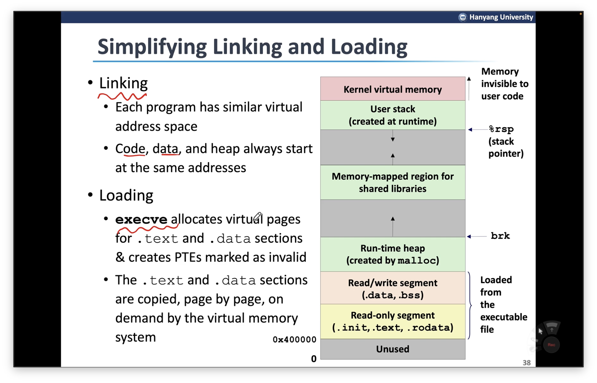

- Linking

  → 어짜피 VM의 Page Table에서 Main Memory로의 Mapping만 수정하기 때문에 Linker의 입장에서는 어떻게 Mapping할건지만 정하면 됨.

- Loading

  → Loader가 실행 파일 내에 ??? → 뭐라노..Loader 공부하고 돌아오면서 다시 보자

#### VM as a Tool for Memory Protection

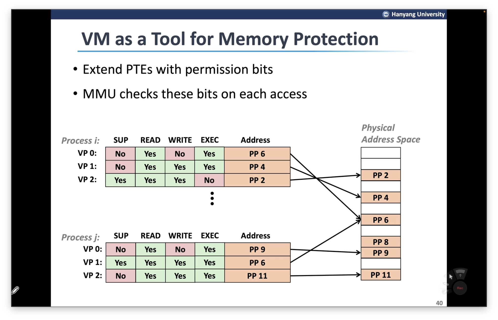

- SUP(Supervisor) : 하나의 Process 내에서는 Kernel Code가 있음. 이 Kernel Code는 OS를 통해(System Call)을 통해서만 실행이 되어야 함. 즉, User Code에서 막 접근하면 안되기 때문에 보호를 위해 사용되는 권한임.
- Page Table의 Entry의 접근은 모두 MMU를 통해서만 가능함.

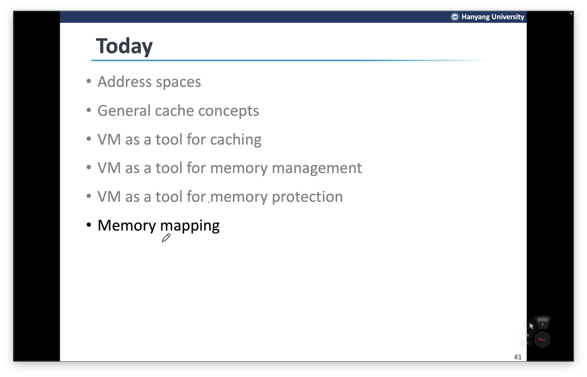

- Mapping → 가상 Memory와 저장 장치 내부의 File과의 Mapping을 의미함.

#### Memory Mapping

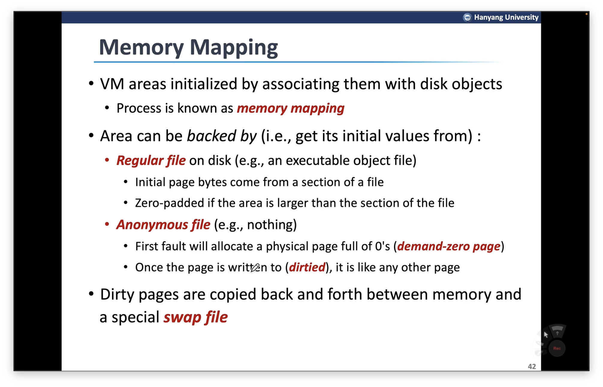

- 저장 장치 내의 연속적이지 않는 공간을 File Abstraction을 통해 연속적으로 나타낼 수 있었음.
- Process의 Memory 또한 Page Table이라는 Abstraction을 통해 연속적으로 보이게끔 만들었음.
- Process의 메모리 영역 중 .text 혹은 .data Section은 Regular File이라고 하는 실행 파일을 지정할 수 있음.
- .bss, .stack , .heap과 같은 Section들은 실행 File과 무관하지만 Program 실행 중 메모리 할당을 통해 Page가 추가될 수 있다. → 추가되는 Page에 대해서는 Anonymous file을 통해 관리 할 수 있음.

  - 새로운 Page의 추가는 Fault가 발생할 수 있음.

  - 새롭게 추가된 Page는 dirtied 상태로 바뀌고 이게 swap file과 연결되어 있다는데 이해가 안됨 ㅇ.ㅇ..;

#### Sharing Revisited : Shared Objects

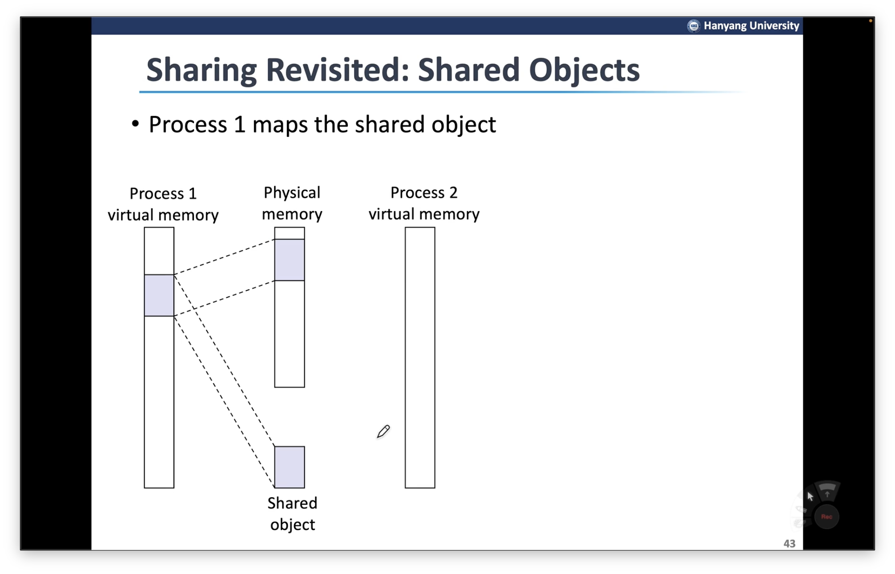

- Process1이 Shared Object를 load 해서 사용하고 있음.
- Load 하면 해당 Library 함수를 가지고 있는 Shared Object File을 Process의 Virtual Memory 상에 Mapping 할 수 있음.
- Mapping 된 정보는 Page Table을 통해 실제 메모리에 나타나져있음.

#### Sharing Revisited : Shared Objects

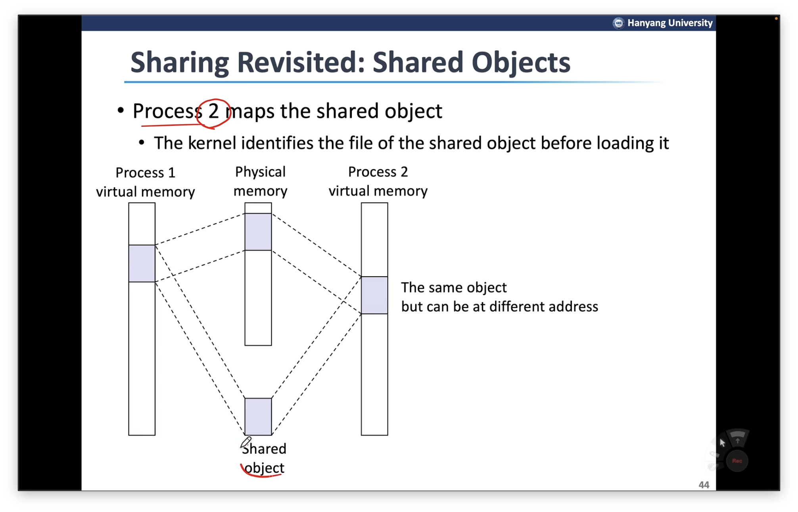

- Process 2가 Process 1과 동일한 Shared Object를 load 한다고 치자.
- File Load는 OS를 통해 Load 됨. OS는 P2의 VM에 load 하기 전 같은 이름의 File이 이미 Load가 되어 있는지 확인
- 이전 P1에 load한 이력이 있기 때문에 Page Table을 확인하여 물리 Page의 위치를 추적하여 해당 정보를 P2의 page table에 저장.

#### Sharing Revisited : Private COW Objects

→ COW : Copy-on-Write\
  → Write에 맞춰 복사가 일어난다.

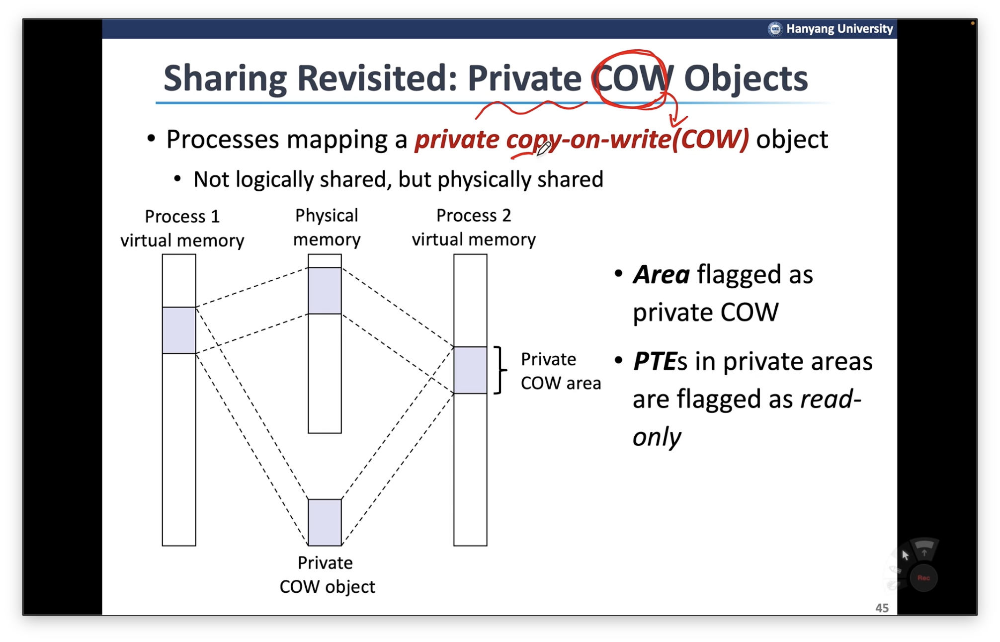

- 아까 Shared와 다르게 각각의 Process는 Object를 공유하지 않고 본인만의 공간에 Load 하고 싶어함.
- 해당 File을 2번 load 하면 된다. → 근데 이러면 효율이 너무 떨어지잖아
- OS는 일단 P.O에 대해 공유를 시켜둠.
- P.O에 대해서 수정된 부분이 생긴다면 차별점을 둠(다음 슬라이드)

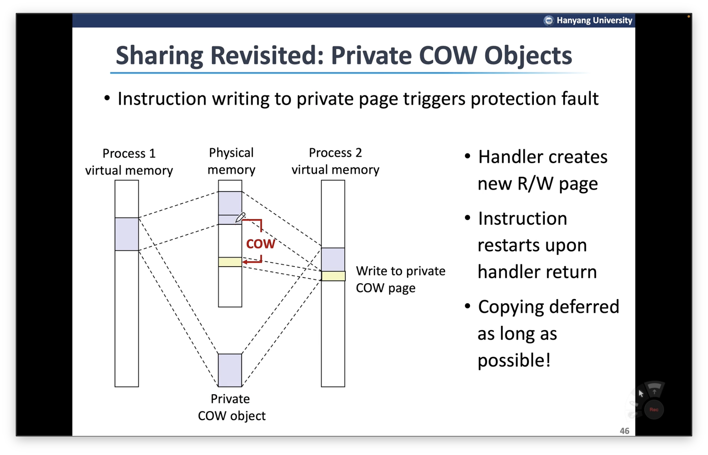

- Write가 생긴 부분에 대해서만 새로운 Page를 만들고 해당 부분을 새로 만든 Page를 가리키도록 수정한다.

#### The fork() Revisited

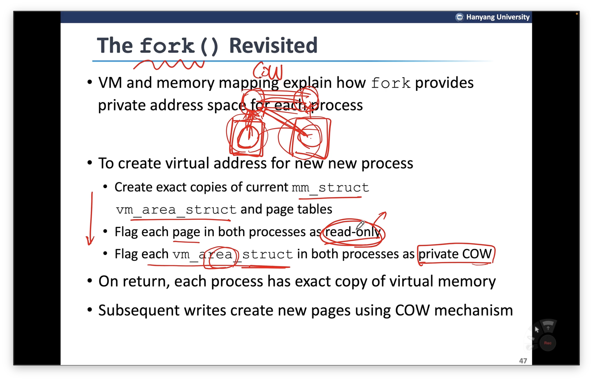

- fork()는 부모 ↔ 자식을 복사하는 call임.
- 이때 부모 process의 모든 page를 하나하나 전부 복사한다면 overhead가 커질 수 있음.
- 이때 Copy Overhead를 줄이기 위해 그냥 memory를 공유하도록 하면 됨.
- 하지만, 부모와 자식 Process는 memory가 독립적이어야 하기 때문에 COW 방법을 활용함.

#### The execve() Revisited

→ Memory mapping을 활용하여 loader의 부담을 줄일 수 있음

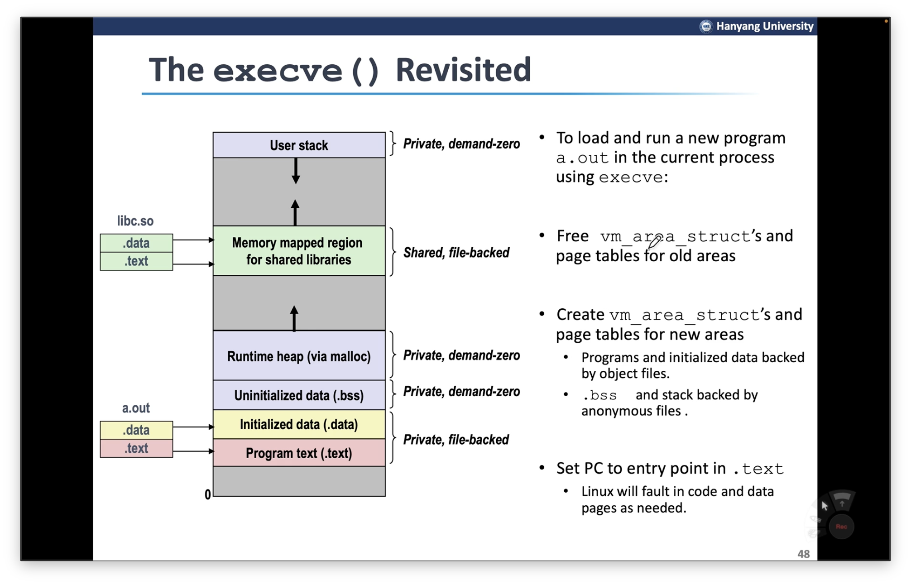

- exec()을 실행하면 현재 Process에 새로운 Process를 입히고 main process부터 다시 시작함.
- 이 과정에서 이전에 실행하고 있던 Memory 영역과 관련된 내용은 해제됨.
- 새로운 Program에 대해 새로운 area를 정확히 구성해주는 것은 번거로울 수 있음.

#### User-Level Memory Mapping

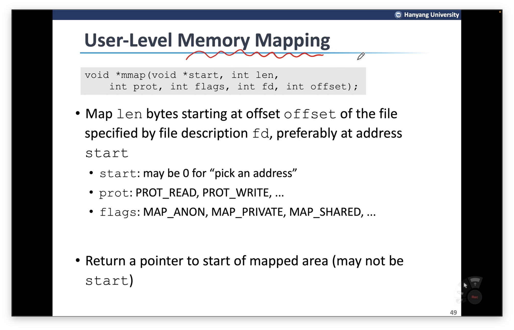

- Memory Mapping을 활용하면 File에 대한 입출력에 대해 입출력 함수를 이용하지 않고도 File의 Data를 읽거나 쓸 수 있다.
- 뭐라노 진짜..

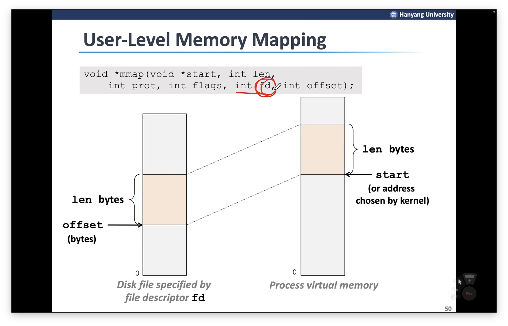

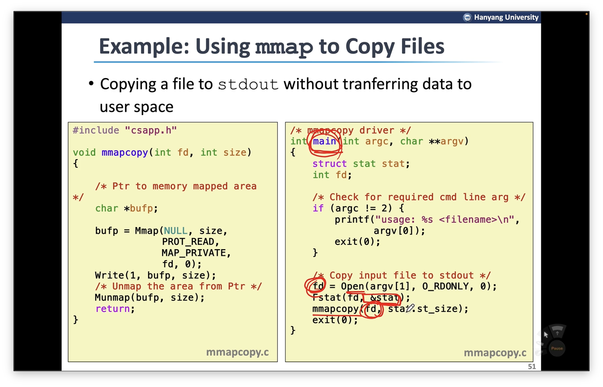

