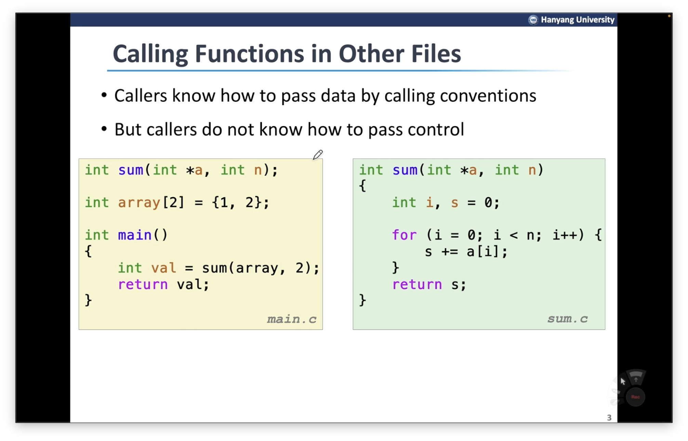

- machine-level에서 calling convetinon을 통해 함수 내부 구현을 몰라도 호출할 수 있음을 배웠다.
- 함수의 주소를 알면 register convention을 통해서 별 문제 없이 호출할 수 있다.
- 이때 함수의 주소는 어떻게 결정할 수 있는 것인가?

#### Static Linking

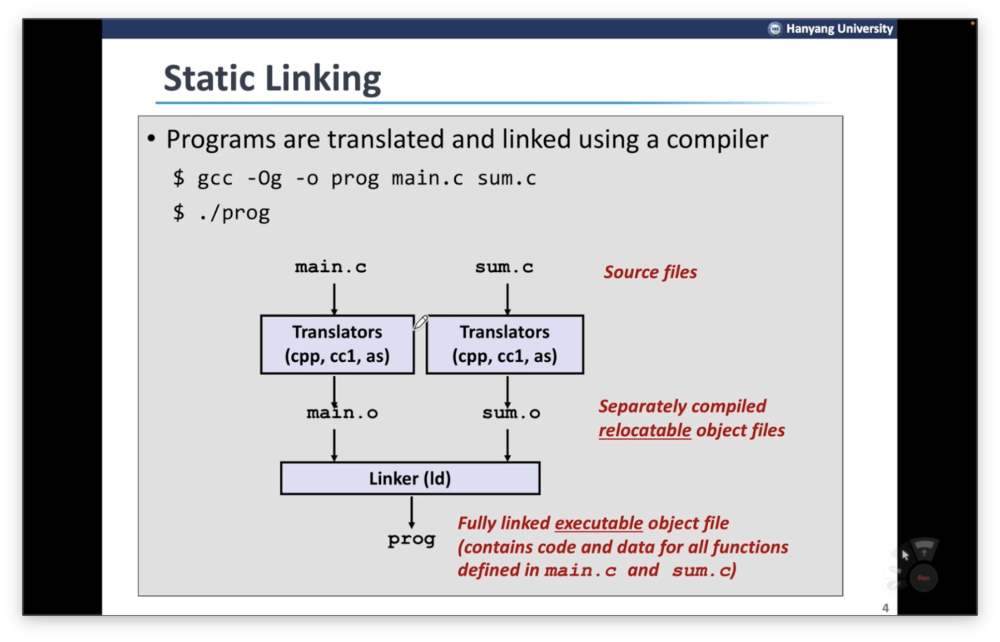

- 함수의 주소는 build 과정에서 결정됨.
- compile 과정에서 각각의 source 파일들에 대한 각각의 object file들이 생성됨.
- 이 각각의 object file들을 linker가 linking 과정에서 link 하여 program을 실행함.

#### Why Linkers?

1. Modularity(재사용성)

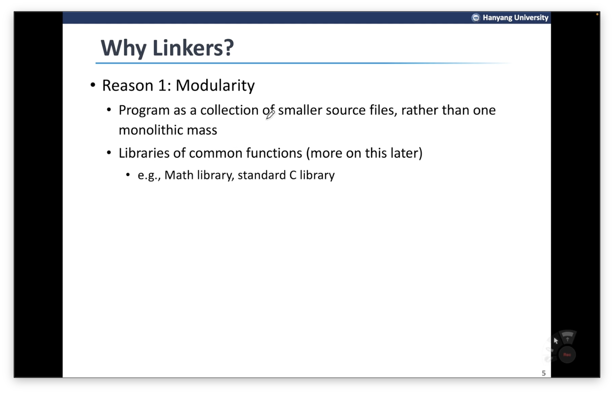

- 2개의 source 코드에서 같은 함수를 사용한다면 하나의 소스코드에 정의하고 다른 소스코드는 정의된 소스코드에서 가져와서 실행하는 방법을 사용할 수 있음.

2. Efficiency(효율성)

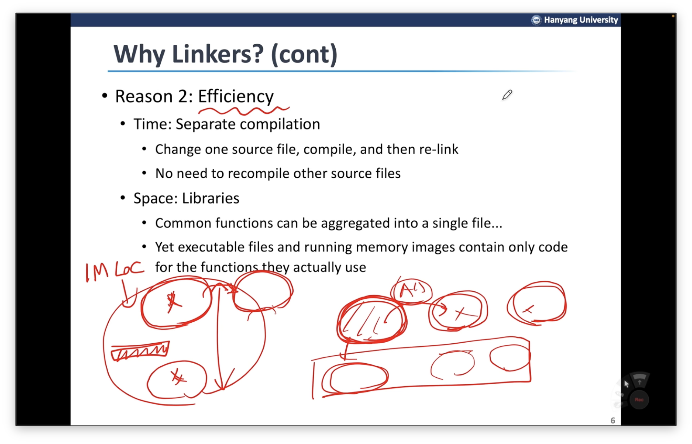

- 용량이 큰 소스 파일 중 일부분을 수정할 때 source file이 여러 개라면 수정한 코드가 담겨있는 source file만 다시 compile 하면 됨.

→ 이러한 장점들이 있지만 이 과정에서는 문제가 있다.

- source file에서 호출하는 함수의 주소는 전체 source file이 모여있을 때 결정됨.
- 하지만 source file들을 개별 compile 하는 경우는 호출하는 함수의 주소를 특정할 수 없다.
- 때문에 함수의 주소를 저장하는 부분을 비워두고 marking 해둔다.

#### What Do Linkers DO?

1. 각 source file 별로 선언되어 있는 Symbol들이 뭔지 파악함

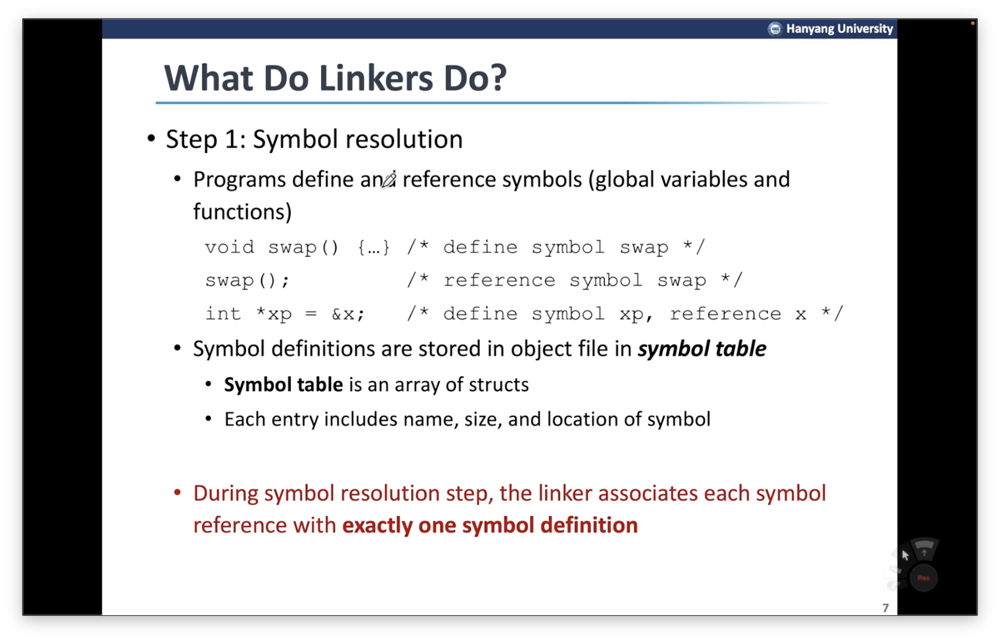

- 각 source file, object file 별로 선언되어 있는 Symbol들이 뭔지 파악하는 것.
- 이 Symbol들은 compiler가 Symbol Table이라는 공간에 symbol의 정의를 저장해두기 때문에 linker는 이 Symbol Table에 접근하여 Symbol을 파악함.
- `하나의 Symbol은 정확히 하나의 정의만 존재해야함.`

2. 결정되지 않은 함수의 주소를 할당함.

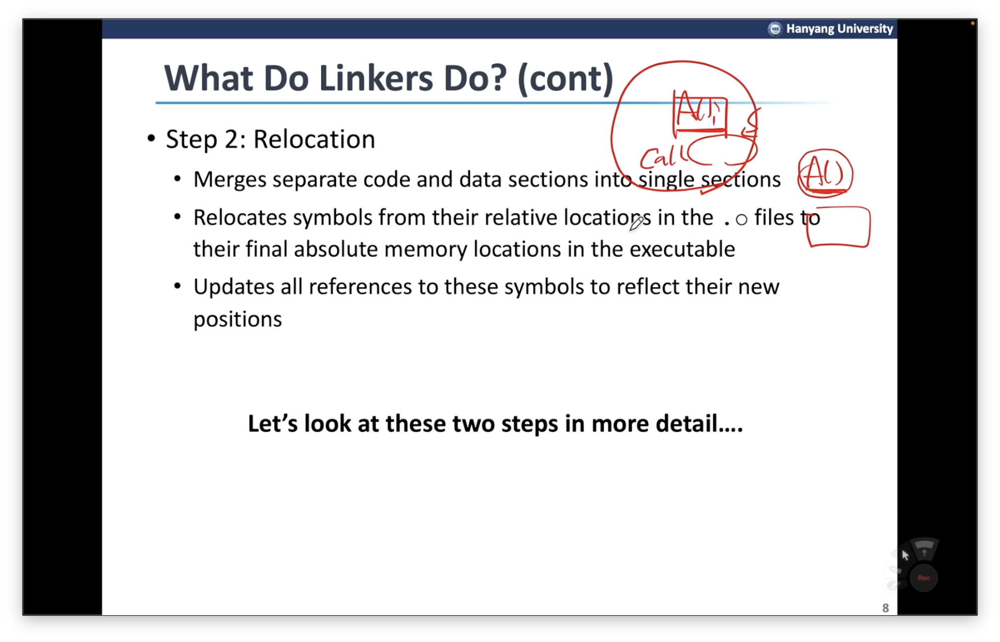

- compiler가 marking 해둔 함수의 주소를 할당해야 하는 부분에 대해서 linker는 함수의 주소를 저장해줌.

#### Three Kinds of Object Files

→ object file : machine code로 구성되어 있는 파일들

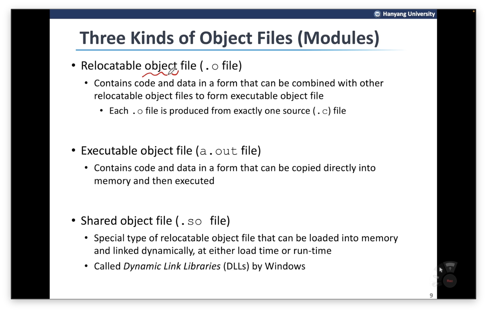

- Relocatable object file : Link 전 아직 실행이 불가능한 file
- Executable object file : 실행 가능한 file
- Shared object file

#### Executable and Linkable Format(ELF)

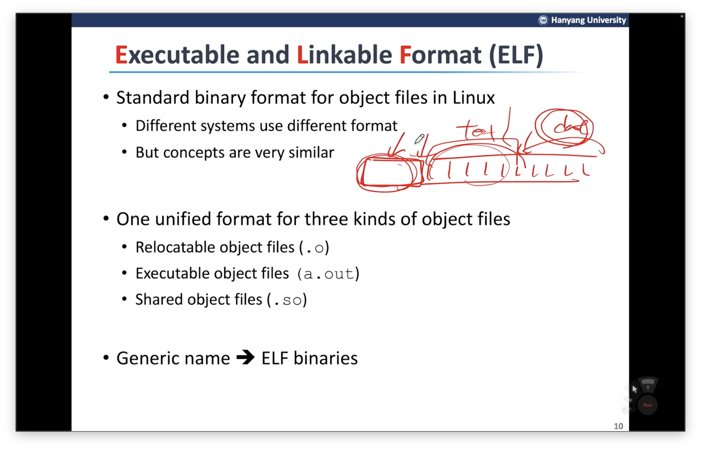

- file의 header에는 file의 text 범위와 data 범위가 적혀있음.
- Linkable : Linking 전의 file, relocatable과 관련됨, input
- Executable : Linker 작업 후의 file, output
- 즉, ELF는 input과 output의 format에 대한 것.
- 근데 input과 output의 format이 같다고? → 같은 format이라면 linker 입장에서 input file을 읽고 전체를 새로 써서 output을 만드는게 아닌 일부분을 수정해서 만들 수 있기 때문에 효율적

#### ELF Object File Format

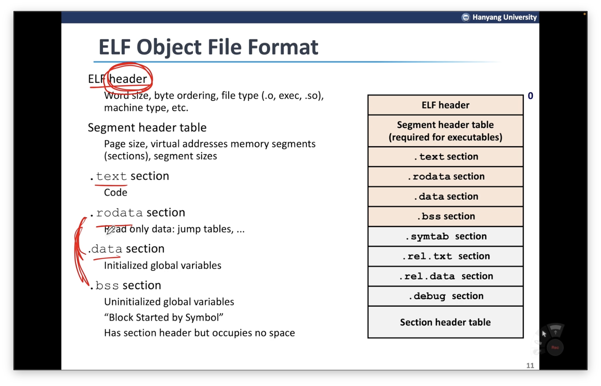

- headr : format 내의 정의되어 있는 section 시작, 크기 정보를 찾을 수 있음.

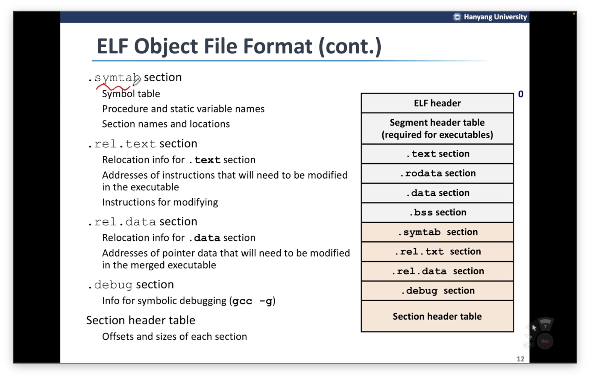

- symtab section : text 또는 data section의 연속된 공간에 있는 정보들이 각각 text 또는 data section 중 어디에 위치해 있는 지를 저장하는 section
- .rel.\~\~ section : relocatable에 대한 정보들이 저장되어 있는 section

  → relocation section 들은 일반 section의 시작 위치, 어떤 symbol을 사용하는 지 등을 저장해둔다.

  → Linker는 전체를 보지 않고 relocation section만 보더라도 어떤 것들을 수정해야하는 지 쉽게 알 수 있다.

- Section header table : 각각의 section 정보가 어디에 있는지 등을 한번에 확인할 수 있다.
- 이 페이지 뭐라는지 모르겠음 말 ㅈㄴ 어버버함 → 나중에 공부할 때 덱스형한테 물어보자

#### Linker Symbols

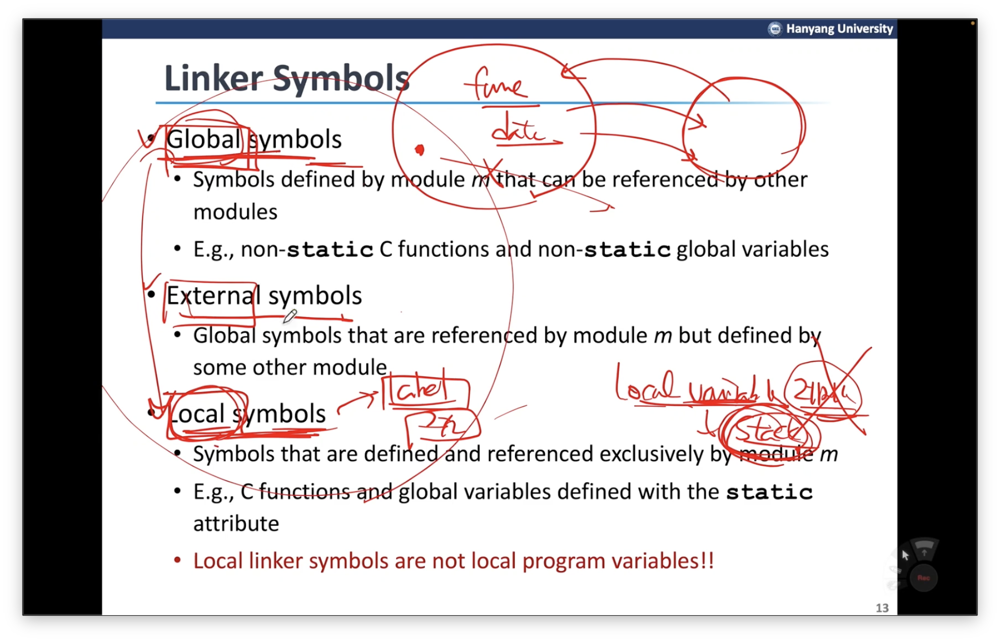

- Global Symbol : 하나의 source file 내에서 선언하고 있는 함수 또는 data
- External Symbol : 다른 곳에서 선언되어 있는 함수 또는 data를 가져오는 것.
- Local Symbol : 하나의 source file 내에서만 사용되는 함수 또는 data. → static 속성.
- *주의 : Global ↔ Local Symbol은 전역변수 지역변수 관계랑 관련이 없음*
- 관련 설명 더 나오는데 진짜 설명을 드럽게 못함. → 덱스형한테 물어보자 ㅇㅇ.

### Step 1 : Symbol Resolution

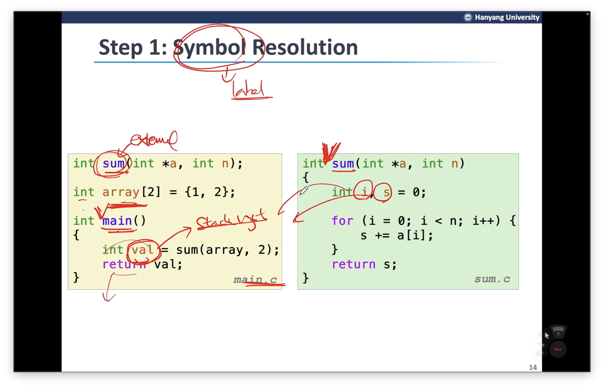

- main.c
  - sum → sum.c에 정의된 것을 사용하기 때문에 external symbol
  - array → main.c에서만 사용되고 있지만 static이 아니기 때문에 Global Symbol
  - 이외 main 내부의 지역변수들은 stack과 Reg에 저장되기 때문에 symbo이 아님.

#### Local Symbols

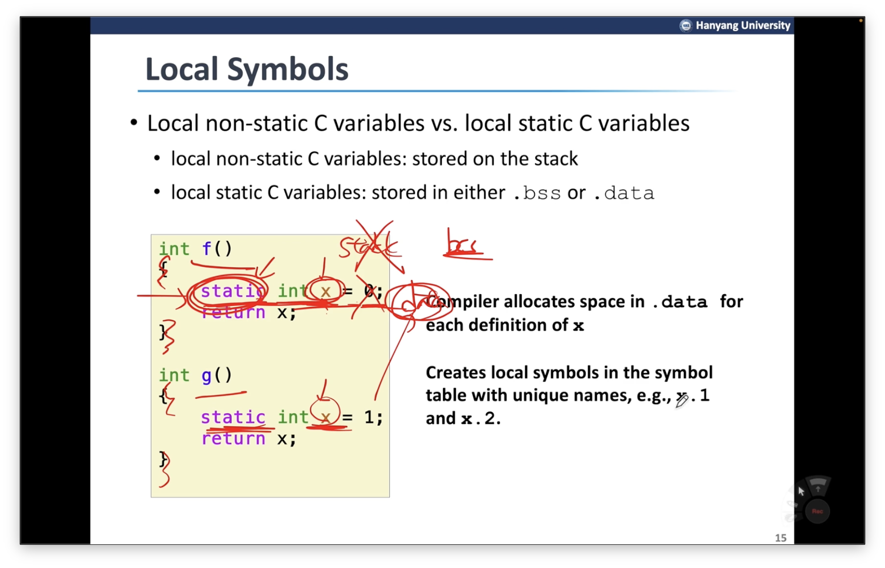

- 위 슬라이드처럼 local 변수는 대부분 symbol로 처리되지 않음.
- 다만 static으로 선언된 local 변수는 symbol로 처리되어서 compiler가 symbol table에 저장
- 이후 .bss 혹은 .data section에 저장됨.
- f()의 x와 g()의 x는 다른 symbol로서 저장되어야함. → data section 내에 다른 주소로 표현되어야함. → compiler는 이 2가지 변수에 대해서 다른 symbol을 부여함.

#### Duplicate Symbol Definitions

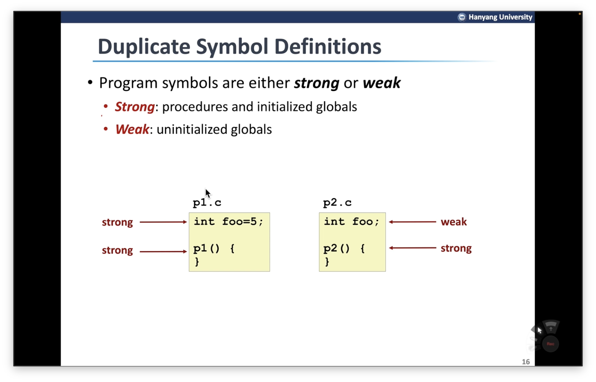

- Symbol은 크게 strong, weak으로 나뉨
- Strong : 함수 혹은 초기화된 전역 변수 → data section에 들어감.
- Weak : 초기화되지 않은 전역 변수 → bss section에 들어감.

#### Linker’s Symbol Rules

→ Linker가 Symbol의 정상 유무를 확인하는 규칙

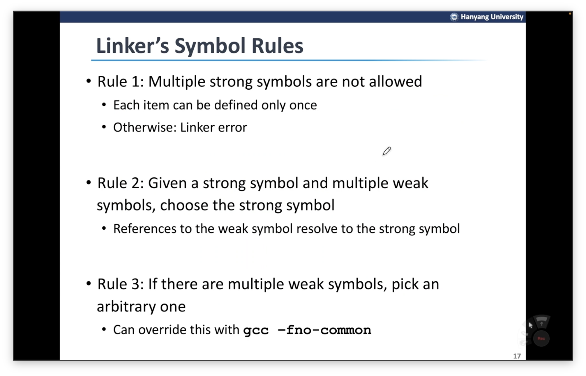

1. 여러 개의 Strong Symbol이 있으면 안됨.

   → 같은 Symbol 명들 사이에 Strong은 하나여야 함. = 변수 및 함수의 정의는 한번만.

2. 하나의 Strong Symbol, 여러 개의 Weak Symbol

   → 여러 Weak Symbol을 Strong으로 대체해서 사용.

3. Strong은 없고, 여러 개의 Weak Symbol이 있는 경우

   → Weak 중 임의의 하나를 정해서 그 Symbol을 기준으로 주소를 저장.

#### Puzzle

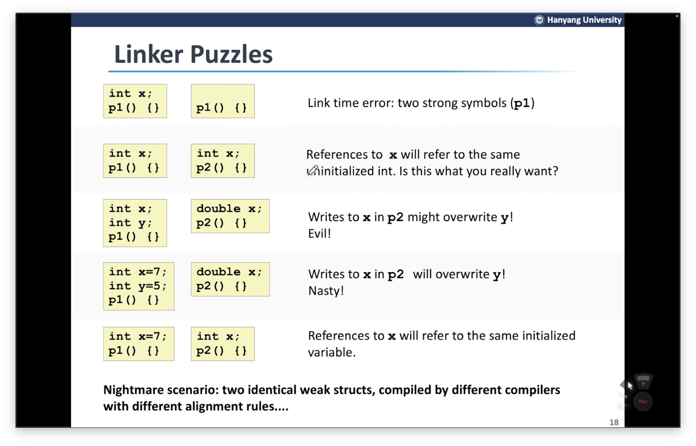

#### Global Variables

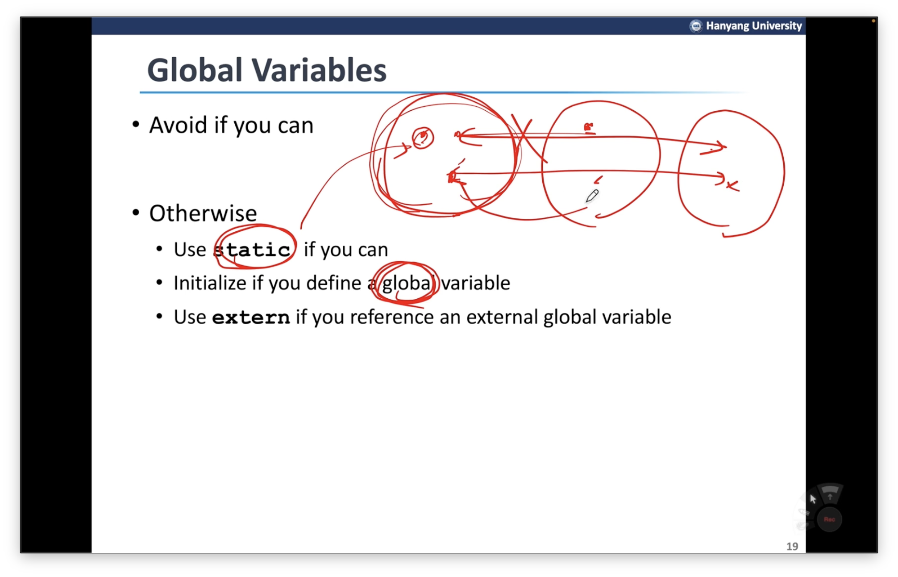

- 전역 변수는 가능한 지양.
- 굳이 함수 밖에서 변수를 사용하고 싶다면 전역변수 말고 static으로 선언해서 Local Symbol로 사용하는 것이 더 좋음
- 만약 여러 Source file에서 사용하고 싶다면 하나의 source file에서 Global Symbol로 선언 후 External로 활용할 수도 있음. → `extern` 키워드를 활용

### Step 2 : Relocation

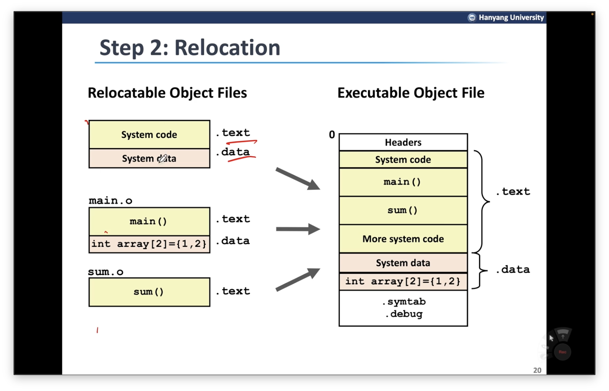

#### Relocation Entries

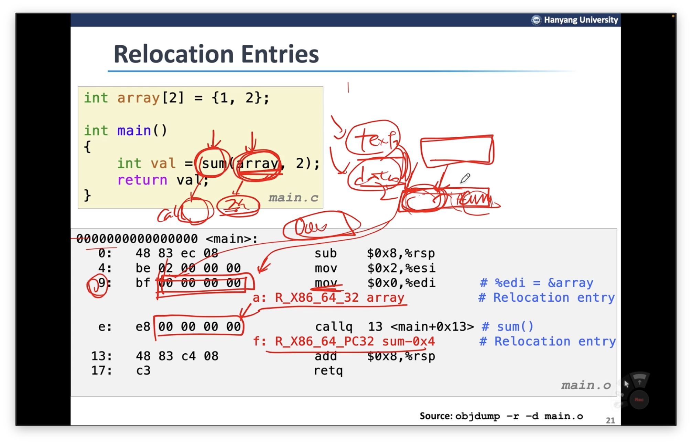

- compile러 후 binary 표현에서 어떤 부분이 주소 할당을 원하는 것인지 혹은 어떤 주소가 어느 위치에 어느 크기로 들어가는지에 대해서는 어떻게 알 수 있을까?
- 수정될 byte에 대해서 어딘가에 marking 해둠 → reloaction entry
- Relocation의 정보는 text와 data를 나눠서 저장함.

  → 나눠 저장하는 이유 이거 얼버무려서 나중에 덱스형이랑 ㄱ

  → data section에는 수정해야 하는 공간의 시작, 끝 위치, 사용될 label 정보가 저장됨.

#### Relocated .text section

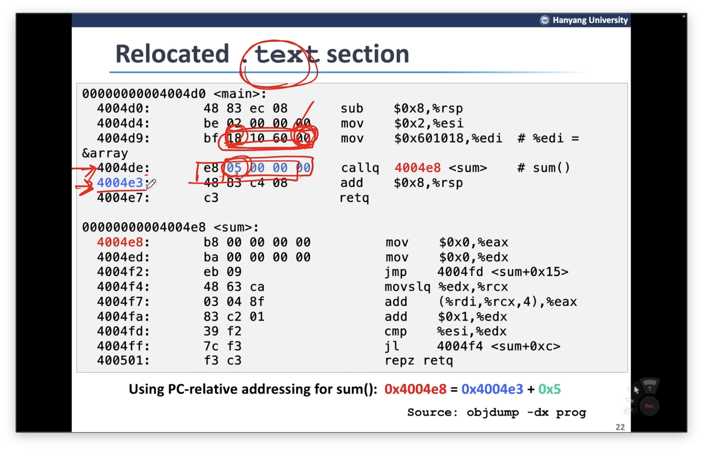

- call함수 기준으로 파란색 글씨의 05 00 00 00는 little endian으로 표현된 pc 기준 offset을 나타냄.
- 실행 기준 pc는 다음 주소인 4004e3을 가리킬테니 offset 계산 결과는 4004e8
- call에 대한 실제 주소는 4004e8이라고 생각하면 됨.

#### Loading Executable Object Files

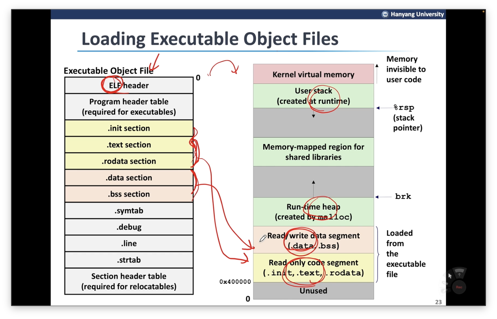

#### Packaging Commonly Used Functions

→ library에 대한 내용

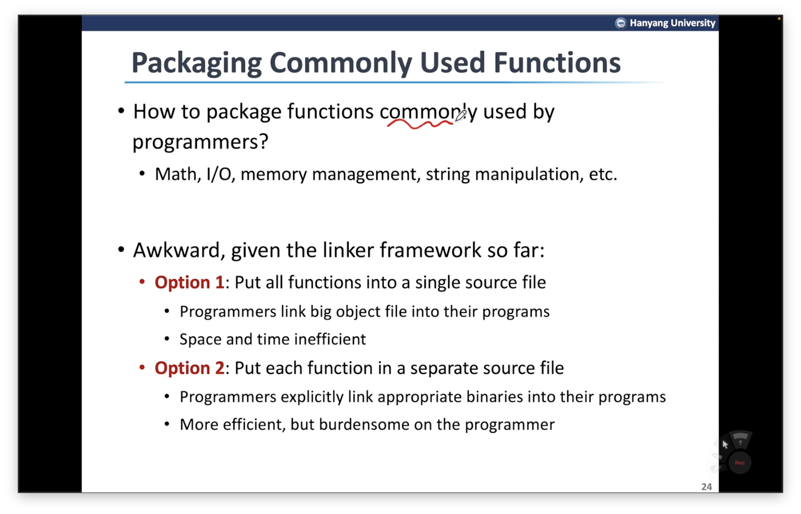

- printf, scanf와 같은 함수를 매번 정의하지 않아도 사용할 수 있다. → 실행할 instruction들이 내가 실행할 실행 파일 내에 복사가 이뤄졌다는 것.
- library 함수를 저장하고 있는 source file이 존재함.

방법 1 : 모든 함수를 object file 하나에 모아서 이 파일을 build에 사용.

→ 시간과 공간의 효율성이 떨어짐.

방법 2 : 사용할 함수를 각각 개별 object file로 생성 후 실행할 file만 모아서 필요한 object file만 build에 활용

→ 시간과 완성된 실행 파일의 크기를 줄일 수 있음.

→ 하지만 프로그래머가 신경 써야하는 부분이 많음.

#### Sttic libraries

→ 사용하는 함수에 대해서만 선택적으로 실행 file에 추가할 수 있는 방법

→ 앞선 2가지 방법의 절충안

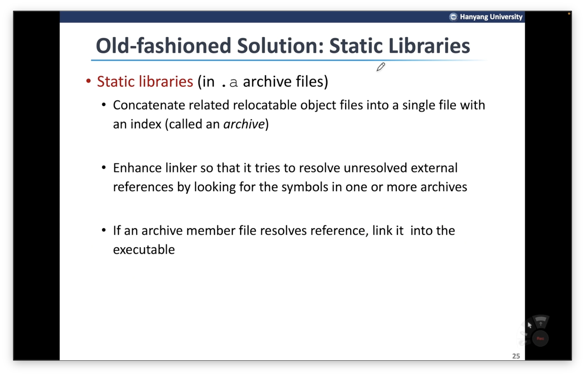

- build에 사용되는 file list에는 일정한 file list를 사용
- 프로그래머가 만든 source file들에 library라고 하는 object file을 모아놓은 묶음 file을 제공
- linker는 source file 검토 후 추가적으로 필요한 함수 혹은 사용한 함수 중 정의되지 않은 함수에 대해서 library에서 찾은 후 필요한 부분만 실행 file에 선택적으로 활용.

→ 프로그래머가 신경 쓰지 않고 linker가 자동으로 처리하기 때문에 이전 방법 2의 단점이 줄어듦.

- 왜 Static 일까?

  → library 함수에 대해서 미리 정해진 위치에 메모리를 지정하고 그 공간에 library 함수를 복사해서 정적이라고 부름.

#### Creating Static Libraries

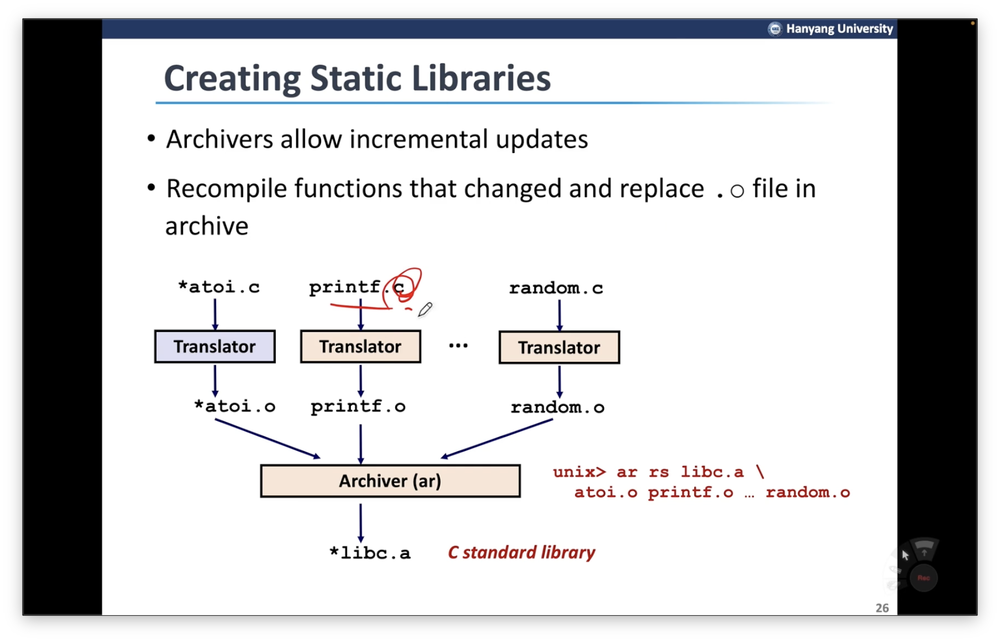

- 여러 함수에 대한 object file들을 Archiver를 활용하여 하나의 파일로 묶어둠.
- library file명은 앞에 반드시 ‘lib’이라고 하는 키워드가 있어야함.

#### Commonly Used Libraries

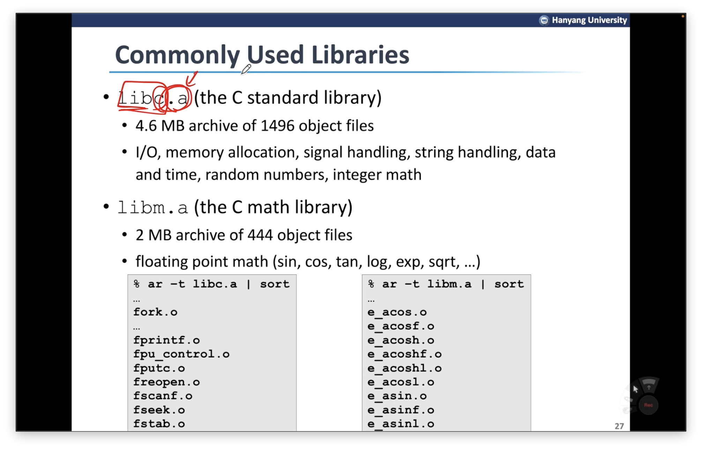

- 확장자
  - .a : library
  - .so : shared library

#### Linking with Static Libraries

→ 실제 library 함수를 생성하는 예시

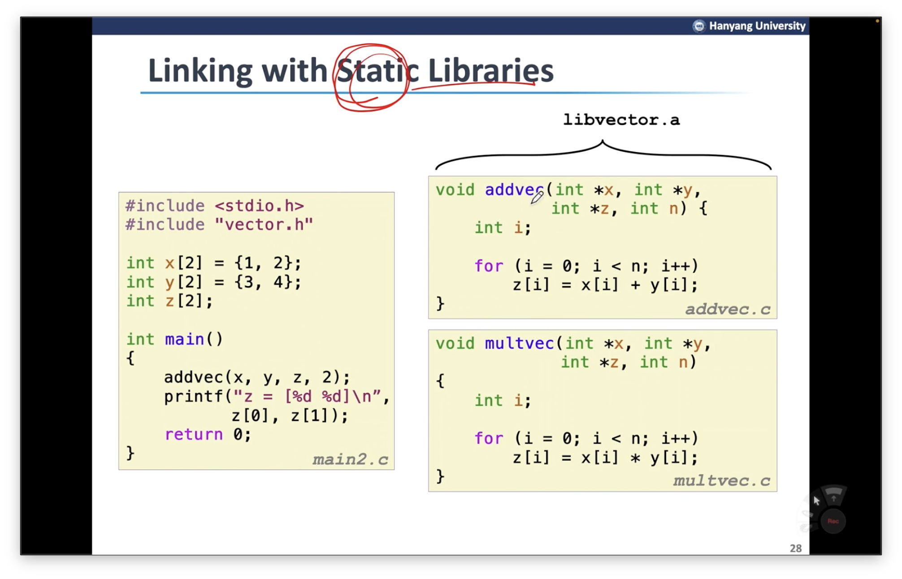

- 우측의 라이브러리에 대한 함수를 여러 source 파일로 구분한 이유

  → 하나의 함수를 수정했을 때 수정한 부분만 새로 compile하기 위함.

  → 변경되지 않은 포션에 대한 재 compile을 막음.

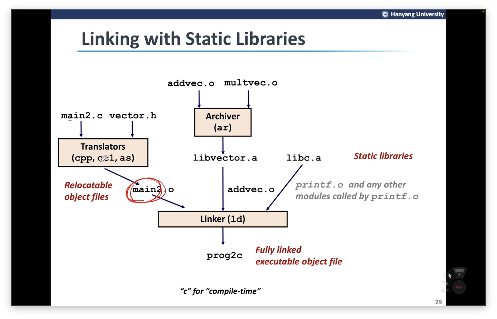

#### Using Static Libraries

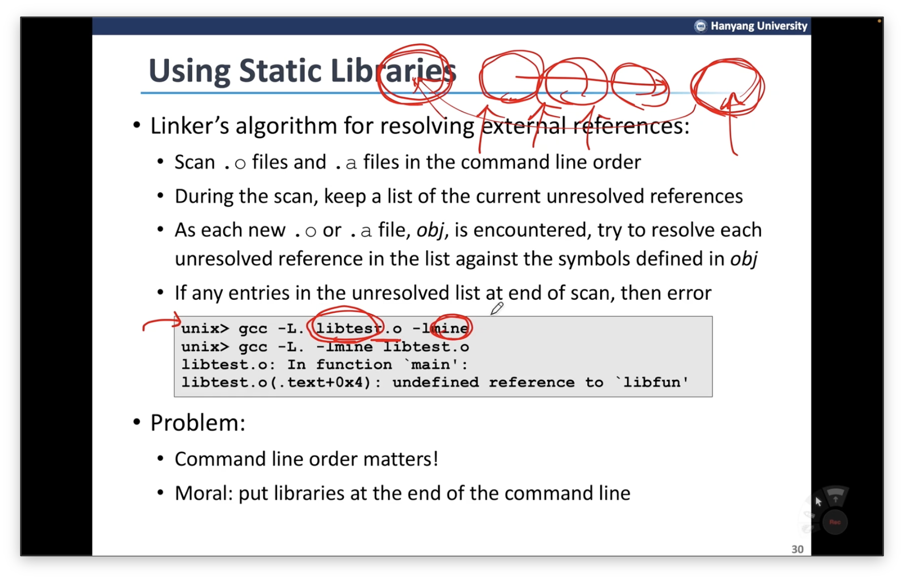

- Static Library의 사용 과정
  - build 과정에서 사용하는 file의 목록들이 있을 때 linker 앞에서부터 순차적으로 훑음.
  - 이러한 방법으로 필요한 Symbol들을 모아두고 마지막에 library에서 찾아서 하나씩 실행 file에 추가하는 방법을 사용함.
- 아쉬운 점

  - 만약 source file list의 순서를 바꿔서 library가 source file의 앞에 오게 된다면 linking에 실패할 수 있다.

  - 실행 file의 크기가 커질 수 있음. → 호출하고 있는 모든 library 함수를 모두 실행 file에 때려 넣음.

    → 하나의 컴퓨터에서 많은 program이 실행되는 환경에서는 메모리를 효율적으로 사용하지 못하는 경향이 있음.

- Static Library를 사용할 때는 source file과 library의 순서를 유의해서 명령해야함.

#### Modern Solution : Shared Libraries

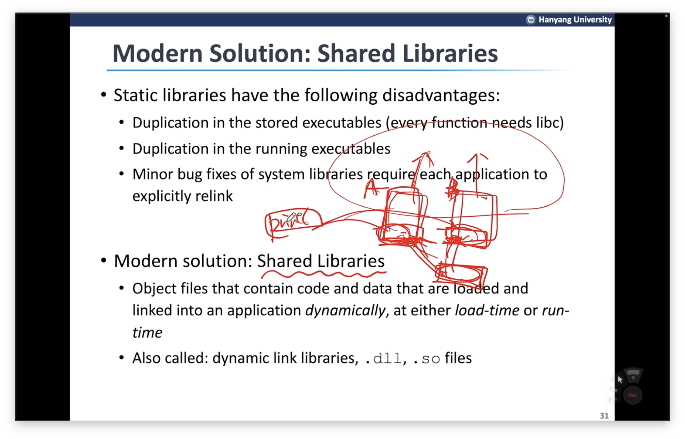

- Static Library는 사용하는 함수를 각각의 실행파일에 하나씩 첨부한다면
- Shared Library는 Linking 과정에서 library 함수를 포함시키는 것이 아닌 함수를 나중에 mapping할 수 있도록 하는 최소한의 작업만 수행하는 방법임.
- 실제 실행 파일에 library 함수를 포함시키지 않기 때문에 실행 파일이 간결하게 유지됨.
- 확장자는 리눅스는 .so 이다.(shared object) / 윈도우는 .dll이다.(dynamic link library)

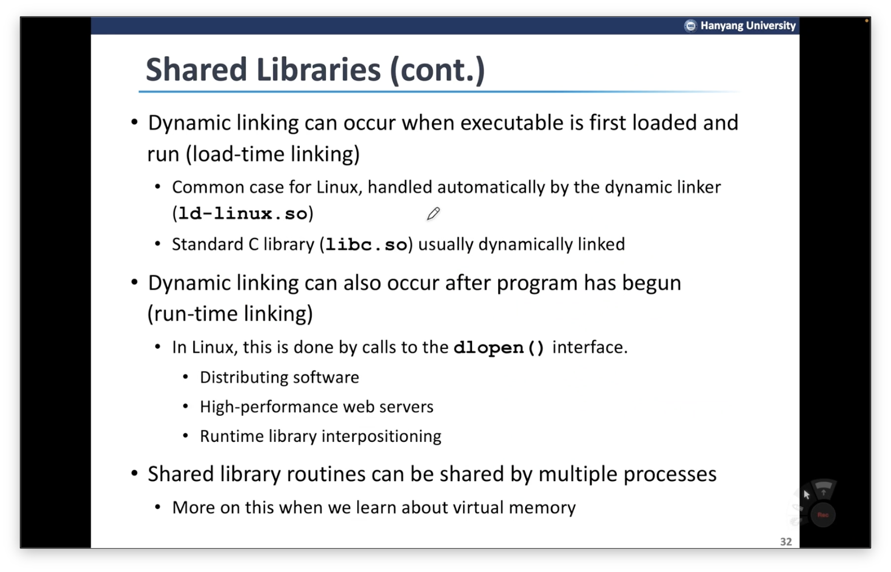

- Shared Library는 linking 과정에서 후에 link 할 수 있도록 최소한의 준비만 하고 마친다.

  → 미완성된 link 과정이 남아 있을 수 있다는 이야기

  → 그럼 얘는 언제 완성되는가?

  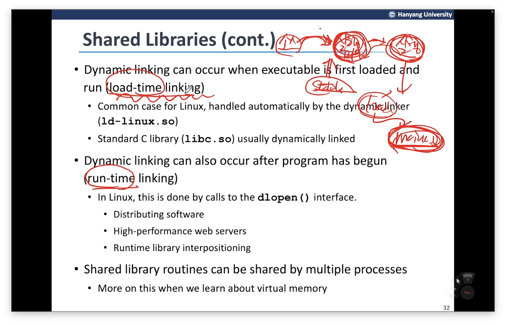

  1. Load Time Linking
     - main 함수가 실행되기 직전에 미완성된 linking을 완료하는 방법
     - .so 파일을 넘겨주어 OS가 linking 하는 구조임.
     - Linking을 마치고 main() 함수 내지 프로그램이 실행된 후에는 연결된 library 함수를 수정할 수 없음. → Linking이 실패한다면 그대로 프로그램 종료.
  2. Run-Time Linking
     - main 함수가 호출된 후 프로그램이 실행 중 미완성된 linking을 완료하는 방법
     - OS가 제공하는 API를 통해서 연결하고자 하는 object file의 함수 이름을 사용하여 실제 사용하고 있는 함수의 linking을 진행함.\
       → 이 연결을 프로그래머가 직접 진행하기 때문에 linking code를 작성해야 한다.
     - 프로그램이 동작하고 있는 상태에서 Link를 다시 진행하는 함수를 호출할 수 있도록 만들어주면 새로운 library 함수를 호출 할 수 있다. → error control에 유연함.

#### Dynamic Linking at Load-time

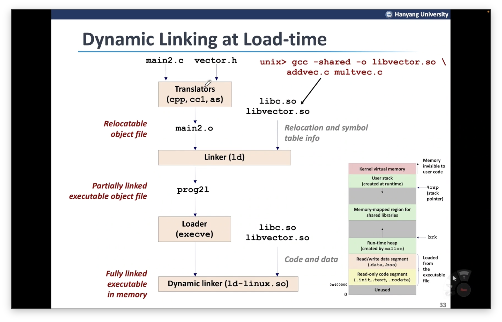

- Linker를 통해 반쯤 완성된 Linking이 있음.
- 후에 execve라고 하는 Loader를 통해 main() 호출 전 link를 마무리

#### Dynamic Linking at Run-time

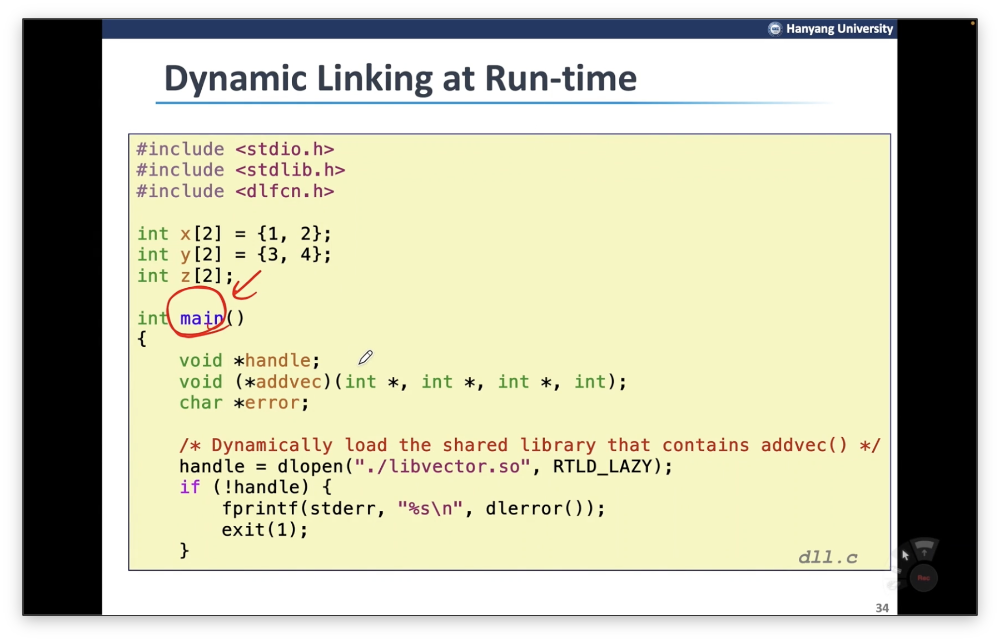

- Linker를 통한 linking이 아니라 Link API를 통해 Linking을 진행함.
- dlopen → dynamic linker open
- “./libvertor.so” → 사용할 library file 명

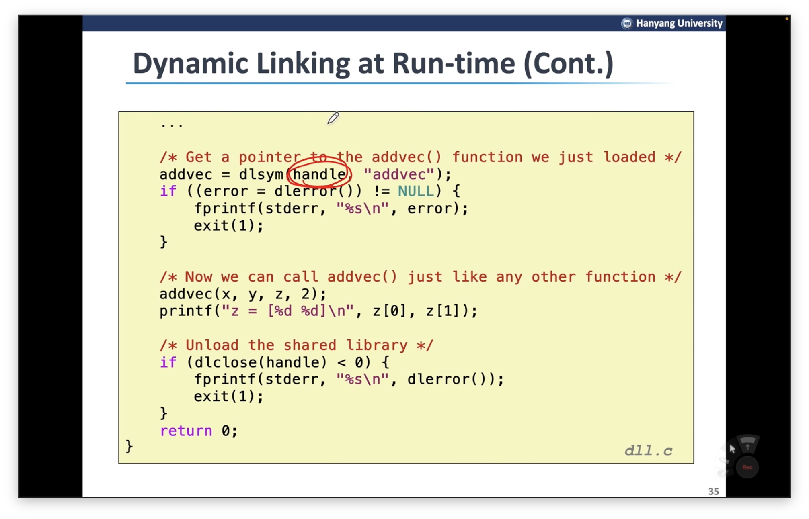

- dlsym(handle, “addvec”)); → addvec라는 symbol을 찾아서 addvec라는 포인터에 저장.

