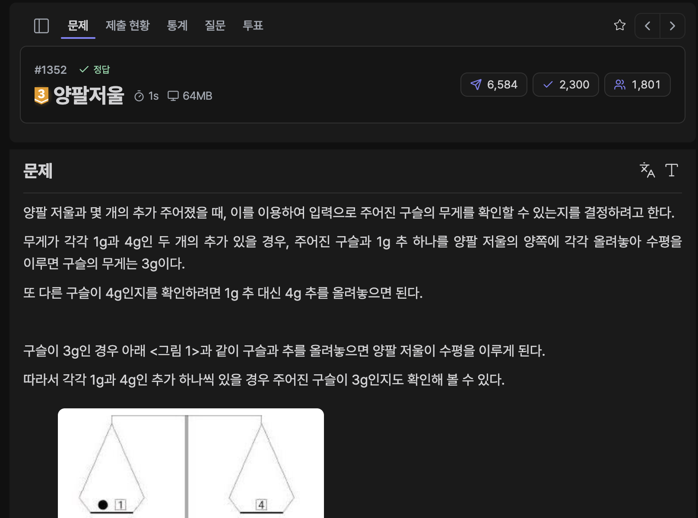

[문제 링크](https://jungol.co.kr/problem/1352)

## 문제

양팔 저울과 몇 개의 추가 주어졌을 때, 이를 이용하여 입력으로 주어진 구슬의 무게를 확인할 수 있는지를 결정하려고 한다. 

무게가 각각 1g과 4g인 두 개의 추가 있을 경우, 주어진 구슬과 1g 추 하나를 양팔 저울의 양쪽에 각각 올려놓아 수평을 이루면 구슬의 무게는 3g이다. 

또 다른 구슬이 4g인지를 확인하려면 1g 추 대신 4g 추를 올려놓으면 된다.

추들의 무게와 확인할 구슬들의 무게가 입력되었을 때, 주어진 추만을 사용하여 구슬의 무게를 확인 할 수 있는지를 결정하는 프로그램을 작성하시오. 

## 입력

입력 파일의 첫째 줄에는 추의 개수가 자연수로 주어진다. 추의 개수는 30 이하이다.

둘째 줄에는 추의 무게들이 자연수로 가벼운 것부터 차례로 주어진다. 

같은 무게의 추가 여러 개 있을 수도 있다.

추의 무게는 500g이하이며, 입력되는 무게들 사이에는 빈칸이 하나씩 있다. 

세 번째 줄에는 무게를 확인하고자 하는 구슬들의 개수가 주어진다. 확인할 구슬의 개수는 7이하이다. 

네 번째 줄에는 확인하고자 하는 구슬들의 무게 Gi( 0 ≤ Gi ≤​ 40,000)가 자연수로 주어지며,  입력되는 무게들 사이에는 빈 칸이 하나씩 있다.

## 출력

주어진 각 구슬의 무게에 대하여 확인이 가능하면 Y, 아니면 N 을 차례로 출력한다.

출력 파일은 한 개의 줄로 이루어지며, 각 구슬에 대한 답 사이에는 빈칸을 하나씩 둔다.

## 풀이

추의 무게는 최대 500g 이고 추의 개수는 최대 30개이다.

즉, 추를 이용해 확인 가능한 무게는 최대 15000g 이다. 구슬의 무게가 이보다 무거울 경우 확인이 불가능하다.

무게를 확인하고자 하는 구슬을 왼쪽에 놓았다 가정하고, 0번째 추부터 차례대로 (오른쪽에 놓았을 때 / 사용하지 않았을 때 / 왼쪽에 놓았을 때) 의 경우를 얻어, 확인 가능한 무게들을 DP 배열에 저장하고자 하였다.

마지막 추까지 사용했을 때, 배열에는 0번째 추부터 마지막 추까지 사용했을 때 확인 가능한 무게들은 True 로 표시된다. 

- 정답 / PyPy3 / 177ms / 80.5MB

```py
# 1352 : 양팔저울
import sys
input = sys.stdin.readline

n = int(input().rstrip())
weights = list(map(int, input().rstrip().split()))

# dp[n][30001]
dp = [[False for _ in range(30001)] for _ in range(n+1)]

dp[0][15000] = True

for i in range(n):
    for j in range(30001):
        if not dp[i][j]: continue
        dp[i+1][j + weights[i]] = True
        dp[i+1][j] = True
        dp[i+1][j - weights[i]] = True

_ = int(input().rstrip())
arr = list(map(int, input().rstrip().split()))
for a in arr:
    print(('Y' if (a <= 15000 and dp[n][a+15000]) else 'N'), end=' ')
```

- (+) 직전 상태의 정보만 사용하니 1차원 DP 를 사용해 최적화도 가능할 것 같다.