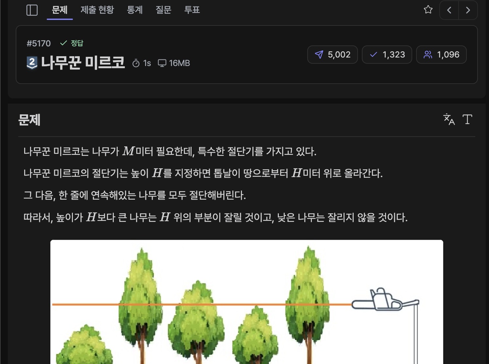

[문제 링크](https://jungol.co.kr/problem/5170)

## 문제

​나무꾼 미르코는 나무가 M미터 필요한데, 특수한 절단기를 가지고 있다.

나무꾼 미르코의 ​절단기는 높이 H를 지정하면 톱날이 땅으로부터 H미터 위로 올라간다. 

그 다음, 한 줄에 연속해있는 나무를 모두 절단해버린다. 

따라서, 높이가 H보다 큰 나무는 H 위의 부분이 잘릴 것이고, 낮은 나무는 잘리지 않을 것이다. 


예를 들어, 한 줄에 연속해있는 나무의 높이가 4,10,7,6,10 이라고 하자. 

​나무꾼 미르코가​ 높이를 6으로 지정했다면, 나무를 자른 뒤의 높이는 4,6,6,6,6 이 될 것이고, 

​나무꾼 미르코는 ​길이가 4인 나무와 1인 나무와 4​인 나무를 들고 집에 갈 것이다. (총 9미터를 집에 들고 간다) 

절단기에 설정할 수 있는 높이는 0 이상의 정수이다.

M미터의 이상의 나무를 가져가기 위해서 절단기에 설정할 수 있는 높이의 최댓값을 구하는 프로그램을 작성하시오.​


## 입력

첫 번째 줄에 나무의 수 N과 나무꾼 미르코​가 벌목해야 하는 나무의 길이 최솟값 M이 주어진다.

두 번째 줄에는 나무의 높이 H_i가 공백을 기준으로 N개 주어진다. 

나무의 높이의 합은 항상 M보다 크거나 같기 때문에, 나무꾼 미르코​는 집에 필요한 나무를 항상 가져갈 수 있다. 

[제약 조건]

- 1 ≤ N ≤ 1 000 000
- 1 ≤ M ≤ 2 000 000 000
- 0 ≤ H_i ≤ 1 000 000 000 (1 ≤ i ≤ N)


## 출력

나무꾼 미르코​가 M미터 이상의 나무를 집에 가져가기 위해서 설정해야하는 절단기 높이의 최댓값을 출력하시오.

## 풀이

파라매트릭 서치 기본 문제이다.

최소 M 만큼을 얻을 수 있는 절단기 높이의 Lower bound 를 얻도록, `ans` 를 M 이상을 얻을 수 있는 높이 (`mid`) 로 갱신하면서 이진탐색을 진행한다.

- 정답 / PyPy3 / 215ms / 92.1MB

```py
# 5170 : 나무꾼 미르코
import sys
input = sys.stdin.readline

n, m = map(int, input().rstrip().split())
arr = list(map(int, input().rstrip().split()))
start = 0
end = max(arr)
ans = 0

while start <= end:
    mid = (start + end) >> 1
    now = 0
    for a in arr: now += max(0, a - mid)
    
    if now >= m: 
        ans = mid
        start = mid + 1
    else:
        end = mid - 1

print(ans)
```