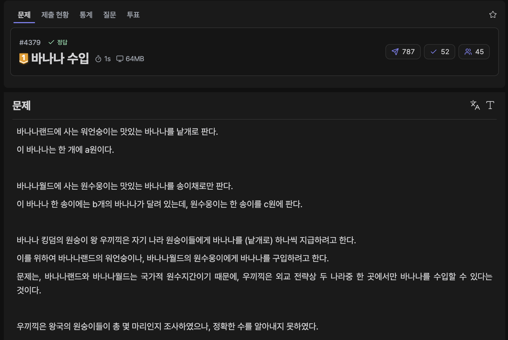
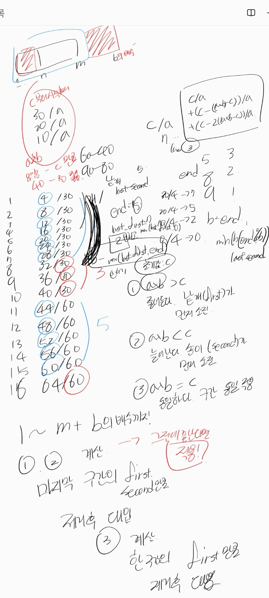
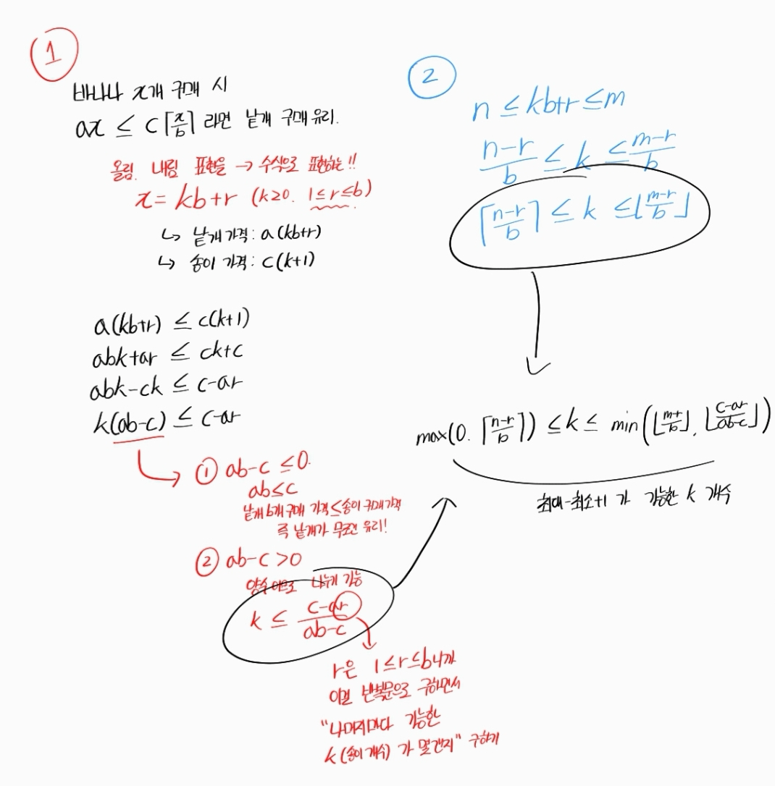
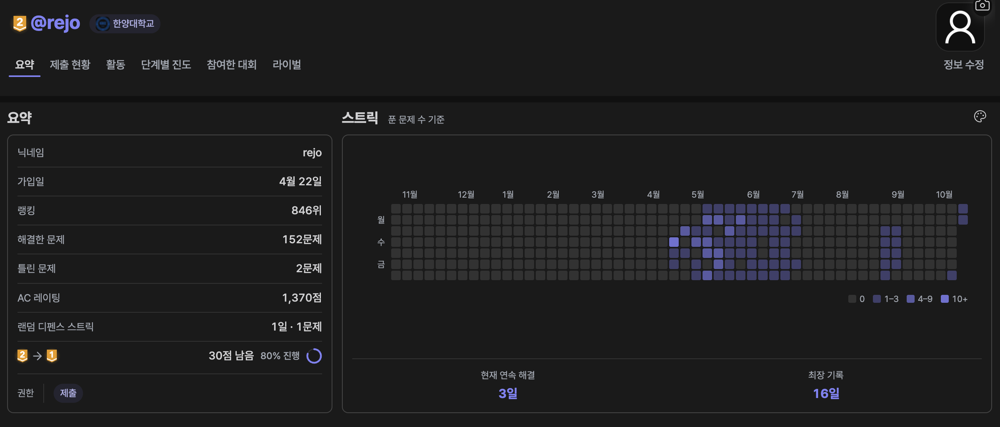

[문제 링크](https://jungol.co.kr/problem/4379)

## 문제

바나나랜드에 사는 워언숭이는 맛있는 바나나를 낱개로 판다. 

이 바나나는 한 개에 a원이다.


바나나월드에 사는 원수웅이는 맛있는 바나나를 송이채로만 판다. 

이 바나나 한 송이에는 b개의 바나나가 달려 있는데, 원수웅이는 한 송이를 c원에 판다.


바나나 킹덤의 원숭이 왕 우끼끽은 자기 나라 원숭이들에게 바나나를 (낱개로) 하나씩 지급하려고 한다. 

이를 위하여 바나나랜드의 워언숭이나, 바나나월드의 원수웅이에게 바나나를 구입하려고 한다. 

문제는, 바나나랜드와 바나나월드는 국가적 원수지간이기 때문에, 우끼끽은 외교 전략상 두 나라중 한 곳에서만 바나나를 수입할 수 있다는 것이다.


우끼끽은 왕국의 원숭이들이 총 몇 마리인지 조사하였으나, 정확한 수를 알아내지 못하였다. 

대신 왕국의 원숭이 수가 n마리 이상, m마리 이하임은 밝혀내었다.


우끼끽은 각각의 n≤x≤m인 정수 x에 대하여, 왕국의 원숭이 숫자가 정확히 x마리라면, 

바나나랜드에서 낱개로 바나나를 사는 것이 가격이 적은 지, 아니면 바나나월드에서 송이로 바나나를 사는 것이 가격이 적은 지 각각 따져보려고 한다. 

모든 가능한 정수 x에 있어서, 바나나랜드에서의 바나나 구입이 나은 경우의 수와, 바나나월드에서의 구입이 나은 경우의 수를 각각 세어주는 프로그램을 작성하라.


참고로 우끼끽은 절대로 자기 국민들을 굶기지 않으므로, 무조건 왕국의 모든 백성들에게 나눠주기에 충분한 양의 바나나를 구입할 것이다.​ 


## 입력

첫 줄에 문제 조건에 주어진 a, b, c가 공백을 사이에 두고 주어진다.

둘째 줄에 문제 조건에 주어진 원숭이 마릿수 x의 범위인 n과 m이 주어진다.

[제약 조건]

- 모든 부분문제에서 1≤ a, c ≤10,000이며, 2≤​b≤​10,000이고, 모든 부분문제에서 1≤n≤m≤10^9(10억)이다. 모든 입력값은 정수이다.


## 출력

첫 줄에 바나나랜드에서 워언숭이에게 바나나를 사는게 나은 경우의 수를 출력한다. 

둘째 줄에 바나나월드에서 원수웅이에게 바나나를 사는게 나은 경우의 수를 출력한다. 

이 두 수를 합치면 반드시 (m-n+1)이 되어야 함에 유의한다. 

만약 두 경우의 가격이 같다면, 워언숭이에게 바나나를 구입하는 경우로 친다. ​ 

## 풀이

### 초기 아이디어 (구간 분할 O(b))

초기 아이디어는 전체 범위를 b개씩 묶어 처리하는 구간 분할 알고리즘이였다.

1. 양 끝 구간을 먼저 직접 계산
   - (n ~ n보다 큰 b의 배수꼴 중 최소) 까지 직접 계산
   - (m보다 작은 b의 배수꼴 중 최대 ~ m)까지 역순으로 직접 계산
2. 한 구간의 경우의 수 계산
   - b개로 구성된 구간에서 낱개 구매와 송이 구매가 유리한 횟수를 계산
3. (n보다 큰 b의 배수꼴 중 최소 ~ m보다 작은 b의 배수꼴 중 최대) 중간 구간 일괄 계산
   - 완전한 구간의 개수 × 한 구간에서 낱개 / 송이 구매가 유리한 횟수

하지만 이 아이디어를 폐기한 이유는, 구간마다 낱개나 송이가 유리한 횟수가 동일하지 않다는 점을 발견했기 때문이다.

### 최종 아이디어 (구간 변화 규칙 이용)

1. 구간을 (1, b), (b+1, 2b), (2b+1, 3b)... 꼴로 나눈다.
2. `solve(end)` 함수를 정의해 1부터 end 까지의 낱개 / 송이 구매 유리 횟수를 구하도록 한다.
3. 첫 구간에서 낱개 구매가 유리한 횟수는 `c // a` 이고, 다음 구간마다 분자 c 는 `a*b-c` 만큼 감소한다.
  - `a*b-c` 가 양수라면 낱개 구매 유리 횟수가 줄어드는 꼴이므로 낱개 구매 유리 횟수를 `first` 로 구한 뒤 송이 구매 유리 횟수를 `end-first`로 구한다.
  - `a*b-c` 가 음수라면 낱개 구매 유리 횟수가 늘어나는 (송이 구매 유리 횟수가 줄어드는) 꼴이므로 송이 구매 유리 횟수를 `second` 로 구한 뒤 낱개 구매 유리 횟수를 `end-second`로 구한다.
  - `a*b-c` 가 0이라면 구간마다 낱개 구매 유리 횟수 / 송이 구매 유리 횟수가 동일하므로 초기 아이디어대로 구한다.
  - 연산은 최대 c 번 (O(c)) 수행하므로 시간 내 계산 가능하다.
4. `solve(m) - solve(n-1)` 로, n부터 m까지의 날개 / 송이 구매 유리 횟수를 구한다.

이후 예외 처리한 부분은 다음과 같다.

1. a 가 c 보다 크다면 무조건 송이를 구매하는 것이 유리하다. 송이만 m-n+1 개 출력한다.
2. c 가 b 보다 클 때, a 가 c/b보다 작거나 같다면 무조건 낱개만 구매하는 것이 유리하다. 낱개만 m-n+1 개 출력한다.



- 정답 / PyPy3 / 185ms / 74.8MB

```py
# 4379 : 바나나 수입
import sys
import math
input = sys.stdin.readline

a, b, c = map(int, input().rstrip().split())
n, m = map(int, input().rstrip().split())

# 초반 아이디어
# 1. [직접 구하기] n ~ b의 배수 시작점
#               m ~ b의 배수 끝점 (역순)
#    초반 상황에는 직접 비교
# 2. [임계점 구하기] b 구간 안에서 낱개 몇번, 송이 몇 번 등장하는지 계산
# 3. [구간 구하기] b의 배수 시작점 ~ b의 배수 끝점 구간 개수 x 몇 번 등장하는지
# 폐기 -> 구간마다 같은게 아님

# 현재 아이디어
# 1부터 b 구간마다, b 구간 안에서 낱개가 이득인 상황은 c / a 개 이다.
# b 구간을 하나씩 지날수록 분자 c 는 (a * b) - c 만큼 줄어든다.
# (ex. 1번 예제에서 4 10 30 일 때 1~10까지는 7번, 11~20까지는 5번, 21~30까지는 2번, 31~40까지는 0번..)
# 1부터 end 까지 낱개/송이 유리한 경우의 수를 구하는 함수를 만들고
#   max(end, end보다 큰 b의 배수꼴) 까지의 낱개/송이 유리한 경우의 수를 구한다.
#   왜? a b c 는 10000 제한이니까 (a * b) - c 가 1이여도 최대 만번만 실행한다.
#   마지막에 계산한 경우만 따로 빼서, end 와 end보다 큰 b의 배수점 사이의 간극을 제외하고 정답을 구한다.

#   (a * b) - c가 줄어들 수도 있고, 늘어날 수도 있고, 같을 수도 있다. 
#       여기서 first는 낱개 유리한 경우, second는 송이 유리한 경우이다.
#   줄어든다면 first 가 작아지는 경우이니 first 개수를 먼저 구한 뒤 마지막에 end - first 로 구한다.
#   늘어난다면 second 가 작아지는 경우이니 second 개수를 먼저 구한 뒤 마지막에 end - second 로 first 를 구한다.
#   같다면 처음 first 가 계속 반복되는 경우이니 구간만큼 곱하고 마지막만 계산한다.
# 1부터 m까지 - 1부터 n-1까지 경우의 수로 n~m까지 경우의 수를 구한다.

# 예외 상황
# 1. a가 c보다 클 때 (송이가 이득) -> 송이 상황으로 m-n+1
# 2. (b < c) a가 c/b보다 작거나 같을 때 (낱개가 이득) -> 낱개 상황으로 m-n+1

if a > c: print(0, m-n+1, sep='\n')
elif b < c and a <= int(c // b + (1 if c % b else 0)): print(m-n+1, 0, sep='\n')
else: 
    # 1부터 end까지의 낱개/송이 경우의 수를 구하는 함수
    def solve(end):
        global a, b, c

        num = c
        cnt = 1
        end_cnt = end // b + (1 if end % b else 0)

        if a * b > c:
            first = 0
            d = (a * b) - c
            last_first = 0
            while cnt <= end_cnt:
                last_first = num // a
                first += last_first
                num -= d

                if num <= 0:
                    if cnt == end_cnt and end % b != 0:
                        first -= max(0, last_first - (end % b))
                    return [first, end - first]
                cnt += 1

            if end % b != 0:
                first -= max(0, last_first - (end % b))
            
            return [first, end - first]
        
        elif a * b < c:
            second = 0
            d = c - (a * b)
            last_second = 0
            while cnt <= end_cnt:
                last_second = b - (num // a)
                second += last_second
                num += d
                if num >= b:
                    if cnt == end_cnt and end % b != 0:
                        second -= min(b - (end % b), last_second)
                    return [end - second, second]
                cnt += 1

            if end % b != 0:
                second -= min(b - (end % b), last_second)

            return [end - second, second]
        elif a * b == c:
            first = (num // a) * end_cnt
            if end % b != 0:
                first -= max(0, last_first - (end % b))

            return [first, end - first]


    one_to_m = solve(m)
    one_to_n = solve(n-1)
    print(one_to_m[0] - one_to_n[0], one_to_m[1] - one_to_n[1], sep='\n')
```

### AI 피드백

낱개가 유리한 상황의 예외 처리가 잘못되었다. 

- `a * b <= c` 일 경우 낱개를 b개만큼 산 것이 더 유리하기 때문에 간략화 가능하다. solve 에서의 세 가지 경우 중 두 가지 경우를 예외 처리가 가능한 것이다.
- `a > c` 경우 또한 `c // a` 에서 0 을 반환하므로 제거해도 된다.

- 정답 / PyPy3 / 136ms / 75.0MB

```py
# 4379 : 바나나 수입
import sys
input = sys.stdin.readline

a, b, c = map(int, input().rstrip().split())
n, m = map(int, input().rstrip().split())

if a * b <= c: print(m-n+1, 0, sep='\n')
else: 
    d = (a * b) - c
    # 1부터 end까지의 낱개/송이 경우의 수를 구하는 함수
    def solve(end):
        first = 0
        num = c
        start = 1

        while start <= end and num >= a:
            length = min(b, end - start + 1)
            first += min(length, num // a)

            num -= d
            start += b

        return first

    answer = solve(m) - solve(n-1)
    print(answer, (m - n + 1) - answer, sep='\n')
```

구간을 분할해 O(c) 에 풀이하는 방법 외에도, 수식 정리를 활용해 나머지를 고정하여 풀이하는 방법도 존재한다.



- 정답 / PyPy3 / 405ms / 75.3MB

```py
# 4379 : 바나나 수입
import sys
input = sys.stdin.readline

a, b, c = map(int, input().rstrip().split())
n, m = map(int, input().rstrip().split())

if a * b <= c: print(m-n+1, 0, sep='\n')
else:
    first = 0
    d = a * b - c
    for r in range(1, b+1):
        mins = max(0, (n - r + b - 1) // b)
        maxs = min((m - r) // b, (c - a * r) // d)
        first += max(0, maxs - mins + 1)

    print(first, m - n + 1 - first, sep='\n')
```

추가적으로, `(a * b - c)` 상황에서 r을 고정했을 때 초반 구간부터 낱개 구매가 더 비싼 나머지가 존재한다. (부등식 정리에서도, `c - ar` 이 양수여야 성립한다. (`r <= c/a`))

`r > c/a` 일 경우 어떤 k에서도 날개 구매가 유리하지 않으므로 탐색하지 않아도 된다.

- 정답 / PyPy3 / 138ms / 74.8MB

```py
# 4379 : 바나나 수입
import sys
input = sys.stdin.readline

a, b, c = map(int, input().rstrip().split())
n, m = map(int, input().rstrip().split())

if a * b <= c: print(m-n+1, 0, sep='\n')
else:
    first = 0
    d = a * b - c
    for r in range(1, min(b, c//a)+1): # r <= c/a 조건 추가
        mins = max(0, (n - r + b - 1) // b)
        maxs = min((m - r) // b, (c - a * r) // d)
        first += max(0, maxs - mins + 1)

    print(first, m - n + 1 - first, sep='\n')
```

