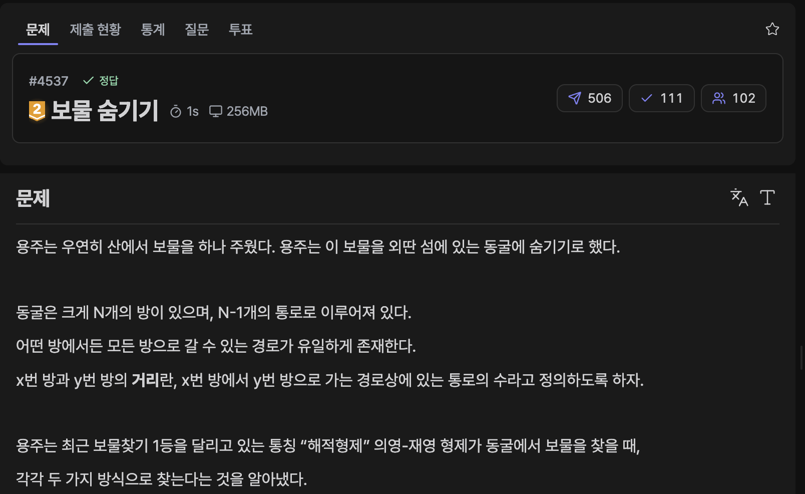

[문제 링크](https://jungol.co.kr/problem/4537)

## 문제

용주는 우연히 산에서 보물을 하나 주웠다. 용주는 이 보물을 외딴 섬에 있는 동굴에 숨기기로 했다.

동굴은 크게 N개의 방이 있으며, N-1개의 통로로 이루어져 있다. 

어떤 방에서든 모든 방으로 갈 수 있는 경로가 유일하게 존재한다. 

x번 방과 y번 방의 거리란, x번 방에서 y번 방으로 가는 경로상에 있는 통로의 수라고 정의하도록 하자.

용주는 최근 보물찾기 1등을 달리고 있는 통칭 “해적형제” 의영-재영 형제가 동굴에서 보물을 찾을 때, 

각각 두 가지 방식으로 찾는다는 것을 알아냈다. 

탐색 방식은 아래와 같다.

- 의영이는 입구(1번 방)에서의 거리가 가장 가까운 방 순서대로 수색하되, 거리가 같은 방끼리는 번호가 작은 방부터 수색한다.

- 재영이는 입구(1번 방)에서의 거리가 가장 가까운 방 순서대로 수색하되, 거리가 같은 방끼리는 번호가 큰 방부터 수색한다.

- 방 하나를 탐색하는데는 1시간이 걸리며, 통로로 이동하는 시간은 너무 미미하므로 무시한다. 의영이와 재영이는 둘 중 한 명이 이미 탐색을 마친 방은 탐색하지 않고 다음 순서로 넘어간다.

- 동시에 같은 방을 탐색하게 될 경우엔 의영이가 맡게 되고 재영이는 다음 순서로 넘어간다.


우선 탐색 방식의 이해를 돕기 위해, 의영이만 혼자 보물을 찾는다고 가정할 때 탐색 순서는

 1->2->3->4->5->6->7->8이며, (1->2->3->4->5->6->8->7이 아님에 유의한다.)

재영이의 경우 1->4->3->2->8->7->6->5이다.

따라서 둘이 같이 탐색을 한다면 탐색순서는 다음과 같다.


용주는 자신이 보물을 숨긴 동굴에 의영-재영 형제가 도착하더라도 최대한 보물을 찾는데 오래 걸리게 만들어, 자신의 보물을 지킬 시간을 벌려고 한다.

그러려면 위 예의 경우에는 6번 방이나 7번 방에 보물을 숨겨야 최대한 오랜 시간인 4시간 동안 버틸 수 있다.

동굴의 구조가 주어졌을 때, 용주가 의영-재영에게 최대한 오래 버티기 위해 용주가 보물을 숨겨야 하는 최적의 방을 찾아 출력하는 프로그램을 작성하시오. ​ 


## 입력

첫 줄에 동굴에 있는 방의 개수인 N이 주어진다.(1≤N≤200,000)

다음 N-1개 줄에 걸쳐서 각 통로의 정보가 u, v의 형식으로 주어진다.(1≤u,v≤N)

이는 방 u와 방 v를 잇는 통로가 존재함을 뜻한다.​ 

## 출력

최적의 방을 찾아 출력한다. 만약 그러한 방이 여러 개일 경우에는 번호가 낮은 순서대로 공백을 사이에 두고 한 줄에 출력한다.

## 풀이

### 초기 아이디어 (더블 힙 O(NlogN))

초기 아이디어는 의영이의 탐색 힙과 재영이의 탑색 힙을 따로 두어, 정렬 기준을 다르게 한 뒤 누가 탐색한 방은 건너뛰어 탐색할 수 있도록 구현하는 것이었다. 의영이와 재영이가 마지막에 탐색한 방만 따로 수집하여 정답으로 출력하도록 구현했다.

- 정답 / PyPy3 / 1698ms / 148.9MB

```py
# 4537 : 보물 숨기기
import sys
import heapq
input = sys.stdin.readline

n = int(input().rstrip())
edges = [[] for _ in range(n+1)]
for _ in range(n-1):
    u, v = map(int, input().rstrip().split())
    edges[u].append(v)
    edges[v].append(u)

vis = [False for _ in range(n+1)]
search_vis_first = [False for _ in range(n+1)]
search_vis_second = [False for _ in range(n+1)]

pq_first = []
pq_second = []

heapq.heappush(pq_first, (0, 1))
heapq.heappush(pq_second, (0, -1))

search_vis_first[1] = True
search_vis_second[1] = True

last_first = -1
last_second = -1

while pq_first:
    now_first = -1
    now_second = -1

    while pq_first and vis[pq_first[0][1]]:
        now = heapq.heappop(pq_first)
        for next in edges[now[1]]:
            if not search_vis_first[next]:
                heapq.heappush(pq_first, (now[0]+1, next))
                search_vis_first[next] = True

    if pq_first:
        now = heapq.heappop(pq_first)
        now_first = now[1]
        vis[now[1]] = True
        for next in edges[now[1]]:
            if not search_vis_first[next]:
                heapq.heappush(pq_first, (now[0]+1, next))
                search_vis_first[next] = True

    while pq_second and vis[-pq_second[0][1]]:
        now = heapq.heappop(pq_second)
        for next in edges[-now[1]]:
            if not search_vis_second[next]:
                heapq.heappush(pq_second, (now[0]+1, -next))
                search_vis_second[next] = True

    if pq_second:
        now = heapq.heappop(pq_second)
        now_second = -now[1]
        vis[-now[1]] = True
        for next in edges[-now[1]]:
            if not search_vis_second[next]:
                heapq.heappush(pq_second, (now[0]+1, -next))
                search_vis_second[next] = True

    if now_first != -1 or now_second != -1:
        last_first = now_first
        last_second = now_second

ans = []
if last_first != -1: ans.append(last_first)
if last_second != -1: ans.append(last_second)

print(' '.join(map(str, sorted(ans))))
```

### AI 피드백

O(N) 으로 풀이 가능하다고 한다.

BFS 를 먼저 초기에 실행한 뒤 정렬 순서를 달리 한 배열에 포인터를 두 개 두는 BFS + 투 포인터 방식으로, 선형 시간에 처리할 수 있다고 한다.

실행 시간이 드라마틱하게 줄어들진 않았지만, 거리별 버킷이라는 테크닉으로 NlogN 정렬 대신 선형 N으로 줄이는 방식에 대해 배웠다.

- 정답 / PyPy3 / 1729ms / 190.2MB

```py
# 4537 : 보물 숨기기
import sys
from collections import deque
input = sys.stdin.readline

n = int(input().rstrip())
edges = [[] for _ in range(n+1)]
for _ in range(n-1):
    u, v = map(int, input().rstrip().split())
    edges[u].append(v)
    edges[v].append(u)

vis = [-1 for _ in range(n+1)]
vis[1] = 0
queue = deque()
queue.append(1)

time = 0

while queue:
    size = len(queue)
    for _ in range(size):
        now = queue.popleft()

        for next in edges[now]:
            if vis[next] == -1:
                vis[next] = time + 1
                queue.append(next)
    time += 1

used = [False for _ in range(n+1)]
first_arr = []
second_arr = []

groups = [[] for _ in range(time)]
for i in range(1, n+1):
    groups[vis[i]].append([vis[i], i])

for g in groups:
    first_arr.extend(g)
    second_arr.extend(reversed(g))

first_idx = 0
second_idx = 0

last_first = -1
last_second = -1

while first_idx < n and second_idx < n:
    now_first = -1
    now_second = -1

    while first_idx < n and used[first_arr[first_idx][1]]:
        first_idx += 1

    if first_idx < n:
        used[first_arr[first_idx][1]] = True
        now_first = first_arr[first_idx][1]

    while second_idx < n and used[second_arr[second_idx][1]]:
        second_idx += 1

    if second_idx < n:
        used[second_arr[second_idx][1]] = True
        now_second = second_arr[second_idx][1]

    if now_first != -1 or now_second != -1:
        last_first = now_first
        last_second = now_second

ans = []
if last_first != -1: ans.append(last_first)
if last_second != -1: ans.append(last_second)
ans.sort()

print(' '.join(map(str, ans)))
        
```