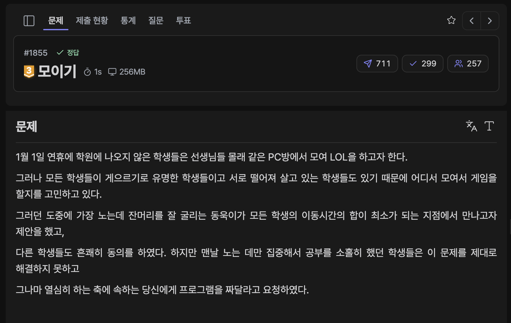

[문제 링크](https://jungol.co.kr/problem/1855)

## 문제

1월 1일 연휴에 학원에 나오지 않은 학생들은 선생님들 몰래 같은 PC방에서 모여 LOL을 하고자 한다. 

그러나 모든 학생들이 게으르기로 유명한 학생들이고 서로 떨어져 살고 있는 학생들도 있기 때문에 어디서 모여서 게임을 할지를 고민하고 있다.

그러던 도중에 가장 노는데 잔머리를 잘 굴리는 동욱이가 모든 학생의 이동시간의 합이 최소가 되는 지점에서 만나고자 제안을 했고, 

다른 학생들도 흔쾌히 동의를 하였다. 하지만 맨날 노는 데만 집중해서 공부를 소홀히 했던 학생들은 이 문제를 제대로 해결하지 못하고 

그나마 열심히 하는 축에 속하는 당신에게 프로그램을 짜달라고 요청하였다.

학생들이 사는 장소와 두 개의 장소를 잇는 경로의 이동시간이 주어지고 어떤 장소에서 모두 같이 모였을 경우, 

모든 학생의 이동 시간의 합의 최소를 구하는 프로그램을 작성하라.


## 입력

입력의 첫 번째 줄에는 학생의 수 N(1≤N≤500), 장소의 수P(1≤P≤800),
그리고 장소를 잇는 경로의 수C(1≤C≤1,450)이 입력된다.

그 다음 줄부터 C개의 줄에는 3개의 정수 i, j, cost가 입력되는데
i번 장소와 j번 장소를 잇는 경로로 이동할 경우 cost만큼의 이동시간이 걸린다는 것이다. 


i번 장소에서 j번 장소로 이동하거나 j번 장소에서 i번 장소로 이동하는 것이 다 가능하다(1≤i, j≤P, 1≤cost≤225)

마지막으로 한 줄에는 N명의 학생이 현재 위치한 장소의 번호가 입력된다.

한 장소에 여러 명의 학생이 있을 수 있음에 유의하라.

## 출력

모든 학생들이 한 장소에 모였을 때 이동시간의 합의 최소를 출력한다.

## 풀이

장소마다 다익스트라 거리 배열을 얻어내어, 학생들이 사는 장소의 거리 합을 구해 최소 거리 장소를 구했다.

- 정답 / PyPy3 / 1512ms / 110.3MB

```py
# 1855. 모이기
import sys
import heapq
input = sys.stdin.readline

n, p, c = map(int, input().rstrip().split())
edges = [[] for _ in range(p+1)]
for _ in range(c):
    i, j, c = map(int, input().rstrip().split())
    edges[i].append([j, c])
    edges[j].append([i, c])

arr = list(map(int, input().rstrip().split()))

def dijkstra(start):
    distances = [float('inf') for _ in range(p+1)]
    distances[start] = 0

    pq = []
    heapq.heappush(pq, [0, start])

    while pq:
        now = heapq.heappop(pq)

        if distances[now[1]] < now[0]: continue

        for next_d, next_c in edges[now[1]]:
            new_c = now[0] + next_c
            if distances[next_d] > new_c:
                distances[next_d] = new_c
                heapq.heappush(pq, [new_c, next_d])

    return distances

ans = float('inf')
for i in range(1, p+1):
    dist = dijkstra(i)

    sums = 0
    for a in arr: sums += dist[a]

    ans = min(ans, sums)

print(ans)
```

- 더 나은 최적화를 위해, 모든 장소에서 다익스트라를 시작하는 것이 아닌 학생들이 사는 장소에서만 다익스트라를 시작하는 방법이 존재한다.