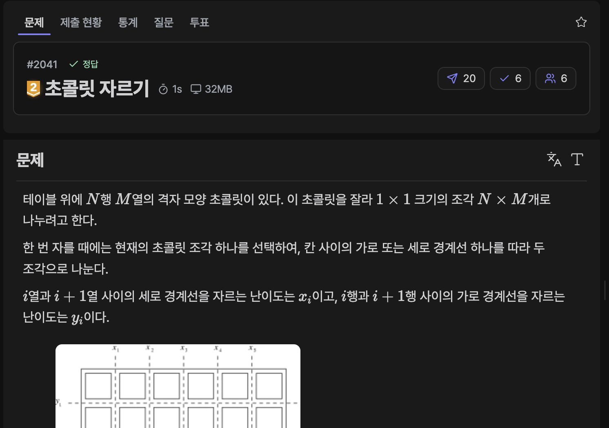

[문제 링크](https://jungol.co.kr/problem/2041)

## 문제

테이블 위에 N행 M열의 격자 모양 초콜릿이 있다. 이 초콜릿을 잘라 1×1 크기의 조각 N×M개로 나누려고 한다.

한 번 자를 때에는 현재의 초콜릿 조각 하나를 선택하여, 칸 사이의 가로 또는 세로 경계선 하나를 따라 두 조각으로 나눈다.

i열과 i+1열 사이의 세로 경계선을 자르는 난이도는 x_i 이고, i행과 i+1행 사이의 가로 경계선을 자르는 난이도는 y_i 이다.


전체 난이도는 각 절단에서 발생한 난이도의 합이다. 초콜릿을 자르는 순서에 따라 같은 원래 경계선을 여러 조각에서 각각 잘라야 할 수도 있다.

초콜릿을 모두 1×1 크기로 나누는 데 필요한 난이도의 최솟값을 구하시오.


## 입력

첫째 줄에 초콜릿의 크기 M,N이 공백으로 구분되어 주어진다. (2≤M,N≤1000)

다음 M−1개의 줄에 세로 경계선을 자르는 난이도 x_1, x_2, …, x_M−1 이 차례대로 하나씩 주어진다. (1≤x_i≤1000)

다음 N−1개의 줄에 가로 경계선을 자르는 난이도 y_1, y_2, …, y_N−1 이 차례대로 하나씩 주어진다. (1≤y_i≤1000)

## 출력

첫째 줄에 초콜릿을 1×1 크기의 조각으로 모두 자르는 데 필요한 난이도의 최솟값을 출력한다.

## 풀이

### 초기 아이디어 (분할 정복)

시간 복잡도 생각 안하고 분할 정복 해보았다. 모든 자르는 경우를 백트래킹 재귀로 분할했지만, N과 M이 두 자리 수 일 때부터 시간 초과를 받았다.

- 시간 초과 / C++20 / 1000ms / 1.6MB

```cpp
// 2041 : 초콜릿 자르기
#include <iostream>
#include <climits>
#include <vector>
#define FASTIO ios::sync_with_stdio(false);cin.tie(0);cout.tie(0);
using namespace std;

// # 세로 1번을 자르면 가로 1번 자르는데 2배가 든다
// # 가로 1번을 자르면 세로 1번 자르는데 2배가 든다
// # 세로 2번을 자르면 가로 1번 자르는데 3배가 든다
// # 가로 2번을 자르면 세로 1번 자르는데 3배가 든다

// # 자르는 순서에 따라서 y1 + 2(x1 + x2) 가 될 수도 있고
// # x1 + x2 + 3y1 이 될 수도
// # x1 + 2y2 + 2x2 가 될 수도 있다

// # 분할정복?

int m, n;
vector<int> arrX;
vector<int> arrY;


int solve(int x1, int y1, int x2, int y2) {
    if (x1 == x2) {
        int sums = 0;
        for (int y = y1; y < y2; y++) sums += arrY[y];
        return sums;
    }
    if (y1 == y2) {
        int sums = 0;
        for (int x = x1; x < x2; x++) sums += arrX[x];
        return sums;
    }

    int res = INT_MAX;
    for (int x = x1; x < x2; x++) {
        int now = solve(x1, y1, x, y2) + solve(x+1, y1, x2, y2) + arrX[x];
        if (res > now) res = now;
    }
    for (int y = y1; y < y2; y++) {
        int now = solve(x1, y1, x2, y) + solve(x1, y+1, x2, y2) + arrY[y];
        if (res > now) res = now;
    }

    return res;
}

int main() {
    FASTIO
    cin >> m >> n;
    
    for (int i = 0; i < m - 1; i++) {
        int x; cin >> x;
        arrX.push_back(x);
    }

    for (int j = 0; j < n - 1; j++) {
        int y; cin >> y;
        arrY.push_back(y);
    }

    cout << solve(0, 0, m - 1, n - 1);

    return 0;
}
```

### 최종 아이디어 (그리디)

난이도가 높은 경계선부터 잘라야, 이후에 여러 개를 자르는 상황에서 난이도가 곱배수가 되지 않는다.  
난이도가 높은 경계선부터 자르고, 가로/세로를 자른 횟수만큼 세로/가로를 그 횟수 + 1 개 만큼 더 잘라야 한다는 관찰을 추가하여 풀이했다.

- 정답 / PyPy3 / 129ms / 83.4MB

```py
# 2041 : 초콜릿 자르기
import sys
import heapq
input = sys.stdin.readline

m, n = map(int, input().rstrip().split())
pq = []
for i in range(m-1):
    heapq.heappush(pq, [-int(input().rstrip()), True, i])
for j in range(n-1):
    heapq.heappush(pq, [-int(input().rstrip()), False, j])

res = 0
x_div_count = 0
y_div_count = 0
while pq:
    now = heapq.heappop(pq)

    res += (-now[0]) * ((y_div_count if now[1] else x_div_count) + 1)

    if now[1]:
        x_div_count += 1
    else:
        y_div_count += 1

print(res)
```