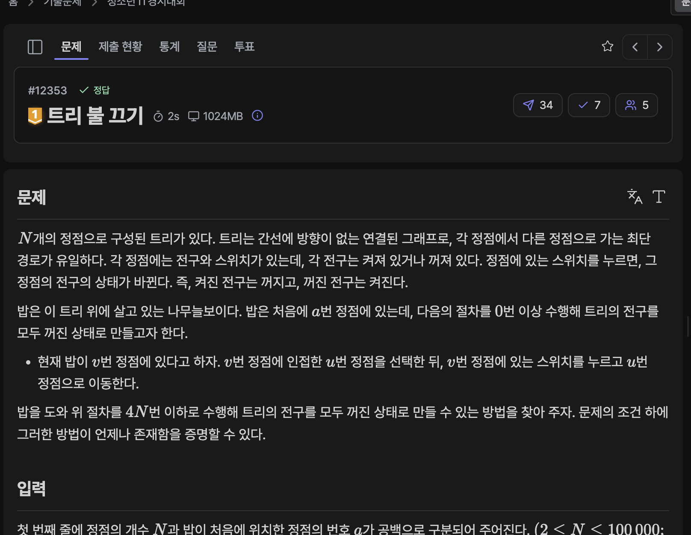
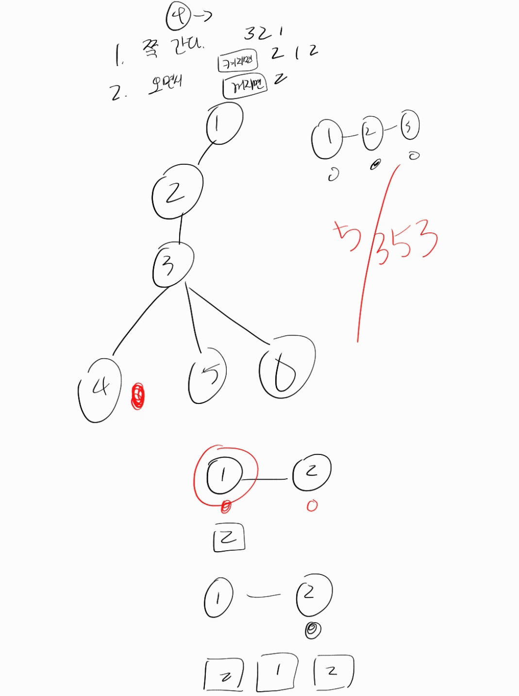

[문제 링크](https://jungol.co.kr/problem/12353)

## 문제

N개의 정점으로 구성된 트리가 있다. 트리는 간선에 방향이 없는 연결된 그래프로, 각 정점에서 다른 정점으로 가는 최단 경로가 유일하다. 각 정점에는 전구와 스위치가 있는데, 각 전구는 켜져 있거나 꺼져 있다. 정점에 있는 스위치를 누르면, 그 정점의 전구의 상태가 바뀐다. 즉, 켜진 전구는 꺼지고, 꺼진 전구는 켜진다.

밥은 이 트리 위에 살고 있는 나무늘보이다. 밥은 처음에 a번 정점에 있는데, 다음의 절차를 0번 이상 수행해 트리의 전구를 모두 꺼진 상태로 만들고자 한다.

현재 밥이 v번 정점에 있다고 하자. v번 정점에 인접한 u번 정점을 선택한 뒤, v번 정점에 있는 스위치를 누르고 u번 정점으로 이동한다.

밥을 도와 위 절차를 4N번 이하로 수행해 트리의 전구를 모두 꺼진 상태로 만들 수 있는 방법을 찾아 주자. 문제의 조건 하에 그러한 방법이 언제나 존재함을 증명할 수 있다.


## 입력

첫 번째 줄에 정점의 개수 N과 밥이 처음에 위치한 정점의 번호 a가 공백으로 구분되어 주어진다. (2≤N≤100000; 1≤a≤N)

두 번째 줄에 전구의 상태를 나타내는 길이 n의 문자열 S가 주어진다. i번 정점의 전구가 켜져 있는 상태라면 i번째 문자는 1, 그렇지 않다면 i번째 문자는 0이다.

세 번째 줄부터 N−1개의 줄에 걸쳐 각각의 간선이 연결하는 두 정점의 번호 x_i, y_i가 공백으로 구분되어 주어진다. (1≤x_i<y_i≤N)

주어진 그래프는 올바른 트리임이 보장된다.

## 출력

첫 번째 줄에 밥이 트리의 전구를 모두 꺼진 상태로 만들기 위해 사용할 절차의 횟수 k를 출력한다. (0≤k≤4N)

두 번째 줄에 각 절차에서 선택한 정점을 나타내는 k개의 정수 u1, u2,⋯,uk를 공백으로 분리하여 출력한다. 이때 u1번 정점은 a번 정점에 인접해야 하며, 2≤i≤k인 모든 i에 대해 ui번 정점은 u_i−1​번 정점에 인접해야 한다.

조건에 따라 트리의 전구을 모두 꺼진 상태로 만드는 방법이 여러 가지라면 그 중 하나만 출력한다. 또한, 수행하는 절차의 수가 최소가 될 필요는 없다.

## 풀이

### 초기 아이디어 (constructive)

구성적 (해 구성) 문제라고 판단하고 규칙을 찾아내고자 했다.



- 트리의 전구를 끄는 절차가 최소일 필요가 없기 때문에, 시작 정점부터 리프 정점까지 탐색하면서 돌아와도 되겠다고 생각했다.
- 리프 정점까지 탐색한 후, 깊이 우선 탐색의 원리로 돌아오면서, 켜진 상태로 돌아오면 다시 돌아가 끄고, 꺼진 상태로 돌아오면 진행하는 방식으로 구현했다.
- 처음에는 시간 초과를 받았다. 비재귀 스택 DFS를 구현함에 있어서 각 정점마다 처음부터 끝까지 간선을 중복해서 탐색하는 문제가 있었다. 탐색 인덱스를 지정해줌으로써 해결하였다.

- 정답 / PyPy3 / 545ms / 154.1MB

```py
# 12353 : 트리 불 끄기

# 비재귀 스택 DFS
# 스타트부터 쭉 가면서
# 돌아올때 켜지면 2 1 2
#        꺼지면 2

import sys
from collections import deque
input = sys.stdin.readline

n, a = map(int, input().rstrip().split())
light = input().rstrip()

edges = [[] for _ in range(n+1)]
for _ in range(n-1):
    u, v = map(int, input().rstrip().split())
    edges[u].append(v)
    edges[v].append(u)

vis = [False for _ in range(n+1)]
vis[a] = True

queue = deque()
queue.append(a)

lights = [False for _ in range(n+1)]
for i in range(n):
    if light[i] == "1": 
        lights[i+1] = True

search_idx = [0 for _ in range(n+1)]
ans = []

while queue:
    now = queue.pop()

    done = True
    while search_idx[now] < len(edges[now]):
        next = edges[now][search_idx[now]]
        search_idx[now] += 1
        if vis[next]: continue
        vis[next] = True
        done = False
        queue.append(now)
        queue.append(next)
        ans.append(next)
        break

    lights[now] = not lights[now]
    if done:
        if queue:
            ans.append(queue[-1])
            if lights[now]:
                ans.append(now)
                lights[now] = not lights[now]
                ans.append(queue[-1])
                lights[queue[-1]] = not lights[queue[-1]]
        else:
            lights[now] = not lights[now]
            if lights[now]:
                ans.append(edges[now][0])

print(len(ans))
print(' '.join(map(str, ans)))
```