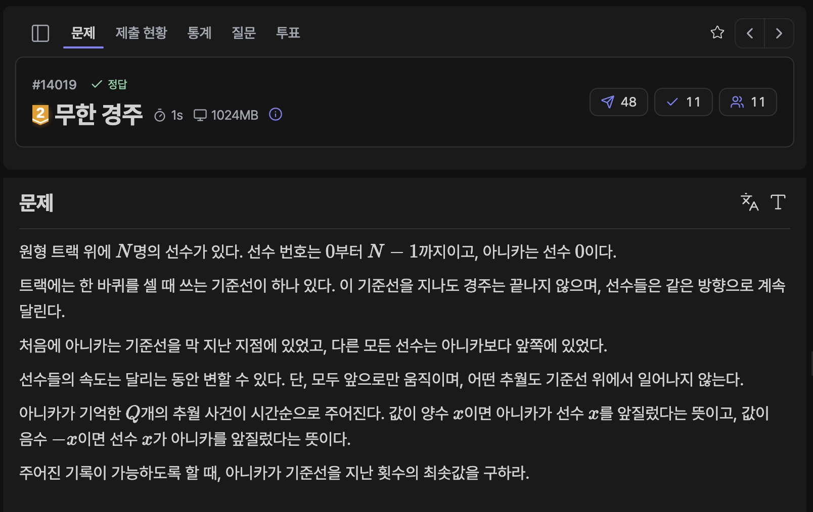

[문제 링크](https://jungol.co.kr/problem/14019)

## 문제

원형 트랙 위에 N명의 선수가 있다. 선수 번호는 0부터 N−1까지이고, 아니카는 선수 0이다.

트랙에는 한 바퀴를 셀 때 쓰는 기준선이 하나 있다. 이 기준선을 지나도 경주는 끝나지 않으며, 선수들은 같은 방향으로 계속 달린다.

처음에 아니카는 기준선을 막 지난 지점에 있었고, 다른 모든 선수는 아니카보다 앞쪽에 있었다.

선수들의 속도는 달리는 동안 변할 수 있다. 단, 모두 앞으로만 움직이며, 어떤 추월도 기준선 위에서 일어나지 않는다.

아니카가 기억한 Q개의 추월 사건이 시간순으로 주어진다. 값이 양수 x이면 아니카가 선수 x를 앞질렀다는 뜻이고, 값이 음수 −x이면 선수 x가 아니카를 앞질렀다는 뜻이다.

주어진 기록이 가능하도록 할 때, 아니카가 기준선을 지난 횟수의 최솟값을 구하라.


## 입력

첫째 줄에 선수 수 N이 주어진다.

둘째 줄에 사건 수 Q가 주어진다.

다음 Q개의 줄에는 사건을 나타내는 정수 x_i가 하나씩 주어진다.

[제약 조건]

- 2≤N≤200000

- 1≤Q≤200000

- 1≤x_i≤N−1 또는 −(N−1)≤x_i≤−1

## 출력

아니카가 기준선을 지난 횟수의 최솟값을 출력한다.

## 풀이

### 초기 아이디어 (ad hoc)

복잡한 알고리즘을 요구하진 않는 것 같아 규칙성을 관찰해보았다.

- (-a, a) or (a, -a) 순서꼴로 주어지는 입력 : 기준선을 넘지 않고 추월하거나 추월당하는 경우이다.
- (a, a) 순서꼴로 주어지는 입력 : 아니카가 트랙을 한 바퀴를 돌아 한 번 더 추월한 경우이다. 즉 기준선을 넘은 경우이다.
- (-a, -a) 순서꼴로 주어지는 입력 : 아니카는 기준선을 넘지 않은 채, 해당 선수가 아니카를 한 번 더 추월한 경우이다.

즉, 아니카가 이번 기준선에서 이미 한 번 추월한 선수들의 정보가 필요하다. 한 바퀴 안에서 여러 선수를 추월할 수 있으니 배열에 현재 해당 선수를 추월한 바퀴 수를 저장하고, 현재 바퀴 수에서 추월한 선수를 한번 더 추월한다면 기준선을 넘은 경우로 판단하여 바퀴 수를 1 증가시켰다.

- 정답 / PyPy3 / 340ms / 110.6MB

```py
# 14019 : 무한 경주
import sys
input = sys.stdin.readline

n = int(input().rstrip()) 
q = int(input().rstrip())
arr = [int(input().rstrip()) for _ in range(q)]

cnt = [-1 for _ in range(n+1)]
ans = 0
for i in range(q):
    if arr[i] < 0:
        cnt[-arr[i]] = -1
        continue

    if cnt[arr[i]] == ans:
        ans += 1
    cnt[arr[i]] = ans

print(ans)
```