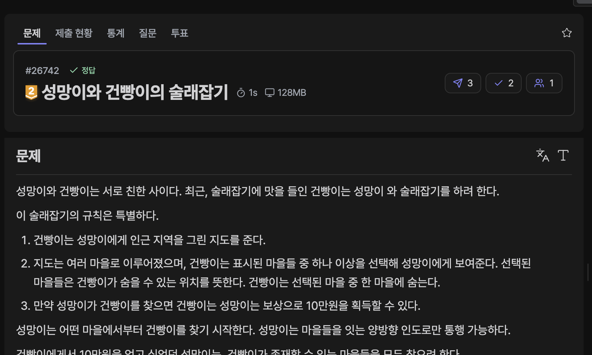

[문제 링크](https://jungol.co.kr/problem/26742)

## 문제

성망이와 건빵이는 서로 친한 사이다. 최근, 술래잡기에 맛을 들인 건빵이는 성망이 와 술래잡기를 하려 한다.

이 술래잡기의 규칙은 특별하다.

건빵이는 성망이에게 인근 지역을 그린 지도를 준다.

지도는 여러 마을로 이루어졌으며, 건빵이는 표시된 마을들 중 하나 이상을 선택해 성망이에게 보여준다. 선택된 마을들은 건빵이가 숨을 수 있는 위치를 뜻한다. 건빵이는 선택된 마을 중 한 마을에 숨는다. 

만약 성망이가 건빵이를 찾으면 건빵이는 성망이는 보상으로 10만원을 획득할 수 있다.

성망이는 어떤 마을에서부터 건빵이를 찾기 시작한다. 성망이는 마을들을 잇는 양방향 인도로만 통행 가능하다.

건빵이에게서 10만원을 얻고 싶었던 성망이는, 건빵이가 존재할 수 있는 마을들을 모두 찾으려 한다.

하지만, 성망이는 체력에 한계가 있어 시작 마을에서부터 K 이하 거리에 있는 마을들만 수색 가능하다.

그래서, 성망이는 건빵이가 있다고 예상되는 지역들을 최대한 많이 수색하려 한다. 이때, 성망이가 건빵이가 있을 것이라고 예상되는 지역들을 최대 몇 곳까지 수색할 수 있는지 출력하는 프로그램을 작성하시오. 단, 성망이는 원하는 마을에서 수색을 시작할 수 있다.


## 입력

첫째 줄에 마을들의 수 N, 마을들을 잇는 인도들의 수 M, 성망이의 수색 가능 범위 K, 건빵이가 숨을 수 있는 마을의 수 R 이 주어진다.

둘째 줄에 건빵이가 숨을 수 있는 마을들 V_1, V_2,…,V_R가 주어진다.

셋째 줄부터 M+2 줄까지는 마을 u_i와 마을 v_i를 연결하는 길이 w_i짜리 인도가 주어진다.

- 모든 마을 들은 간접/직접적으로 연결되어 있다.

- 1≤N≤1000

- 1≤M≤10000

- 1≤K≤∑_i (w_i)

- 1≤V_i≤N,  i!=j인 임의의 i와 j 에 대해 V_i!=V_j다.

- 1≤R≤N

- u_i!=v_i, 1≤u_i, v_i≤N, 1≤w_i≤500

## 출력

성망이가 건빵이가 있을 것이라고 예상되는 지역들을 최대 몇 곳까지 수색할 수 있는지 출력한다.

## 풀이

### 초기 아이디어 (Dijkstra)

정점마다 다익스트라를 실행해 거리 배열을 받고, 건빵이가 숨을 수 있는 마을 거리가 K 이하라면 카운트했다.

- 정답 / PyPy3 / 2784ms / 308.7MB

```py
# 26742. 성망이와 건빵이의 술래잡기

# 다익스트라로 K 안에 들어오는 V들을 "정점마다" 모두 세면 될 것 같은데,
# 시간 복잡도가 O(VElogV) 3억? 1s 안엔 안 될 것 같은데..
# 그래도 플루이드 워셜보단 낫나? 

import sys
import heapq
input = sys.stdin.readline

n, m, k, r = map(int, input().rstrip().split())
gunbbang = list(map(int, input().rstrip().split()))

edges = [[] for _ in range(n+1)]
for _ in range(m):
    u, v, w = map(int, input().rstrip().split())
    edges[u].append([v, w])
    edges[v].append([u, w])

def dijkstra(start):
    dist = [float('inf') for _ in range(n+1)]
    dist[start] = 0

    pq = []
    heapq.heappush(pq, [0, start])

    while pq:
        now = heapq.heappop(pq)
        if dist[now[1]] < now[0]: continue
        
        for next in edges[now[1]]:
            new_cost = now[0] + next[1]
            if dist[next[0]] > new_cost:
                dist[next[0]] = new_cost
                heapq.heappush(pq, [new_cost, next[0]])

    return dist

ans = 0
for i in range(1, n+1):
    dist = dijkstra(i)
    cnt = 0
    for g in gunbbang:
        if dist[g] <= k:
            cnt += 1

    ans = max(ans, cnt)

print(ans)
```

### 최적화

풀이 코드를 AI에게 피드백 받았다.

- 다익스트라를 모든 정점에서 시작하는 것이 아닌, 건빵이가 숨을 수 있는 위치에서만 다익스트라를 돌린 뒤 K 이하의 정점을 카운트해서, 수색을 최대한 많이 할 수 있는 정점을 발견할 수 있다. 이 최적화는 건빵이가 숨을 수 있는 위치가 전체 정점일 때 (즉, 최악일 때) 시간복잡도는 위 풀이와 동일하지만, 그렇지 않은 경우에 좋은 효율을 보인다.

- 정답 / PyPy3 / 2049ms / 147.2MB

```py

cnt = [0 for _ in range(n+1)]
for g in gunbbang:
    dist = dijkstra(g)
    for i in range(1, n+1):
        if dist[i] <= k:
            cnt[i] += 1

print(max(cnt))

```