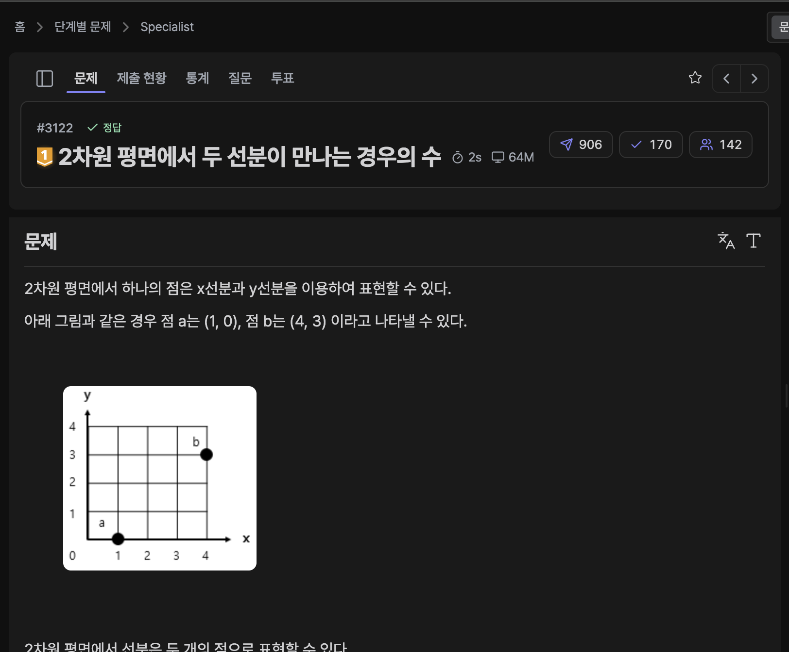

[문제 링크](https://jungol.co.kr/problem/3122)

## 문제

2차원 평면에서 하나의 점은 x선분과 y선분을 이용하여 표현할 수 있다.

2차원 평면에서 선분은 두 개의 점으로 표현할 수 있다.

선분 정보가 N개 주어질때 임의의 두 선분이 서로 만나거나 교차하는 경우의 수를 구하는 프로그램을 작성하시오.

두 선분의 끝점이 닿기만하는 경우나 포개어 지는 경우도 경우의 수에 포함된다.


## 입력

첫 행에 선분의 개수 N (1 <= N <= 10,000)이 주어진다.

두 번째 행부터 N행에 걸쳐 각 선분의 정보 sx, sy, ex, ey (-1,000,000 <= sx, sy, ex, ey <= 1,000,000)가 공백으로 구분되어 주어진다. 

## 출력

선분이 서로 만나거나 교차하는 모든 경우의 수를 구하여 출력한다.

## 풀이

### 초기 아이디어 (선분 교차)

선분교차 알고리즘을 사용하여 브루트포스로 교차 여부를 검사했다.

파이썬은 함수 호출로 인한 메모리 초과가 발생해 C++ 로 풀이했다.

- 정답 / C++20 / 815ms / 1.9MB

```cpp
// 3122. 2차원 평면에서 두 선분이 만나는 경우의 수
#include <iostream>
#include <vector>
#define FASTIO ios::sync_with_stdio(false);cin.tie(0);cout.tie(0);
using namespace std;
typedef long long LL;


class Point {
public:
    LL x, y;

    Point(LL _x, LL _y): x(_x), y(_y) {}

    bool operator>(const Point& other) {
        return ((this->x > other.x) || ((this->x == other.x) && (this->y > other.y)));
    }
    bool operator<=(const Point& other) {
        return ((this->x < other.x) || ((this->x == other.x) && (this->y <= other.y)));
    }
};

inline LL ccw(Point a, Point b, Point c) {
    return ((a.x * b.y + b.x * c.y + c.x * a.y) - (b.x * a.y + c.x * b.y + a.x * c.y));
}

class Line {
public:
    Point p1, p2;

    Line(Point _p1, Point _p2): p1(_p1), p2(_p2) {}
    
    inline bool intersect(const Line& other) {
        LL a = ccw(p1, p2, other.p1);
        LL b = ccw(p1, p2, other.p2);
        LL c = ccw(other.p1, other.p2, p1);
        LL d = ccw(other.p1, other.p2, p2);

        if (a == 0 && b == 0 && c == 0 && d == 0) {
            return max(min(p1.x, p2.x), min(other.p1.x, other.p2.x))
                        <= min(max(p1.x, p2.x), max(other.p1.x, other.p2.x))
                && max(min(p1.y, p2.y), min(other.p1.y, other.p2.y))
                        <= min(max(p1.y, p2.y), max(other.p1.y, other.p2.y));
        }

        return ((a <= 0 && b >= 0) || (a >= 0 && b <= 0))
            && ((c <= 0 && d >= 0) || (c >= 0 && d <= 0));
    }
};

int main() {
    int n; cin >> n;
    
    vector<Line> l;
    for (int i = 0; i < n; i++) {
        LL sx, sy, ex, ey; cin >> sx >> sy >> ex >> ey;
        l.push_back(Line(Point(sx, sy), Point(ex, ey)));
    }

    LL ans = 0;
    for (int i = 0; i < n - 1; i++) {
        for (int j = i + 1; j < n; j++) {
            if (l[i].intersect(l[j])) ans++;
        }
    }

    cout << ans;

    return 0;
}
```