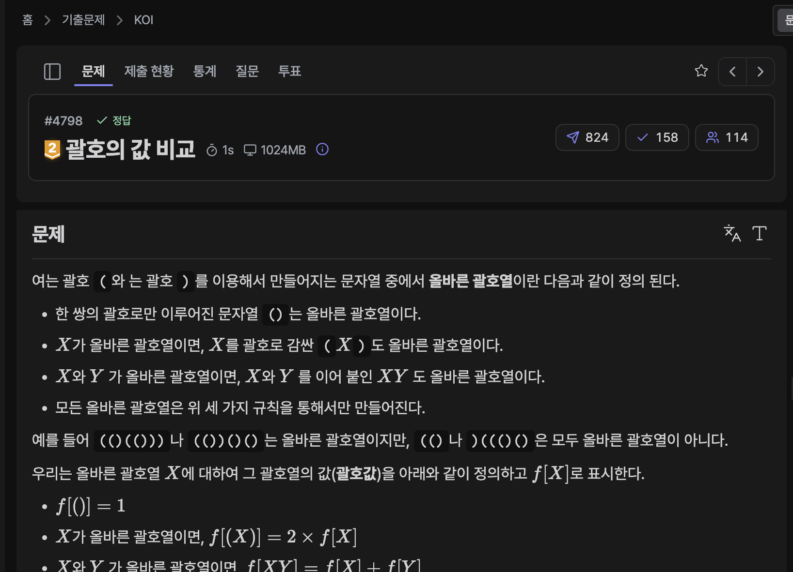

[문제 링크](https://jungol.co.kr/problem/4798)

## 문제

여는 괄호 (와 는 괄호 )를 이용해서 만들어지는 문자열 중에서 올바른 괄호열이란 다음과 같이 정의 된다.

한 쌍의 괄호로만 이루어진 문자열 ()는 올바른 괄호열이다.

X가 올바른 괄호열이면, X를 괄호로 감싼 (X)도 올바른 괄호열이다.

X와 Y 가 올바른 괄호열이면, X와 Y 를 이어 붙인 XY 도 올바른 괄호열이다.

모든 올바른 괄호열은 위 세 가지 규칙을 통해서만 만들어진다.

예를 들어 (()(()))나 (())()()는 올바른 괄호열이지만, (()나 )((()()은 모두 올바른 괄호열이 아니다.

우리는 올바른 괄호열 X에 대하여 그 괄호열의 값(괄호값)을 아래와 같이 정의하고 f[X]로 표시한다.

- f[()]=1

- X가 올바른 괄호열이면, f[(X)]=2×f[X]

- X와 Y 가 올바른 괄호열이면, f[XY]=f[X]+f[Y]

 예를 들어 몇 가지 올바른 괄호열들의 괄호값을 구해 보자.

- f[()]=1

- f[(())]=2×f[()]=2×1=2

- f[()()]=f[()]+f[()]=1+1=2

- f[()()()]=f[()]+f[()()]=1+2=3

- f[(()())]=2×f[()()]=2×2=4

- f[((()))]=2×f[(())]=2×2=4

- f[()(())]=f[()]+f[(())]=1+2=3

- f[(()())()(())]=f[(()())]+f[()(())]=4+3=7

두 개의 올바른 괄호열 A와 B를 읽고, 두 문자열의 괄호값 f[A]와 f[B]를 비교하는 프로그램을 작성하라. 즉, f[A]=f[B]인지, f[A]<f[B]인지, f[A]>f[B]인지를 판단하는 프로그램을 작성하라.

하나의 입력에서 T개의 테스트 케이스를 해결해야 한다.


## 입력

첫 번째 줄에 테스트 케이스의 개수 T가 주어진다.

이후 T개의 테스트 케이스가 차례로 주어진다. 각 테스트 케이스의 형식은 다음과 같다.

- 첫 번째 줄에 A가 주어진다.

- 두 번째 줄에 B가 주어진다.​ 

## 출력

각각의 테스트 케이스마다, 한 개의 줄에,

- f[A]=f[B]이면 =,

- f[A]<f[B]이면 <,

- f[A]>f[B]이면 >

을 출력한다.​ 


## 풀이

### 초기 아이디어 (스택 + 괄호 값 계산)

초기에는 스택을 활용하여 괄호열 값을 직접 계산했다. 하지만 조건 상으로는 A나 B의 길이가 3백만이 될 수 있었고, 2를 백 오십만 번 곱하는 상황이 발생할 수 있었다.

- #1 정답 / PyPy3 / 196ms / 58.4MB
- #2 정답 / PyPy3 / 217ms / 68.3MB
- #3 시간 초과 / PyPy3 / 5000ms / 291.4MB
- #4 시간 초과 / PyPy3 / 5000ms / 285.0MB

```py
# 4798 : 괄호의 값 비교
import sys
input = sys.stdin.readline

def calc(string):
    stack = []
    for s in string:
        if s == '(':
            stack.append(0)
        else:
            now = stack.pop()
            if now == 0:
                stack.append(1)
            else:
                stack.pop()
                stack.append(now * 2)

            now = stack.pop()
            while stack and stack[-1] > 0:
                now += stack.pop()
            stack.append(now)

    return stack[0]

t = int(input().rstrip())
for _ in range(t):
    a = calc(list(input().rstrip()))
    b = calc(list(input().rstrip()))
    
    print('=' if (a == b) else ('>' if (a > b) else '<'))
```

### 두 번째 아이디어 (스택 + 자릿 수 계산)

스택에 실제 괄호 문자열 값이 아닌, 제곱 현황을 계산하여, 덧셈이나 곱셈 등 합치는 연산 때 2의 제곱 자릿수 정보만을 유지하도록 설계했다. 하지만 잦은 리스트 추가 삭제 연산이 문제가 되었다.

- #1 정답 / PyPy3 / 74ms / 58.7MB
- #2 정답 / PyPy3 / 129ms / 58.8MB
- #3 시간 초과 / PyPy3 / 1298ms / 393.8MB
- #4 시간 초과 / PyPy3 / 5000ms / 394.2MB

```py
# 4798 : 괄호의 값 비교
import sys
input = sys.stdin.readline

def calc(string):
    stack = []
    for s in string:
        if s == '(':
            stack.append([])
        else:
            now = stack.pop()
            if now == []:
                stack.append([0])
            else:
                stack.pop()
                narr = []
                for n in now:
                    narr.append(n+1)
                stack.append(narr)

            narr = stack.pop()
            if stack and stack[-1] != []:
                arrLeft = list(narr)
                arrRight = list(stack.pop())

                idxLeft = 0
                idxRight = 0

                lenLeft = len(arrLeft)
                lenRight = len(arrRight)

                newArr = []
                while idxLeft < lenLeft and idxRight < lenRight:
                    if arrLeft[idxLeft] <= arrRight[idxRight]:
                        newArr.append(arrLeft[idxLeft])
                        idxLeft += 1
                    else:
                        newArr.append(arrRight[idxRight])
                        idxRight += 1

                    if len(newArr) > 1 and newArr[-2] == newArr[-1]:
                        newArr.pop()
                        newArr.append(newArr.pop() + 1)

                    if len(newArr) > 1 and newArr[-2] > newArr[-1]:
                        first = newArr.pop()
                        second = newArr.pop()
                        newArr.append(first)
                        newArr.append(second)

                while idxLeft < lenLeft:
                    newArr.append(arrLeft[idxLeft])
                    idxLeft += 1

                    if len(newArr) > 1 and newArr[-2] == newArr[-1]:
                        newArr.pop()
                        newArr.append(newArr.pop() + 1)

                    if len(newArr) > 1 and newArr[-2] > newArr[-1]:
                        first = newArr.pop()
                        second = newArr.pop()
                        newArr.append(first)
                        newArr.append(second)

                while idxRight < lenRight:
                    newArr.append(arrRight[idxRight])
                    idxRight += 1

                    if len(newArr) > 1 and newArr[-2] == newArr[-1]:
                        newArr.pop()
                        newArr.append(newArr.pop() + 1)

                    if len(newArr) > 1 and newArr[-2] > newArr[-1]:
                        first = newArr.pop()
                        second = newArr.pop()
                        newArr.append(first)
                        newArr.append(second)

                narr = list(newArr)
            stack.append(narr)

    return stack[0]

def comp(a, b):
    idxA = len(a) - 1
    idxB = len(b) - 1

    while True:
        if idxA == -1 and idxB == -1: return '='
        if idxA == -1: return '<'
        if idxB == -1: return '>'

        if a[idxA] > b[idxB]: return '>'
        if a[idxA] < b[idxB]: return '<'

        idxA -= 1
        idxB -= 1

t = int(input().rstrip())
for _ in range(t):
    a = calc(list(input().rstrip()))
    b = calc(list(input().rstrip()))
    print(comp(a, b))
```

### ChatGPT 아이디어 (스택 + O(N) 깊이 활용 계산)

ChatGPT 에게 아이디어를 받아보니, 굳이 합치는 연산을 바로 적용하지 않아도, **몇 번째 깊이에 괄호가 몇 번 등장하는지** 를 세기만 하면 나중에 올림 연산으로 처리하면 되는 풀이였다. 매우 인상 깊은 아이디어였다..

- #1 정답 / PyPy3 / 82ms / 58.6MB
- #2 정답 / PyPy3 / 269ms / 58.7MB
- #3 정답 / PyPy3 / 1482ms / 344.6MB
- #4 정답 / PyPy3 / 1489ms / 344.6MB

```py
# 4798 : 괄호의 값 비교
import sys
input = sys.stdin.readline

def calc(string):
    bits = [0] * (len(string) // 2 + 1)
    depth = 0
    prev = ''

    # 몇 번째 깊이에 몇 번 괄호가 등장했는지 센다
    for s in string:
        if s == '(': depth += 1
        else:
            if prev == '(':
                bits[depth - 1] += 1
            depth -= 1
        prev = s

    # 올림
    for i in range(len(bits) - 1):
        bits[i + 1] += bits[i] // 2
        bits[i] %= 2

    # 0 제거
    while bits[-1] == 0: bits.pop()

    return bits


def comp(a, b):
    if len(a) > len(b): return '>'
    if len(a) < len(b): return '<'

    for x, y in zip(reversed(a), reversed(b)):
        if x > y: return '>'
        if x < y: return '<'

    return '='


t = int(input().rstrip())
for _ in range(t):
    print(comp(calc(list(input().rstrip())), calc(list(input().rstrip()))))
```