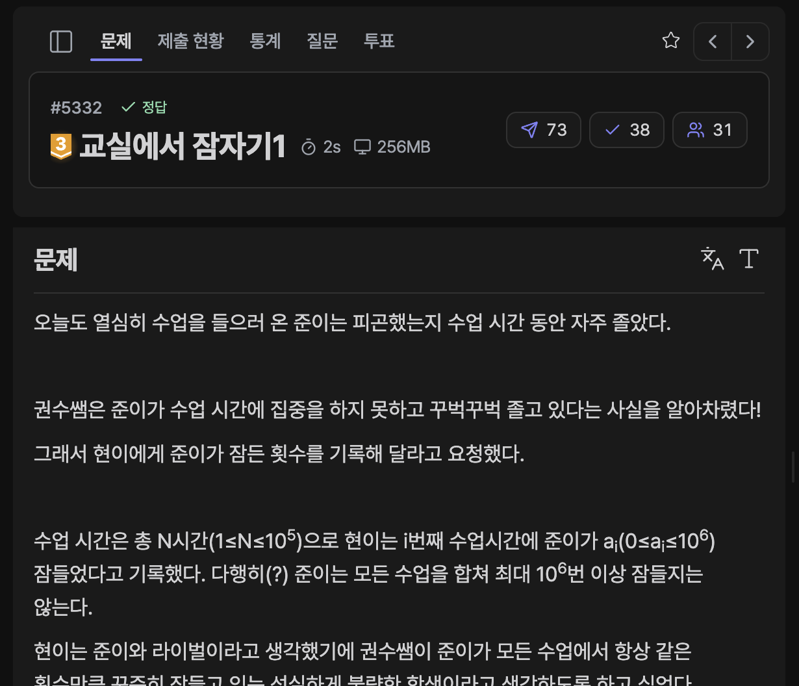

[문제 링크](https://jungol.co.kr/problem/5332)

## 문제

오늘도 열심히 수업을 들으러 온 준이는 피곤했는지 수업 시간 동안 자주 졸았다.

 

권수쌤은 준이가 수업 시간에 집중을 하지 못하고 꾸벅꾸벅 졸고 있다는 사실을 알아차렸다!

그래서 현이에게 준이가 잠든 횟수를 기록해 달라고 요청했다.
 

수업 시간은 총 N시간(1≤N≤​10^5)으로 현이는 i번째 수업시간에 준이가 ai(0≤ai≤10^6) 잠들었​다고 기록했다. 다행히(?) 준이는 모든 수업을 합쳐 최대 10^6번 이상 잠들지는 않는다.

현이는 준이와 라이벌이라고 생각했기에 권수쌤이 준이가 모든 수업에서 항상 같은 횟수만큼 꾸준히 잠들고 있는 성실하게 불량한 학생이라고 생각하도록 하고 싶었다.

현이가 기록을 수정할 수 있는 유일한 방법은 인접한 두 수업 시간을 병합하는 것이다.

예를 들어, a=[1,2,3,4,5]인 경우 현이가 두 번째 시간과 세 번째 시간을 병합하면 기록은 [1,5,4,5]가 된다.

 
현이가 기록의 모든 숫자를 동일하게 만들 수 있도록 기록에 적용해야 하는 최소 변경 수를 계산하는 프로그램을 작성하시오.


## 입력

각 테스트 케이스는 독립적으로 해결해야 하는 T(1≤T≤10)개의 하위 테스트 케이스를 포함한다.

 
입력의 첫 번째 줄에는 해결할 하위 테스트 케이스의 수인 T가 입력된다. 

그 다음 줄부터는 T번에 걸쳐 각각 두 줄씩 첫 번째 행은 N, 두 번째 행은 a1, a2, …, aN이 입력된다.

 
각 하위 테스트 케이스에서 모든 숫자의 합이 10^6을 초과하지 않음이 보장된다.

또한 모든 하위 테스트 케이스의 N 합계가 10^5를 초과하지 않음이 보장된다.


## 출력

각 하위 테스트 케이스 별로 현이가 기록의 모든 숫자를 동일하게 만드는 데 필요한 최소 수정 횟수를 출력하시오.


## 풀이

### 초기 아이디어 (누적 합 + 우선순위 큐)

초기에 떠올렸던 아이디어는, 전체 합 인수의 배수꼴이 구간에 차례대로 등장한다면 (예: 3, 6, 9, 12) 해당 인수로 분할이 가능하다는 아이디어였다. 

누적 합을 구하면서, 다음에 오는 누적 합이 배수꼴로 이어지는지를 검사한다. 마지막까지 이어진 배수꼴 중 초기 인수가 가장 작은 배수꼴이 병합 횟수가 가장 작은 경우이다.

- 정답 / PyPy3 / 1203ms / 274.4MB

```py
# 5332 : 교실에서 잠자기1
import sys
import heapq
input = sys.stdin.readline

t = int(input().rstrip())
for _ in range(t):
    n = int(input().rstrip())
    arr = list(map(int, input().rstrip().split()))

    sums = 0
    pq = []
    for i in range(n):
        if arr[i] == 0: continue
        sums += arr[i]

        heapq.heappush(pq, [sums * 2, sums, 2])
        while pq[0][0] < sums: 
            heapq.heappop(pq) 

        while pq[0][0] == sums and pq[0][1] != sums:
            now = heapq.heappop(pq)
            heapq.heappush(pq, [now[1] * (now[2] + 1), now[1], now[2] + 1])

    ans = 0
    while pq:
        now = heapq.heappop(pq)
        if now[1] * (now[2] - 1) == sums:
            ans = n - now[2] + 1
            break

    print(ans)
```


### ChatGPT 피드백

힙 연산 없이, 구간 합은 반드시 첫 번째 구간의 누적합 중 하나여야 하므로, 첫 번째 구간의 누적합을 구할 때 전 구간이 그 구간으로 나누어지는지를 브루트포스로 검사한다.

```py
import sys
input = sys.stdin.readline

t = int(input())

for _ in range(t):
    n = int(input())
    arr = list(map(int, input().split()))
    total = sum(arr)

    if total == 0:
        print(0)
        continue

    prefix = 0
    prev = 0
    ans = n - 1

    for x in arr:
        prefix += x

        if prefix == prev:
            continue
        prev = prefix

        if total % prefix != 0:
            continue

        now = 0
        valid = True

        for v in arr:
            now += v

            if now > prefix:
                valid = False
                break

            if now == prefix:
                now = 0

        if valid and now == 0:
            ans = n - total // prefix
            break

    print(ans)
```