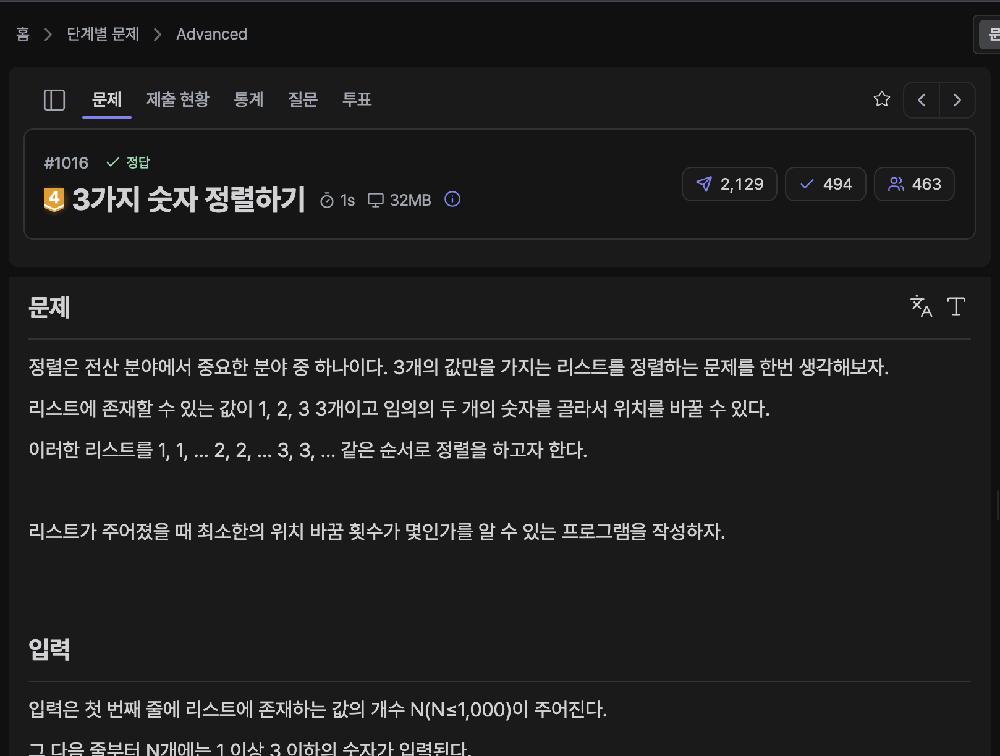

[문제 링크](https://jungol.co.kr/problem/1016)

## 문제

정렬은 전산 분야에서 중요한 분야 중 하나이다. 3개의 값만을 가지는 리스트를 정렬하는 문제를 한번 생각해보자. 

리스트에 존재할 수 있는 값이 1, 2, 3 3개이고 임의의 두 개의 숫자를 골라서 위치를 바꿀 수 있다. 

이러한 리스트를 1, 1, ... 2, 2, ... 3, 3, ... 같은 순서로 정렬을 하고자 한다.

리스트가 주어졌을 때 최소한의 위치 바꿈 횟수가 몇인가를 알 수 있는 프로그램을 작성하자.

## 입력

입력은 첫 번째 줄에 리스트에 존재하는 값의 개수 N(N≤1,000)이 주어진다. 

그 다음 줄부터 N개에는 1 이상 3 이하의 숫자가 입력된다.


## 출력

위에 주어진 조건대로 정렬을 하기위해서 필요한 최소한의 위치 바꿈 횟수를 출력한다.


## 풀이

### 초기 아이디어 (최적 해 그리디)

1. 두 요소의 위치를 최소로 바꾸기 위해서, 맨 앞 1이 들어가야 할 구간에 2와 3이 들어가 있다면 바로 바꾸어 주어야 한다.
2. 뒤에 있던 1을 앞으로 가져오고, 2와 3을 바꾼 부분에 순서대로 채운다.
3. 그 다음 2가 들어가야할 구간에 3이 들어가 있다면 바로 바꾸어 주어야 한다.

여기서 "뒤에 있던 1을 앞으로 가져온 횟수" + "2가 들어가야할 구간에 3이 들어간 횟수" 가 정답이다.

- 정답 / PyPy3 / 116ms / 68.9MB

```py
# 1016. 3가지 숫자 정렬하기
import sys
input = sys.stdin.readline

n = int(input().rstrip())
arr = [int(input().rstrip()) for _ in range(n)]

# 1. 1의 개수를 센다.
# 2. 1의 개수만큼 배열 앞 부분의 (2, 3)을 뒤 1에 작은 거 먼저 배치한다.
# 3. 2의 개수를 센다. 앞 부분의 3을 ...

one_count = arr.count(1)
cnt2 = 0
cnt3 = 0
for i in range(one_count):
    if arr[i] == 2: cnt2 += 1
    elif arr[i] == 3: cnt3 += 1
    arr[i] = 1

ans = cnt2 + cnt3
for i in range(one_count, n):
    if arr[i] == 1:
        if cnt2 > 0:
            arr[i] = 2
            cnt2 -= 1
        else:
            arr[i] = 3

two_count = arr.count(2)
for i in range(one_count, one_count + two_count):
    if arr[i] == 3: ans += 1

print(ans)
```