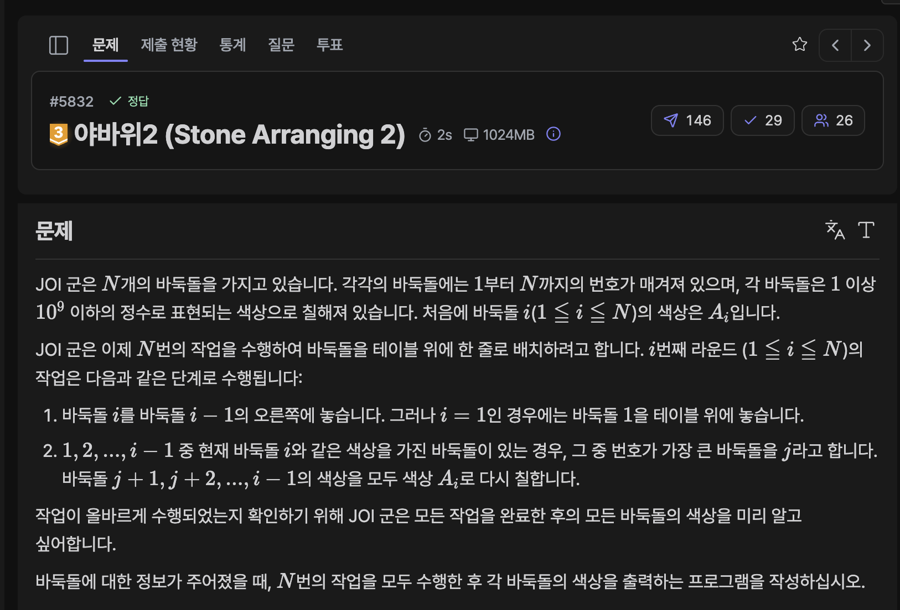

[문제 링크](https://jungol.co.kr/problem/1016)

## 문제

JOI 군은 N개의 바둑돌을 가지고 있습니다. 각각의 바둑돌에는 1부터 N까지의 번호가 매겨져 있으며, 각 바둑돌은 1 이상 10^9 이하의 정수로 표현되는 색상으로 칠해져 있습니다. 처음에 바둑돌 i(1≦i≦N)의 색상은 A_i입니다.

JOI 군은 이제 N번의 작업을 수행하여 바둑돌을 테이블 위에 한 줄로 배치하려고 합니다. i번째 라운드 (1≦i≦N)의 작업은 다음과 같은 단계로 수행됩니다:

바둑돌 i를 바둑돌 i−1의 오른쪽에 놓습니다. 그러나 i=1인 경우에는 바둑돌 1을 테이블 위에 놓습니다.

1,2,...,i−1 중 현재 바둑돌 i와 같은 색상을 가진 바둑돌이 있는 경우, 그 중 번호가 가장 큰 바둑돌을 j라고 합니다. 바둑돌 j+1,j+2,...,i−1의 색상을 모두 색상 A_i로 다시 칠합니다.

작업이 올바르게 수행되었는지 확인하기 위해 JOI 군은 모든 작업을 완료한 후의 모든 바둑돌의 색상을 미리 알고 싶어합니다.

바둑돌에 대한 정보가 주어졌을 때, N번의 작업을 모두 수행한 후 각 바둑돌의 색상을 출력하는 프로그램을 작성하십시오.

## 입력

첫 줄에 정수 N이 주어진다. (1≦N≦200000)

두 번째 줄부터 (i+1)번째 줄에 A_i 가 주어진다. (1≦A_i≦10^9)

## 출력

N줄에 걸쳐서 i번째 줄에 N번의 작업을 마친 후의 바둑돌 i의 색상을 출력하세요.

## 풀이

### 초기 아이디어 (압축 스택)

현재 탐색한 돌의 색상과 같은 색상이 기존에 존재하는지 & 그 중에서 가장 뒤에 있는 돌은 몇 번째인지를 O(N) 으로 처리해야 했다.

아이디어를 떠올려 보니, 돌의 색상은 10억 이하 안에서 등장하지만 그 종류는 20만 개 이하이기 때문에, 딕셔너리로 돌의 색상 존재 여부를 관리하면서, 동시에 연속되는 구간을 압축해서 스택에 저장하면 중복해서 처리하는 시간이 줄어드므로 O(N) 으로 처리가 가능하겠다고 생각했다.

- 정답 / PyPy3 / 537ms / 110.1MB

```py
# 5832. 야바위2 (Stone Arranging 2)
import sys
from collections import deque
input = sys.stdin.readline

n = int(input().rstrip())
arr = [int(input().rstrip()) for _ in range(n)]

# 내 색상 중 가장 마지막 인덱스부터 ~ 현재 인덱스까지 다시 칠하기
# 키 포인트는 앞에서 먼저 칠했다고 뒤에서 더 앞부분까지 칠해버릴 수 있다
# 또한, 이미 칠해진 앞이 있다면 뒤에서 감지를 해야 한다
# O(N) 으로 해결해야 함
# Ai 는 10^9까지, N은 20만까지

# 압축 스택?
stack = deque()
stack.append([arr[0], 0, 0])
nums = {arr[0]:1}

for i in range(1, n):
    if nums.get(arr[i], -1) == -1:
        nums[arr[i]] = 1
        stack.append([arr[i], i, i])
        continue

    while stack[-1][0] != arr[i]:
        nums[stack[-1][0]] -= 1
        if nums[stack[-1][0]] == 0:
            del nums[stack[-1][0]]
        stack.pop()

    start = stack[-1][1]
    stack.pop()
    stack.append([arr[i], start, i])

for s in stack:
    print(('%d\n'%(s[0]))*(s[2]-s[1]+1), end='')
```

- 풀이 이후 ChatGPT 에게 피드백을 받아보니, 구간에는 같은 색의 돌이 2번 이상 등장하지 않는다고 한다. (같은 색에 돌이 등장하면 구간이 합쳐지기 때문이다) 따라서 Dictionary 가 아닌 Set 로 하면 더욱 최적화할 수 있었다.