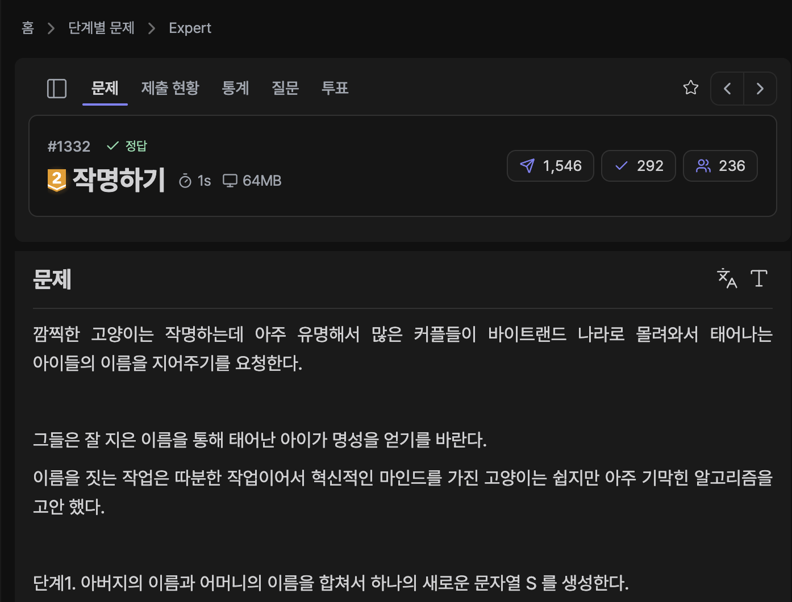

[문제 링크](https://jungol.co.kr/problem/1332)

## 문제

깜찍한 고양이는 작명하는데 아주 유명해서 많은 커플들이 바이트랜드 나라로 몰려와서 태어나는 아이들의 이름을 지어주기를 요청한다.

 
그들은 잘 지은 이름을 통해 태어난 아이가 명성을 얻기를 바란다. 

이름을 짓는 작업은 따분한 작업이어서 혁신적인 마인드를 가진 고양이는 쉽지만 아주 기막힌 알고리즘을 고안 했다.


- 단계1. 아버지의 이름과 어머니의 이름을 합쳐서 하나의 새로운 문자열 S 를 생성한다.

- 단계2. 이 문자열 S 에서 prefix(접두어) 도 되고 suffix(접미어) 도 되는 문자열을 찾는다.

 
예로 아버지의 이름이 ala 이고 어머니의 이름이 la 이면 합친 문자열 S = alala 이다. 

이 문자열에서 prefix 와 suffix 가 동시에 되는 문자열은

 
a

ala

alala
 
세 가지가 존재한다.


문자열을 받아 prefix 와 suffix 가 동시에 가능한 문자열의 길이를 구하는게 문제이다.​ 

## 입력

각 입력데이터는 소문자만이 입력되고, 문자열의 길이는 1 이상 400,000 이하이다.

## 출력

각 입력데이터 당 출력은 오름차순으로 출력한다.

## 풀이

### 초기 아이디어 (KMP 아이디어)

KMP 실패 함수에서 접두사와 접미사의 공통 부분을 얻는 메커니즘을 가져왔다. 
문자열 전체는 접두사이자 접미사가 될 수 있으니 포함하고, 더 짧은 접두사/접미사 후보를 while 로 추적하며 답을 구한다.

- 정답 / PyPy3 / 558ms / 90.9MB

```py
# 1332 : 작명하기
import sys
input = sys.stdin.readline

s = input().rstrip()
n = len(s)

table = [0] * n
j = 0

for i in range(1, n):
    while j > 0 and s[i] != s[j]:
        j = table[j - 1]

    if s[i] == s[j]:
        j += 1
        table[i] = j

ans = []
length = n

while length > 0:
    ans.append(length)
    length = table[length - 1]

print(*reversed(ans))

```