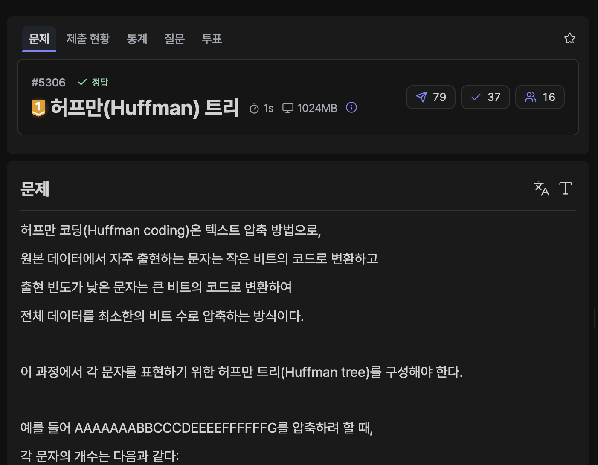

[문제 링크](https://jungol.co.kr/problem/5306)

## 문제

허프만 코딩(Huffman coding)은 텍스트 압축 방법으로, 

원본 데이터에서 자주 출현하는 문자는 작은 비트의 코드로 변환하고 

출현 빈도가 낮은 문자는 큰 비트의 코드로 변환하여 

전체 데이터를 최소한의 비트 수로 압축하는 방식이다.

이 과정에서 각 문자를 표현하기 위한 허프만 트리(Huffman tree)를 구성해야 한다.

각 문자에 대한 비트코드를 출력하는 프로그램을 작성하시오.​​

## 입력

첫 줄에 문자열의 길이 N이 주어진다. ( 1 <= N <= 100,000)

다음 줄에 알파벳 대문자로만 이루어진 문자열이 하나 입력된다.

## 출력

출력 예와 같이 출력하시오.

순서는 상관 없으며, 허프만 코드 조건에 만족하며 압축된 코드 길이가 정답과 같으면 답으로 처리한다.

## 풀이

### 초기 아이디어 (우선순위 큐 + BFS)

우선순위 큐를 사용해 허프만 트리를 실제로 구현한 후, BFS 로 탐색하여 각 문제에 대한 비트코드를 구했다.

- 정답 / PyPy3 / 282ms / 71.0MB

```py
# 5306. 허프만(Huffman) 트리
import sys
import heapq
from collections import deque
input = sys.stdin.readline

n = int(input().rstrip())
string = input().rstrip()
pq = []
nodes = []

for i in range(26):
    c = chr(ord('A')+i)
    cnt = string.count(c)
    if cnt > 0: 
        heapq.heappush(pq, [cnt, len(nodes)])
        nodes.append([c, -1, -1])


available = []
while len(pq) > 1 or available:
    now = heapq.heappop(pq)
    if not available:
        available = now
        continue

    heapq.heappush(pq, [available[0] + now[0], len(nodes)])
    nodes.append(['*', available[1], now[1]])

    available = []

root = heapq.heappop(pq)[1]

queue = deque()
queue.append([root, ''])

ans = {}

while queue:
    now = queue.popleft()
    if nodes[now[0]][0] != '*':
        ans[nodes[now[0]][0]] = now[1]
        continue
        
    queue.append([nodes[now[0]][1], now[1] + '0'])
    queue.append([nodes[now[0]][2], now[1] + '1'])

if len(ans) == 1:
    print(list(ans.keys())[0], '0')
else:
    for k, v in ans.items():
        print(k, v)
```

- 풀이하고 나서 보니, `available` 을 굳이 사용하지 않아도 `heappop()` 을 두 번 하면 될 것 같다..