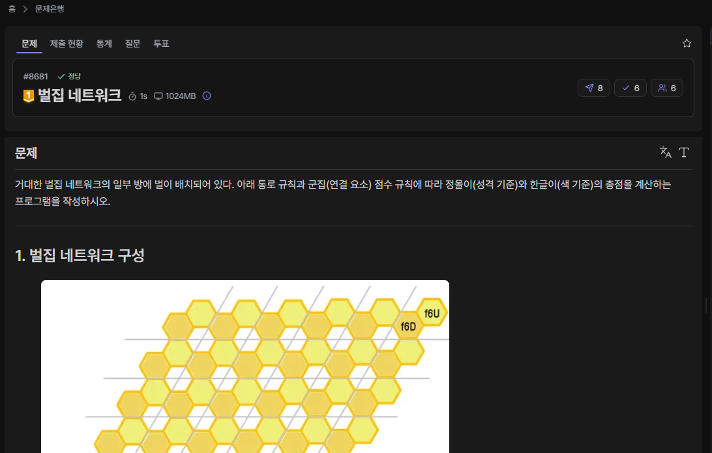

[문제 링크](https://jungol.co.kr/problem/8681)

## 문제

거대한 벌집 네트워크의 일부 방에 벌이 배치되어 있다. 아래 통로 규칙과 군집(연결 요소) 점수 규칙에 따라 정올이(성격 기준)와 한글이(색 기준)의 총점을 계산하는 프로그램을 작성하시오.

1. 벌집 네트워크 구성

- 열: a, b, c, d, e, f (왼쪽에서 오른쪽 순서, 6개)

- 행: 1, 2, 3, 4, 5, 6 (아래에서 위 순서, 6개)

- 각 (열, 행)마다 위/아래 두 층의 방이 있어 총 72개의 방이 존재한다.

- 방 표기: 열문자 + 행숫자 + 층기호

- U = 위층(Up), D = 아래층(Down)

- 예: c5D, f4U

- 통로(인접) 규칙 : 두 방이 아래 규칙 중 하나를 만족하면 서로 통로로 연결되어 있다고 본다. 통로는 양방향이며, 경계 밖에 해당하는 방은 무시한다.

- D 방의 이웃(모두 U 방): 같은 칸의 U (x,y,D ↔ x,y,U), 왼쪽 열 같은 행의 U (x-1,y,U), 같은 열의 아래 행 U (x,y-1,U)

- U 방의 이웃(모두 D 방): 같은 칸의 D (x,y,U ↔ x,y,D), 오른쪽 열 같은 행의 D (x+1,y,D), 같은 열의 위 행 D (x,y+1,D)

위 규칙으로 무방향 인접 그래프가 정의된다.

2. 벌의 속성

- 색(4종): C(Cyan), P(Purple), M(Mint), F(Fuchsia)

- 성격(4종): 1, 2, 3, 4

- 한 테스트 케이스에서 동일한 (색, 성격) 조합은 최대 4개까지만 등장한다. (총 16종 × 4개 = 최대 64마리이므로 72칸 중 일부는 비어 있을 수 있다.)

- 표기: 색문자 + 성격숫자 (예: C3, F2)

3. 점수 규칙

입력으로 벌이 놓인 방들만 정점으로 하여 그래프를 만든다. 인접한 두 벌이 아래 조건을 만족하면 간선을 둔다.

- 색 그래프: 인접하고 색이 같은 경우 연결

- 성격 그래프: 인접하고 성격이 같은 경우 연결

각 기준별로 연결 요소(컴포넌트)를 만들며, 각 벌의 점수는 다음과 같다.

- 정올이: 해당 벌이 속한 성격 컴포넌트의 크기

- 한글이: 해당 벌이 속한 색 컴포넌트의 크기

각 플레이어의 총점은 해당 기준으로 모든 벌의 점수를 합한 값이다.


## 입력

첫 줄에 테스트 케이스의 수 T가 주어진다.

각 테스트 케이스마다 첫 줄에 벌이 놓인 방의 개수 N이 주어진다.

이어 N줄에 걸쳐 각 줄에 방의 정보와 해당 방에 위치한 벌의 정보가 공백으로 구분되어 주어진다.

[제약 조건]

- 1≤T≤1000

- 1≤N≤64

- 방의 정보는 [a-f][1-6][UD]의 형태로 a1U, d4U, f6D 등과 같이 주어진다.

- 벌의 정보는 [CPMF][1-4]의 형태로 C1, P2, M4, F3 등과 같이 주어진다.

- 같은 테스트 케이스 내에서 방의 정보가 중복되어 주어지지 않는다.

## 출력

각 테스트 케이스마다 한 줄에 정올이의 총점과 한글이의 총점을 공백으로 구분하여 출력한다.

## 풀이

### 초기 아이디어 (그래프 이론 + 분리 집합)

벌집을 3차원 배열로 구성하고, 색 그래프의 엣지와 성격 그래프의 엣지를 구성하여 유니온 파인드로 풀이했다. 오랜만의 유파 문제라서 재밌었다.

- 정답 / PyPy3 / 583ms / 77.2MB

```py
# 8681. 벌집 네트워크
import sys
input = sys.stdin.readline

# a5d
# xyz

Z_DICT = {'D':0,'U':1}

# D는 무조건 U로 가야한다
# 왼쪽 열, 아래 행, 같은 칸
# U는 무조건 D로 가야한다
# 오른쪽 열, 위 행, 같은 칸
DIR_X = [[-1, 0, 0], [1, 0, 0]]
DIR_Y = [[0, -1, 0], [0, 1, 0]]

def node_num(x, y, z):
    return x + y * 6 + z * 36

def node_idx(num):
    return [num % 6, (num % 36) // 6, num // 36]

def find(parent, now):
    stack = []
    while parent[now] != now:
        stack.append(now)
        now = parent[now]

    pp = now
    for s in stack:
        parent[s] = pp

    return pp

def union(parent, cnt, u, v):
    u = find(parent, u)
    v = find(parent, v)

    if u > v: u, v = v, u

    if u != v:
        parent[v] = u
        cnt[u] += cnt[v]
        return True
    return False

t = int(input().rstrip())
for _ in range(t):
    n = int(input().rstrip())
    arr = [[['' for _ in range(2)] for _ in range(6)] for _ in range(6)] 
    for _ in range(n):
        room, bee = input().rstrip().split()
        arr[ord(room[0])-ord('a')][int(room[1])-1][Z_DICT[room[2]]] = bee

    # 1. 엣지를 구성한다
    edges_jungol = []
    edges_hangul = []
    for i in range(6):
        for j in range(6):
            for k in range(2):
                if arr[i][j][k] == '': continue
                for d in range(3):
                    nx = i + DIR_X[k][d]
                    ny = j + DIR_Y[k][d]
                    nz = k ^ 1

                    if nx < 0 or nx > 5 or ny < 0 or ny > 5 or arr[nx][ny][nz] == '': continue

                    # 정올 : 성격 (숫자)가 같은가?
                    if arr[nx][ny][nz][1] == arr[i][j][k][1]: edges_jungol.append([node_num(nx, ny, nz), node_num(i, j, k)])
                    # 한글 : 색깔 (글자)가 같은가?
                    if arr[nx][ny][nz][0] == arr[i][j][k][0]: edges_hangul.append([node_num(nx, ny, nz), node_num(i, j, k)])


    # 2. 유파를 한다
    parent_jungol = [i for i in range(72)]
    cnt_jungol = [1 for _ in range(72)]

    for u, v in edges_jungol:
        union(parent_jungol, cnt_jungol, u, v)
            

    parent_hangul = [i for i in range(72)]
    cnt_hangul = [1 for _ in range(72)]

    for u, v in edges_hangul:
        union(parent_hangul, cnt_hangul, u, v)

    # 3. 점수를 센다
    jungol = 0
    for nn in range(72):
        i, j, k = node_idx(nn)
        if arr[i][j][k] == '': continue
        jungol += cnt_jungol[find(parent_jungol, nn)]

    hangul = 0
    for nn in range(72):
        i, j, k = node_idx(nn)
        if arr[i][j][k] == '': continue
        hangul += cnt_hangul[find(parent_hangul, nn)]

    print(jungol, hangul)
```

- DFS, BFS 를 사용해도 좋은 접근일 것 같다.